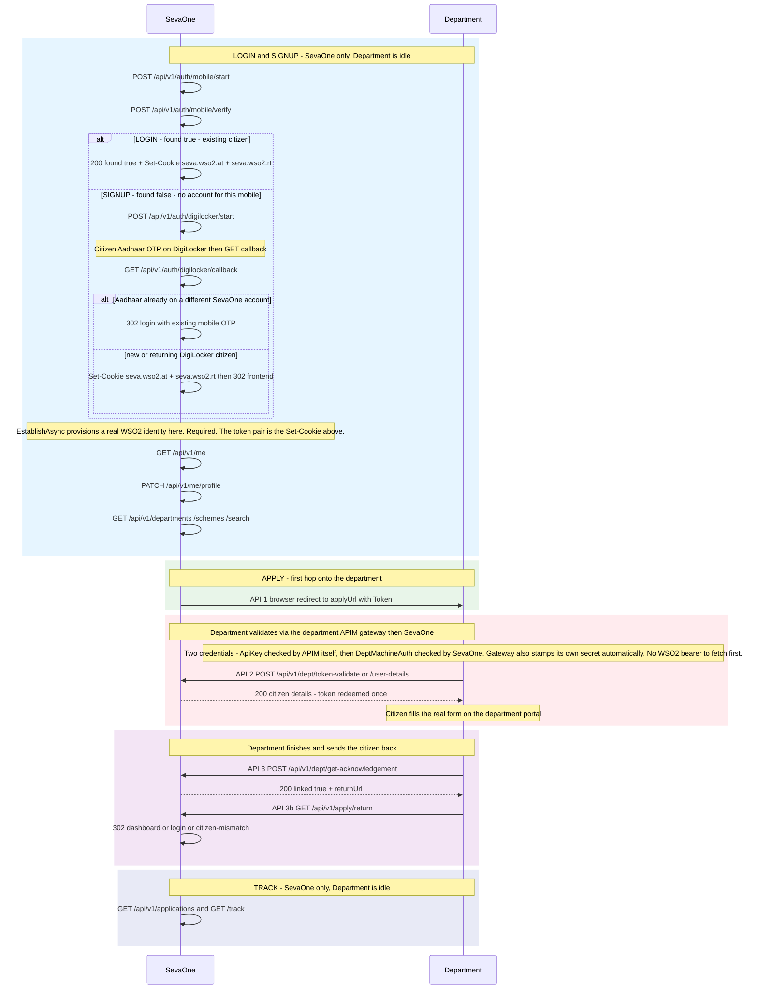
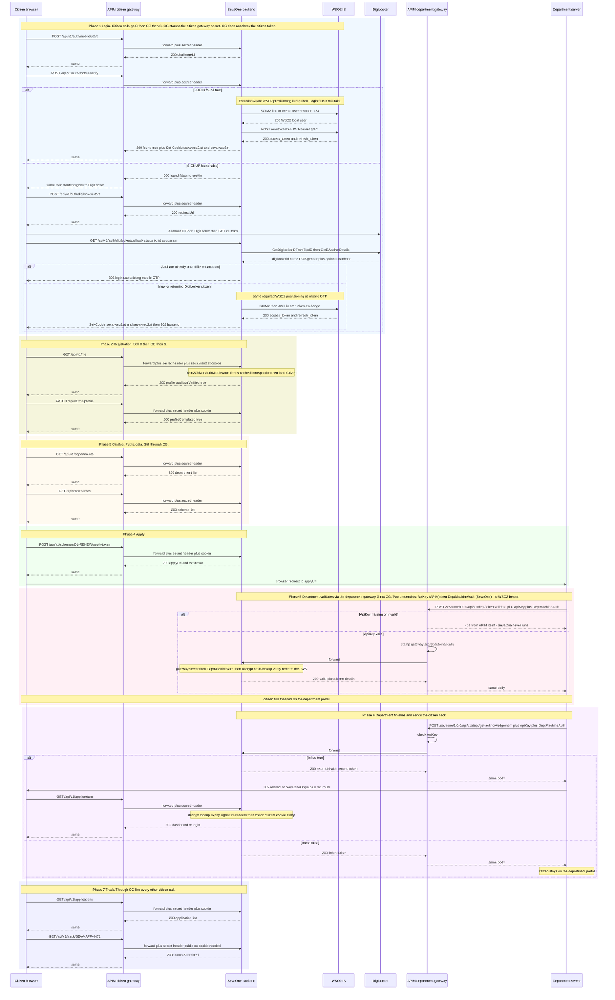
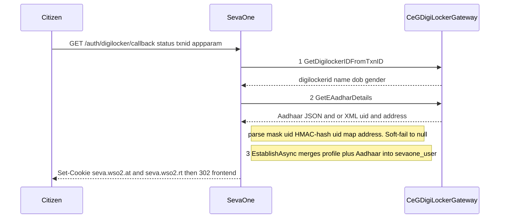

# Complete flow — endpoints in order, with full request/response payloads

The citizen journey from login to tracking an application, with a real JSON example for every call.

All JSON is camelCase (ASP.NET Core `System.Text.Json`). Mobile-OTP request/response shapes were confirmed against a running backend.

---

## Start here

SevaOne is a front door. The citizen logs in and picks a service here. The real application is filled on the **department’s own portal**. SevaOne hands the citizen over with an encrypted `Token=`, the department reads the profile from SevaOne, then sends the browser back.

| Phase | Who is acting | What happens | Auth |
|---|---|---|---|
| 1 Login / signup | Citizen ↔ SevaOne (via citizen APIM gateway), which provisions a real WSO2 identity for the citizen as part of login | Mobile OTP. If no account, DigiLocker Aadhaar. Real WSO2 access/refresh tokens set as `seva.wso2.at`/`seva.wso2.rt` `HttpOnly` cookies — **this is now required for login to succeed**, not a background extra | None until the cookies are set |
| 2 Registration | Citizen ↔ SevaOne (via citizen gateway) | `GET /me`, then `PATCH /me/profile` (usually only email is still missing) | `seva.wso2.at` cookie |
| 3 Catalog | Citizen ↔ SevaOne (via citizen gateway) | Departments, schemes, search | None |
| 4 Apply | Citizen ↔ SevaOne (via citizen gateway), then browser → department | `POST .../apply-token` → redirect to department `applyUrl` | `seva.wso2.at` cookie |
| 5 Validate | Department server → SevaOne, via the department gateway | `token-validate` or `user-details`. Token spent once | `ApiKey` (checked by APIM itself) then `DeptMachineAuth` (checked by SevaOne; the gateway also stamps its own secret automatically — nothing the department sends) |
| 6 Return | Department server, then citizen browser | `get-acknowledgement` → redirect `GET /apply/return` | `/dept/*` via the **department** APIM gateway. `/apply/return` is the citizen's browser, via the **citizen** APIM gateway |
| 7 Track | Citizen ↔ SevaOne (via citizen gateway) | `GET /applications`, public `GET /track/{ref}` | `seva.wso2.at` cookie for list/detail; track is public |

**Login vs signup:** `POST /auth/mobile/verify` with `found: true` is login (cookies set). `found: false` is signup — next call is DigiLocker, not another OTP.

**Two doors, different depth of check.** Every citizen-facing call — login included — goes through the **citizen** APIM gateway (`sevaone-citizen`); every department-facing call goes through a separate **department** APIM gateway (`sevaone`). The citizen gateway does no identity validation of its own (every operation is `authType: "None"`) — it's purely a network perimeter, stamping a fixed secret onto every request it forwards (`X-SevaOne-Citizen-Gateway-Secret`). The department gateway does that too (`X-SevaOne-Dept-Gateway-Secret`), but it *also* does one real check itself: every operation requires a valid `ApiKey` (per-department, `authType: "Application"`, `securityScheme: ["api_key"]`) — a bad or missing key is rejected at APIM, SevaOne never runs. SevaOne's own backend still does its own identity check on both sides after that: the citizen's WSO2 cookie for citizen calls, `DeptMachineAuth` for department calls (resolves *which* department — a different question than "is this a valid application" that `ApiKey` already answered).

**Every real host/port this flow actually touches** (local dev values — see `WSO2_IS_APIM_SETUP.md` for how these get configured):

| What | URL | Who calls it, and when |
|---|---|---|
| Citizen APIM gateway | `https://localhost:8244/sevaone-citizen/1.0.0/api/v1/...` | Citizen's browser — every citizen-facing call in phases 1-4 and 7 |
| Department APIM gateway | `https://localhost:8244/sevaone/1.0.0/api/v1/dept/...` | Department's server — phase 5 (validate) and phase 6 (get-acknowledgement) |
| WSO2 IS — SCIM2 | `https://localhost:9443/scim2/Users` | SevaOne's backend only, during `EstablishAsync` (phase 1) — find-or-create the citizen's WSO2 user, never called by a browser or department directly |
| WSO2 IS — token endpoint | `https://localhost:9443/oauth2/token` | SevaOne's backend only — JWT-bearer grant during `EstablishAsync` (phase 1, mints the cookie pair) and `refresh_token` grant on `POST /auth/refresh` |
| WSO2 IS — introspection | `https://localhost:9443/oauth2/introspect` | SevaOne's backend only, `Wso2CitizenAuthMiddleware` — Redis-cached, so this isn't hit on every request, only on a cache miss (~every 60s per token) |
| SevaOne backend, direct | `http://localhost:5080` | Nobody, in production-shaped traffic — both gateways reject a direct call outright. Useful only for isolating a bug locally |

Notice **WSO2 IS is never called by the citizen's browser or by a department server** — only by SevaOne's own backend, server-side, and only for the citizen-login path. Department calls never touch WSO2 IS at all (see phase 5/6 below).

**Management URLs — a different set, for people configuring WSO2 itself, not part of the runtime flow above.** Nobody in the citizen/department journey ever hits these; they're where *you* go to provision a new department, generate its `ApiKey`, or manage the system.

| What | URL | For |
|---|---|---|
| APIM **Devportal** (web UI) | `https://localhost:9444/devportal` | Create a department's Application, subscribe it to `SevaOne-API`, generate its `ApiKey` — the actual, most common admin task. Full click-by-click steps: `WSO2_IS_APIM_SETUP.md` → "Department onboarding" |
| APIM **Publisher** (web UI) | `https://localhost:9444/publisher` | Edit the API definitions themselves — operations, security scheme, throttling tiers, deploy a new revision. Not for provisioning departments, that's Devportal |
| APIM **Admin Portal** (web UI) | `https://localhost:9444/admin` | Throttling policy definitions (the `Bronze`/`20KPerMin` tiers referenced above), Key Manager registration |
| WSO2 **IS Console** (web UI) | `https://localhost:9443/console` | Citizen WSO2 users live here (`sevaone-{SevaOneUserId}`) if you ever need to inspect/fix one directly — SevaOne itself only ever touches these via SCIM2, not this UI |
| Devportal REST API | `https://localhost:9444/api/am/devportal/v3` | The scriptable version of the Devportal steps above — `POST /applications`, `POST /subscriptions`, `POST /applications/{id}/api-keys/PRODUCTION/generate`. Real working commands: `WSO2_IS_APIM_SETUP.md` → "Department onboarding" |
| Publisher REST API | `https://localhost:9444/api/am/publisher/v4` | The scriptable version of the Publisher steps above — edit operations/security/policies, create+deploy revisions |
| Admin REST API | `https://localhost:9444/api/am/admin/v4` | Throttling policy definitions (`/throttling/policies/subscription`, `/throttling/policies/advanced`) |

All of this is a completely separate credential/login (`admin`/`admin` in local dev, a real WSO2 admin account elsewhere) from anything a citizen or department ever authenticates with — don't confuse WSO2's own admin login with `DeptMachineAuth`, `ApiKey`, or the citizen's WSO2 token; they're unrelated.

---

## SevaOne vs Department

SevaOne is the left column. Department is the right column.



---

## Full API flow

Every endpoint below, in call order, across all seven phases — with the **actual gateway hops**
shown explicitly. `CG` and `G` are two *separate* APIM APIs (citizen and department). `IS` is
WSO2 Identity Server, called directly by SevaOne only for citizen provisioning during login
(SCIM2 find-or-create, then a JWT-bearer token exchange) — it has no role in department calls at
all; both gateways today are a network perimeter plus a stamped secret, with SevaOne's own
backend doing the real identity check on each side. Full JSON for each call is in the phase
sections that follow this diagram; here you get the shape and the routing.



**Reading this diagram:** `GET /apply/return` in Phase 6 is the one exception worth noting —
it goes through the citizen gateway `CG` (same shared-secret perimeter check as everything
else) but does **not** require a valid `seva.wso2.at` cookie to be *present*; the handler must
distinguish "no session" (expired while the citizen was on the department's site — redirect to
login) from "wrong citizen's session" (a stolen return URL — hard reject). See `TOKEN_FLOW.md`
→ Completion-token for that distinction in full.

---

## Phase 1 — Citizen login

### 1a. Mobile OTP (primary path)

`POST /api/v1/auth/mobile/start` — no auth
**Request**
```json
{ "mobile": "9876500000" }
```
**Response 200**
```json
{ "challengeId": "e601a4c71abf2d28e1c49fee0a1aadc5" }
```
Sends a 6-digit OTP via `ISmsOtpSender` (currently `LoggedSmsOtpSender`, logs only — no
real SMS provider chosen yet). Doesn't reveal whether the number is registered.

`POST /api/v1/auth/mobile/verify` — no auth
**Request**
```json
{ "challengeId": "e601a4c71abf2d28e1c49fee0a1aadc5", "otp": "228437" }
```
**Response 200** — existing, verified citizen. Also sets `HttpOnly` cookies `seva.wso2.at` and `seva.wso2.rt`.
```json
{ "found": true, "mobile": "9876500000", "returnTo": "/register?next=%2F" }
```
Before this response goes out, `EstablishAsync` provisions/refreshes the citizen's real WSO2 IS
identity (SCIM2 find-or-create + a JWT-bearer token exchange) and the resulting token pair
becomes both cookies above. This step is **required** — if it fails (WSO2 unreachable, exchange
rejected), the request fails and no cookies are set. See "Citizen authentication" below.
**Response 200** — no citizen on file for this verified mobile yet. No cookie — frontend goes to DigiLocker (1b).
```json
{ "found": false, "mobile": "9123456780", "returnTo": null, "digiLockerPendingId": "a1b2c3d4e5f6" }
```

### 1b. DigiLocker (new citizen — proves identity, creates the account)

`POST /api/v1/auth/digilocker/start` — no auth
**Request**
```json
{ "flow": "signup", "returnTo": "/dashboard", "pendingId": "a1b2c3d4e5f6" }
```
**Response 200**
```json
{ "redirectUrl": "https://api.digitallocker.gov.in/public/oauth2/1/authorize?..." }
```
The browser is sent to that URL. After DigiLocker OTP, CeG redirects to
`GET /api/v1/auth/digilocker/callback?status=success&txnid=...&appparam=...`, which sets the
same two `HttpOnly` cookies as mobile OTP and 302s to the frontend (`/register?next=...` when
the profile is incomplete). Duplicate Aadhaar is a 302 to `/login?loginError=...` rather than a JSON 409
because this is a browser GET.

Server calls CeG `GetDigilockerIDFromTxnID` then `GetEAadharDetails` (soft-fail), then
`EstablishAsync`. The OTP-verified mobile is carried via `pendingId` because CeG's ID API does
not return a phone number.

**Citizen authentication (both paths above):** every successful `EstablishAsync` call — mobile
OTP or DigiLocker — calls `IWso2CitizenIdentityClient.ProvisionAndExchangeAsync`, which hits
WSO2 IS directly, twice, server-side:
1. `POST https://localhost:9443/scim2/Users` (or a `GET` filter first, to find-or-create) —
   the WSO2 IS user `sevaone-{SevaOneUserId}`.
2. `POST https://localhost:9443/oauth2/token` — a SevaOne-signed JWT assertion, exchanged for a
   real, WSO2-introspectable access/refresh token pair (RFC 7523 JWT-bearer grant).

That pair **is** the two `HttpOnly` cookies set on the response — `seva.wso2.at` /
`seva.wso2.rt`. There is no separate SevaOne-issued session anymore; the old `seva.sid` /
`SevaSession` machinery has been deleted. Every later request presents `seva.wso2.at`, and
`Wso2CitizenAuthMiddleware` validates it via `POST https://localhost:9443/oauth2/introspect` —
Redis-cached, so this isn't a WSO2 round trip on every request, only on a cache miss. Why hand
session-issuing to WSO2 at all: so a citizen who proved their identity once can, in principle,
be validated by a *different* system (another department, a future mobile app) directly against
WSO2, without going through SevaOne again. Full mechanics: `WSO2_IS_APIM_SETUP.md` → Citizen
authentication; `TOKEN_FLOW.md` → Citizen authentication.

*(The WSO2 redirect + password-grant/Email-OTP login paths are retired and deleted —
`GET /auth/login`, `GET /auth/callback`, `POST /auth/password`, `POST /auth/otp` were removed
outright from `AuthController.cs`, not left in place as `410 Gone` stubs, so these routes now
404 like any other unmapped path. Everything behind them (`Wso2OidcClient`, the demo-user
fallback) is gone from the codebase too. They never set `AadhaarVerified`/`MobileVerified`
anyway, so none of the identity safeguards on this page ever covered them — see
`AUTHENTICATION_APIS.md` §1.)*

`POST /auth/mobile/start` and `POST /auth/digilocker/start` are rate-limited (5 requests /
10 min per client IP); `POST /auth/mobile/verify` is rate-limited separately (5 requests /
5 min per IP, a bucket shared with `POST /operator/login`) — brute-forcing a 6-digit OTP or a
password is no longer just a matter of unthrottled request volume.

---

## Phase 2 — Finish registration

`GET /api/v1/me` — **Auth: Seva**
**Response 200** — DigiLocker citizen: name, mobile, DOB, gender, Aadhaar, and address came from DigiLocker. Email is still missing.
```json
{
  "id": "3f9a1c2e-7b44-4d21-9c3a-1e6f2b9a7d10",
  "sevaId": "SEVA-000123",
  "name": "Ramesh Kumar",
  "username": "digilocker:1234abcd",
  "mobile": "9876500000",
  "email": null,
  "address": "12, MG Road, Shivajinagar",
  "district": "Bengaluru Urban",
  "taluk": "Bengaluru North",
  "aadhaarMasked": "XXXX-XXXX-3210",
  "aadhaarVerified": true,
  "profileCompleted": false,
  "profileFinishPct": 90
}
```
`aadhaarVerified:true` is the signal the frontend should use to hide/pre-fill the Aadhaar-last-4
field at `/register` instead of asking again — it's only ever true when this came from
DigiLocker's real document, never from a self-typed value.

`PATCH /api/v1/me/profile` — **Auth: Seva**
**Request** — `aadhaarLast4` is ignored when `aadhaarVerified` is already true. Omit it in that case.
```json
{
  "name": "Ramesh Kumar",
  "mobile": "9876500000",
  "email": "ramesh@example.com",
  "address": "12, MG Road, Shivajinagar",
  "district": "Bengaluru Urban",
  "taluk": "Bengaluru North",
  "aadhaarLast4": null
}
```
**Response 200** — same `MeDto` shape, now `profileCompleted: true`, `profileFinishPct: 100`. `aadhaarMasked` / `aadhaarVerified` unchanged.

```json
{
  "id": "3f9a1c2e-7b44-4d21-9c3a-1e6f2b9a7d10",
  "sevaId": "SEVA-000123",
  "name": "Ramesh Kumar",
  "username": "digilocker:1234abcd",
  "mobile": "9876500000",
  "email": "ramesh@example.com",
  "address": "12, MG Road, Shivajinagar",
  "district": "Bengaluru Urban",
  "taluk": "Bengaluru North",
  "aadhaarMasked": "XXXX-XXXX-3210",
  "aadhaarVerified": true,
  "profileCompleted": true,
  "profileFinishPct": 100
}
```


Only the last 4 Aadhaar digits are ever accepted from the client — the full number is never
stored, only the masked form.

---

## Phase 3 — Browse the catalog

`/departments`, `/schemes`, and `/schemes/{code}` are served from an in-process 5-minute
`IMemoryCache` inside `CatalogService` (SevaOne's own backend, not APIM) — this data changes
rarely (admin edits, not per-request), so repeat browsing hits the cache instead of Postgres.
`/search` is intentionally not cached (query-driven, not repeat-friendly the same way). A cache
miss on a bad `schemes/{code}` isn't cached — a `404` never gets remembered, so a scheme added
right after a failed lookup is picked up immediately, not after a 5-minute wait.

`GET /api/v1/departments` — no auth
```json
[
  {
    "id": "d1e2f3a4-5b6c-47d8-9e0f-1a2b3c4d5e6f",
    "code": "TRANSPORT",
    "name": "Transport Department",
    "portalName": "Sarathi",
    "portalDomain": "sarathi.parivahan.gov.in",
    "isIntegrated": true,
    "schemeCount": 12
  }
]
```

`GET /api/v1/schemes?department=TRANSPORT&q=license&category=` — no auth
```json
[
  {
    "serviceCode": "DL-RENEW",
    "name": "Driving License Renewal",
    "departmentCode": "TRANSPORT",
    "departmentName": "Transport Department",
    "category": "License",
    "sakalaDays": 7,
    "fee": "₹200",
    "description": "Renew an expired or expiring driving license.",
    "eligibility": ["Valid existing DL", "Age 18+"],
    "aliases": ["dl renewal", "license renewal"],
    "departmentIntegrated": true
  }
]
```

`GET /api/v1/schemes/DL-RENEW` — no auth
```json
{
  "serviceCode": "DL-RENEW",
  "name": "Driving License Renewal",
  "departmentCode": "TRANSPORT",
  "departmentName": "Transport Department",
  "category": "License",
  "sakalaDays": 7,
  "fee": "₹200",
  "description": "Renew an expired or expiring driving license.",
  "documents": ["Existing DL", "Address proof", "Photo"],
  "eligibility": ["Valid existing DL", "Age 18+"],
  "aliases": ["dl renewal"],
  "steps": ["Fill form", "Upload documents", "Pay fee"],
  "portal": "sarathi.parivahan.gov.in",
  "departmentIntegrated": true
}
```

`GET /api/v1/search?q=driving license` — no auth (keyword/alias match; returns a clarifying
question instead of a full match list when more than one service matches — deterministic
today, swappable for a real LLM later without touching the response shape)
```json
{
  "kind": "match",
  "service": {
    "serviceCode": "DL-RENEW",
    "name": "Driving License Renewal",
    "departmentCode": "TRANSPORT",
    "departmentName": "Transport Department",
    "category": "License",
    "sakalaDays": 7,
    "fee": "₹200",
    "departmentIntegrated": true
  },
  "clarify": null
}
```

---

## Phase 4 — Apply (mint the handoff token)

`POST /api/v1/schemes/DL-RENEW/apply-token` — **Auth: Seva**, no body
**Response 200**
```json
{
  "applyUrl": "https://sarathi.parivahan.gov.in/apply?DepartmentID=TRANSPORT&ServiceID=DL-RENEW&SevaOneUserID=123&Token=CfDJ8NxKp3vQmR2FZs7Y1LhWmXt9BvNcRkTz5oQaPeUdXhK4nRvWbLm2ZjHqTf8xYpDzGsMhVnKw3RtPqLxNbCz",
  "expiresAt": "2026-08-14T18:15:00Z"
}
```
Server-side: mints a signed JWS (`sub`, `dept_id`, `service_id`, `assisted_mode`,
`operator_id`), stores plaintext + SHA-256 hash in `portal.sevaone_token` (with `return_url`
set, default `/dashboard`), encrypts it via `IApplyRedirectProtector` (AES/Data Protection),
and embeds the encrypted value as `Token=` alongside plain
`DepartmentID`/`ServiceID`/`SevaOneUserID`.

**Browser is redirected to `applyUrl` — this is the department's own site.** SevaOne's job
pauses here.

*(Operator-assisted variant: `POST /api/v1/operator/apply-token` with
`{ "serviceCode": "DL-RENEW", "sevaOneUserId": 123 }`, **Auth: SevaOperator** — mints with
`assistedMode:true` and the real `operatorId`, otherwise identical from here on.)*

---

## Phase 5 — Department validates the handoff (server-to-server, via APIM)

Auth on all `dept/*` calls: **two credentials**, both held and sent by the department. `ApiKey`
(a per-department key from an APIM Application) is checked by **APIM itself** — bad or missing,
and the request never reaches SevaOne. `DeptMachineAuth` (Basic `client_id:client_secret` or
`X-SevaOne-Dept-Client`/`X-SevaOne-Dept-Secret`) is checked by **SevaOne**, and resolves *which*
department is calling. The gateway also stamps its own secret onto the forwarded request
(`X-SevaOne-Dept-Gateway-Secret`), but that's automatic and invisible to the department, not
something it fetches or sends itself. There is no WSO2 bearer/`client_credentials` step anywhere
in this chain — `ApiKey` is a pure-APIM construct, no WSO2 IS behind it. See `TOKEN_FLOW.md` →
WSO2 layer, and `DEPARTMENT_INTEGRATION_GUIDE.md` for the full request-level detail.

`POST https://localhost:8244/sevaone/1.0.0/api/v1/dept/token-validate` — citizen already known to this department
**Request**
```json
{ "departmentId": "TRANSPORT", "token": "CfDJ8NxKp3vQmR2FZs7Y1LhWmXt9BvNcRkTz5oQaPeUdXhK4nRvWbLm2ZjHqTf8xYpDzGsMhVnKw3RtPqLxNbCz" }
```
**Response 200**
```json
{
  "valid": true,
  "sevaOneUserId": 123,
  "serviceId": "DL-RENEW",
  "assistedMode": false,
  "operatorId": null,
  "expiresAt": "2026-08-14T18:15:00Z",
  "returnUrl": "/dashboard"
}
```

`POST https://localhost:8244/sevaone/1.0.0/api/v1/dept/user-details` — citizen new to this department (returns a fuller profile,
no form typed on their site)
**Request**
```json
{ "departmentId": "TRANSPORT", "token": "CfDJ8NxKp3vQmR2FZs7Y1LhWmXt9BvNcRkTz5oQaPeUdXhK4nRvWbLm2ZjHqTf8xYpDzGsMhVnKw3RtPqLxNbCz" }
```
**Response 200**
```json
{
  "sevaOneUserId": 123,
  "sevaId": "SO1234KA",
  "name": "Ramesh Kumar",
  "mobile": "9876500000",
  "email": "ramesh@example.com",
  "aadhaarMasked": "XXXX-XXXX-3210",
  "dateOfBirth": "1990-04-12",
  "gender": "Male",
  "stateName": "Karnataka",
  "districtName": "Bengaluru Urban",
  "taluk": "Bengaluru North",
  "villageName": null,
  "address": "12 MG Road",
  "returnUrl": "/dashboard"
}
```
Both calls **atomically redeem** the token (`portal.sp_try_redeem_token`) — a second call
with the same token is rejected. The citizen now applies for the actual service on the
department's own portal; that part is entirely outside SevaOne's API surface.

---

## Phase 6 — Department finishes, sends the citizen back

`POST https://localhost:8244/sevaone/1.0.0/api/v1/dept/get-acknowledgement` — department server, via APIM
**Request**
```json
{
  "departmentId": "TRANSPORT",
  "sevaOneUserId": 123,
  "serviceId": "DL-RENEW",
  "status": "SUBMITTED",
  "acknowledgementId": "TRN-2026-88213"
}
```
**Response 200 — normal case**
```json
{
  "linked": true,
  "returnUrl": "/apply/return?token=CfDJ9AqQnE4Kd8P6sHxRzT1aWv3MnDxYbTgSeVh7QcPzKf5uLrNoXaJd6McRpVy2FbHwSnEt",
  "expiresAt": "2026-08-14T18:25:00Z"
}
```
**Response 200 — citizen has no SevaOne relationship at all (e.g. logged into dept directly)**
```json
{ "linked": false, "returnUrl": null, "expiresAt": null }
```
Mints a **second, independent, 10-minute** one-time token (the original was already redeemed
in Phase 5 — this is deliberately not a reuse). If `linked:true`, the department redirects the
citizen's browser to `{SevaOneOrigin}{returnUrl}`, i.e.
`{SevaOneOrigin}/apply/return?token=CfDJ9AqQnE4Kd8P6sHxRzT1aWv3MnDxYbTgSeVh7QcPzKf5uLrNoXaJd6McRpVy2FbHwSnEt`.

**This call is also the first point SevaOne actually records that the application exists.**
Before minting the token, `PortalDeptFacingService.CompleteApplicationAsync` checks whether an
`orchestration.applications` row already exists for this citizen + scheme + department; if not,
it creates one — `sevaReference` generated fresh, `departmentReference` taken from this
request's `acknowledgementId`, `applicantName`/`address`/`district`/`taluk` filled from the
citizen's own SevaOne profile (not from anything the department sent), and `status` mapped from
`request.Status`. This is what Phase 7 below and the department-status webhook actually read
from — without it, neither would have anything to show. Calling `get-acknowledgement` more than once (e.g. the
department redirecting a second time after the first completion token expired unused) does
**not** create a duplicate row — only the token is refreshed.

`GET https://localhost:8244/sevaone-citizen/1.0.0/api/v1/apply/return?token=CfDJ9AqQnE4Kd8P6sHxRzT1aWv3MnDxYbTgSeVh7QcPzKf5uLrNoXaJd6McRpVy2FbHwSnEt` — citizen browser, via the citizen gateway, **not** `[Authorize]`-gated
```
Response: 302 redirect to {Frontend}/dashboard
            (session matches the token's citizen -> success)
       or 302 redirect to {Frontend}/login?returnTo=/dashboard
            (no active session -- likely just expired while on the department's site)
       -- a session that matches a DIFFERENT citizen than the token is a hard reject,
          distinctly audit-logged as apply.return.citizen_mismatch (the real attack case)
```
Decrypts → hash-looks-up → checks expiry → verifies signature → **atomically redeems first**
→ then cross-checks against the browser's current session. No JSON body — this endpoint only
ever returns a redirect. Every outcome writes a distinct audit action (`apply.return.success`,
`.no_session`, `.citizen_mismatch`, `.expired`, `.already_used`, `.token_not_found`,
`.decrypt_failed`, `.signature_invalid`).

`POST /api/v1/dept/payment-status` (`DeptController.PaymentStatus`) still physically exists in
the codebase, but it is **orphaned, unreachable code, not a live endpoint** — it was
deliberately removed from the department APIM gateway's operation list along with all other
payment-related surface, and direct port-5080 access is rejected outright regardless. No
department can reach it through any path today; it's not documented in
`DEPARTMENT_INTEGRATION_GUIDE.md` either. See `TOKEN_FLOW.md` → Payment status.

The department can also push a plain status update, independent of the token-based calls above:

`POST /api/v1/internal/webhooks/status` — **not** via APIM, a plain shared-secret header instead
**Request** (header `X-Seva-Webhook-Secret` = configured `Seva:WebhookSecret`)
```json
{ "departmentCode": "revenue", "departmentReference": "TEST-REF-001", "status": "UnderReview", "note": "Verification in progress" }
```
**Response 202 Accepted**

Looks up the application by `departmentCode` + `departmentReference` — which only resolves to
anything because `get-acknowledgement` above already created that row. Live-verified: pushed
`UnderReview` against an application created by `get-acknowledgement`, and `GET /applications`
immediately reflected the new status.

---

## Phase 7 — Citizen checks progress (any time after Phase 4)

`GET /api/v1/applications` — **Auth: Seva**
```json
[
  {
    "sevaReference": "SEVA-APP-4471",
    "departmentReference": "TRN-2026-88213",
    "serviceCode": "DL-RENEW",
    "serviceName": "Driving License Renewal",
    "departmentCode": "TRANSPORT",
    "departmentName": "Transport Department",
    "status": "Submitted",
    "submittedAt": "2026-08-14T17:45:00Z",
    "sakalaDueAt": "2026-08-21T17:45:00Z"
  }
]
```

`GET /api/v1/applications/SEVA-APP-4471` — **Auth: Seva**
```json
{
  "sevaReference": "SEVA-APP-4471",
  "departmentReference": "TRN-2026-88213",
  "serviceCode": "DL-RENEW",
  "serviceName": "Driving License Renewal",
  "departmentCode": "TRANSPORT",
  "departmentName": "Transport Department",
  "status": "Submitted",
  "submittedAt": "2026-08-14T17:45:00Z",
  "sakalaDueAt": "2026-08-21T17:45:00Z",
  "applicantName": "Ramesh Kumar",
  "address": "12 MG Road",
  "purpose": null,
  "district": "Bengaluru Urban",
  "taluk": "Bengaluru North",
  "timeline": [
    { "status": "Submitted", "note": "Application received", "at": "2026-08-14T17:45:00Z" }
  ]
}
```

`GET /api/v1/track/SEVA-APP-4471` — **no auth** (public tracking by reference)
```json
{
  "sevaReference": "SEVA-APP-4471",
  "serviceName": "Driving License Renewal",
  "departmentName": "Transport Department",
  "status": "Submitted",
  "submittedAt": "2026-08-14T17:45:00Z",
  "sakalaDueAt": "2026-08-21T17:45:00Z"
}
```

---

## How the Aadhaar detail fetch works (inside Phase 1b)

`GET /api/v1/auth/digilocker/callback` is one citizen-facing hop, but it triggers **two**
CeG Gateway calls before `EstablishAsync` ever runs. This isn't a new citizen-facing
endpoint; it's what actually happens inside the box already documented in Phase 1b.



**Merge rules in `CitizenSessionService.EstablishAsync`** (`SevaOne.Business/Portal/Services/CitizenSessionService.cs:91`):

- **Duplicate-account detection (new-citizen path only)** — before creating a brand-new
  account, if the DigiLocker session is Aadhaar-verified, SevaOne looks up
  `portal.sp_get_citizen_by_aadhaar_hash` first. A match means this real person already has
  an account under a *different* login (their `digilocker:<id>` subject can legitimately
  differ session-to-session even for the same person) — e.g. they registered earlier with
  mobile ending in `1234`, and this DigiLocker session only started because a *later* mobile-OTP
  attempt with a different number (`3456`) found no account. Rather than silently creating a
  second account for the same Aadhaar, this throws a `ConflictException` (the callback 302s to
  `/login?loginError=...`) telling the citizen — safely, since this request has
  already been through real Aadhaar consent — which number their existing account uses, so
  they can log in with mobile OTP instead.
- **Mobile** — only auto-filled the first time SevaOne has none on file at all. A later
  DigiLocker login's Aadhaar-linked mobile does **not** silently overwrite an existing contact
  number (the citizen may deliberately use a different one for notifications). The OTP-verified
  mobile from `found:false` is carried via `pendingId` because CeG's ID API typically does not return a phone.
- **Aadhaar/address/district/taluk/state** — backfilled any time `citizen.AadhaarHash` is
  currently empty, **regardless of `ProfileCompleted`** — this is a one-way trust upgrade
  (unverified → verified), so it applies even to a citizen who already finished registration
  through a weaker path (WSO2/password) earlier and only links DigiLocker afterward.
- **Aadhaar hash conflict** — if a citizen's account already has a *different* Aadhaar hash on
  file and a new DigiLocker login reports a mismatching one, it is **not** auto-applied; an
  `auth.aadhaar_mismatch` audit entry is written instead (this would mean two different real
  identities landed on one SevaOne account — worth a human looking at it, not silently
  overwriting).
- **Fetch failure** — `GetEAadhaarDetailsAsync` returns `null` (never throws) on any problem —
  wrong/changed XML schema, network failure, missing fields. `AadhaarVerified` stays `false`
  and login proceeds exactly as it did before this existed: the citizen still lands at
  `/register` and can type their Aadhaar last-4 manually as the fallback.

**Why this can't be fully verified ahead of time:** CeG `GetEAadharDetails` response shape is
not fully specified in their public samples. The parser accepts JSON uid/address fields and
UIDAI-style XML (or Base64 XML), namespace/root-agnostic attribute search (`uid`, `dist`,
`subdist`, `state`, `vtc`, `house`, `street`, `lm`, `loc`, `po`), and soft-fails to `null`
rather than crashing the login if the real response doesn't match what was assumed here.

---

## Where WSO2 actually fits

WSO2 **Identity Server (IS)** and WSO2 **API Manager (APIM)** are two different products with
four jobs across this journey — easy to conflate since they share the "WSO2" name, and two of
the four (roles 2 and 4) look similar on the surface (both are "an APIM gateway in front of
SevaOne") and today actually do work the same way underneath, having started out different.

- **Role 1 — WSO2 IS, citizen login (retired and deleted).** `GET /auth/login` → `GET
  /auth/callback` and `POST /auth/password` were the only endpoints that ever *authenticated* a
  citizen against WSO2 IS — the controller actions themselves have been deleted outright, so
  these four routes now 404 like any other unmapped path, and the code behind them
  (`Wso2OidcClient`, `Wso2Options`, the demo-user fallback) is gone too, not just made
  unreachable. Mobile-OTP and DigiLocker still prove identity with zero WSO2 involvement — that
  part of the picture hasn't changed.
- **Role 2 — WSO2 APIM, department gateway (`sevaone`).** Sits in front of `/api/v1/dept/*`
  only — `token-validate`, `user-details`, `get-acknowledgement`. There is **no WSO2 IS involvement
  here at all** — a department's server never fetches a WSO2 bearer token. APIM *does* still do
  one real check itself, though: every operation requires a per-department `ApiKey`
  (`authType: "Application"`, `securityScheme: ["api_key"]`) — a bad or missing key is rejected
  at the gateway, SevaOne never runs. Once that passes, APIM stamps
  `X-SevaOne-Dept-Gateway-Secret` onto every forwarded request; SevaOne's own backend checks that
  stamp, then `DeptMachineAuth`, both itself — `DeptMachineAuth` resolves *which* department,
  a different question than "is this application allowed to call this gateway at all" that
  `ApiKey` already answered. (This used to instead require a WSO2 `client_credentials` bearer,
  introspected by APIM before forwarding — that layer was dropped as a simplification, and
  `ApiKey` was added later in its place as a lighter-weight real check; see `TOKEN_FLOW.md` →
  WSO2 layer and `WSO2_IS_APIM_SETUP.md` → Department onboarding.)
- **Role 3 — WSO2 IS, the citizen's actual credential.** `EstablishAsync` — the same shared step
  both mobile-OTP and DigiLocker funnel through — calls
  `IWso2CitizenIdentityClient.ProvisionAndExchangeAsync` right after the citizen row is
  created/updated (see the `Note over S,W` steps in the Phase 1 diagram above): SCIM2
  find-or-create a WSO2 IS user (`sevaone-{SevaOneUserId}`), then a JWT-bearer exchange (RFC
  7523) for a real, WSO2-introspectable access/refresh token pair. **This is now required, not
  optional** — the resulting pair becomes the `seva.wso2.at`/`seva.wso2.rt` `HttpOnly` cookies,
  which are the *only* thing that authenticates a citizen to SevaOne. There is no
  SevaOne-issued session anymore. This is the **only** place WSO2 IS is involved anywhere in this
  journey. Full mechanics and the two hard-to-guess `iss`/`aud` matching rules:
  `WSO2_IS_APIM_SETUP.md` → Citizen authentication. `TOKEN_FLOW.md` → Citizen authentication.
- **Role 4 — WSO2 APIM, citizen gateway (`sevaone-citizen`).** Every citizen-facing endpoint in
  this document — including login itself — goes through this gateway; a direct call to the
  backend's own port is rejected. APIM's OAuth2 policy can only read a bearer from the
  `Authorization` **header**, and the citizen's token lives in a `HttpOnly` **cookie** (so page
  scripts can't steal it) — APIM structurally cannot check it. So this gateway's job is narrowed
  to "only I can reach the backend" plus stamping a shared secret
  (`X-SevaOne-Citizen-Gateway-Secret`) onto every forwarded request; SevaOne's own
  `Wso2CitizenAuthMiddleware` does the real token check, via a Redis-cached introspection call so
  WSO2 isn't hit on every single request. This was the original model for role 2's gateway as
  well — the department gateway was simplified this session to match it.

---

## Out of scope for this journey

`POST /api/v1/departments/{code}/sessions` and `POST /api/v1/applications` are a *separate*
integration mode for departments with a real `IDepartmentConnector` — SevaOne submits the
application directly on the citizen's behalf instead of redirecting them out to the
department's own portal (Phases 4-6 above). Not part of the redirect-based journey this
document covers; not detailed here.
