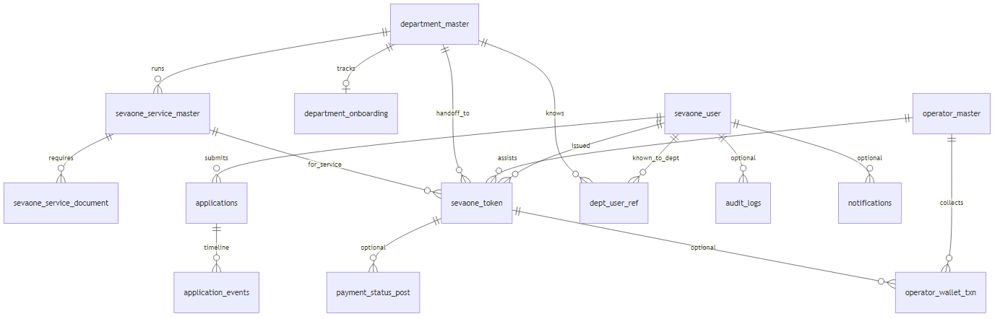
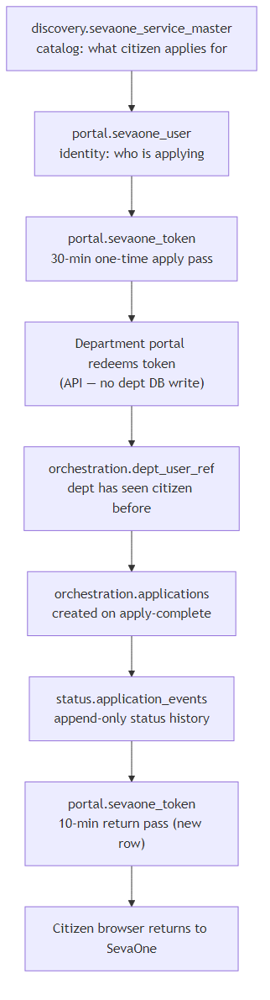
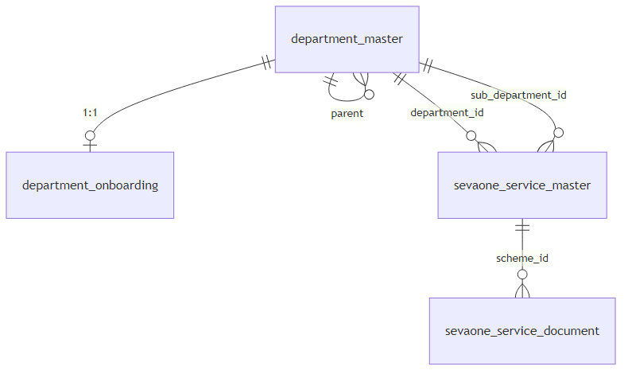
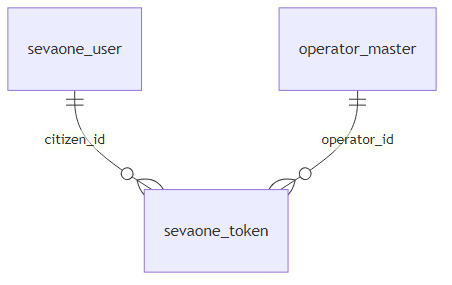
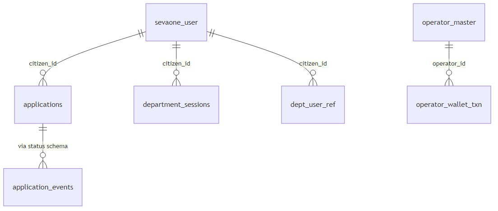

# SevaOne Postgres Database Reference

**Version:** Derived from Flyway migrations in `backend/database/migrations/`  
**Audience:** Engineers onboarding to SevaOne  
**Verification:** Schema verified against migration SQL files. Live `psql` was not available in the build environment; re-validate against your deployed database after migrations run.

---

## 1. Overview

SevaOne uses **one Postgres database** split into **six schemas**. Each schema owns one concern. Application code never issues ad-hoc `INSERT`/`UPDATE`/`DELETE` on tables — all access goes through named `sp_*` functions in the same schema.

| Schema | Owns | Tables |
|---|---|---|
| **discovery** | Department and service catalog | 4 |
| **portal** | Citizens, operators, handoff tokens | 3 |
| **orchestration** | Applications, dept sessions, wallet, outbox | 5 |
| **status** | Application timeline, payment posts | 2 |
| **audit** | Action log, DB error log | 2 |
| **notification** | Outbound message queue | 1 |

**Total: 16 tables**, plus 1 read-only view (`discovery.v_sevaone_service_document_flat`).

**Conventions (all tables)**

- Primary keys are `uuid` (except `audit.db_errors.id` which is `bigint` identity).
- Foreign keys use `uuid` references, not human-readable codes like `revenue` or `SVC001`.
- Timestamps are `timestamptz`. Booleans are real `boolean` columns.
- Human-readable codes (`department_id`, `service_id`) exist as secondary unique columns for display and integration.

---

## 2. System-wide ER diagram



---

## 3. Cross-schema relationship map

### 3.1 Citizen → apply → department handoff



### 3.2 Cardinality summary

| From | To | Relationship | FK on delete |
|---|---|---|---|
| `department_master` | `department_master` (parent) | N:1 optional | RESTRICT |
| `sevaone_service_master` | `department_master` | N:1 | RESTRICT |
| `sevaone_service_master` | `department_master` (sub-dept) | N:1 optional | SET NULL |
| `sevaone_service_document` | `sevaone_service_master` | N:1 | RESTRICT |
| `department_onboarding` | `department_master` | 1:1 | RESTRICT |
| `sevaone_token` | `sevaone_user` | N:1 | RESTRICT |
| `sevaone_token` | `operator_master` | N:1 optional | RESTRICT |
| `sevaone_token` | `department_master` | N:1 | RESTRICT |
| `sevaone_token` | `sevaone_service_master` | N:1 | RESTRICT |
| `applications` | `sevaone_user` | N:1 | RESTRICT |
| `applications` | `sevaone_service_master` | N:1 | RESTRICT |
| `applications` | `department_master` | N:1 | RESTRICT |
| `application_events` | `applications` | N:1 | CASCADE |
| `dept_user_ref` | department + citizen | N:1 each | RESTRICT |
| `operator_wallet_txn` | operator, citizen, token | N:1 | RESTRICT / SET NULL |
| `payment_status_post` | citizen, dept, scheme, token | N:1 optional | RESTRICT / SET NULL |

`audit.audit_logs.citizen_id` and `notification.notifications.citizen_id` are **logical** references only — no FK constraint.

---

## 4. Data lifecycle at a glance

| Table | Write path today | Notes |
|---|---|---|
| `discovery.department_master` | **Seed only** | `R__seed_lookup.sql` — 12 departments |
| `discovery.sevaone_service_master` | **Seed only** | ~40 services in seed script |
| `discovery.sevaone_service_document` | **None** | Table exists; 0 rows |
| `discovery.department_onboarding` | **Function only, not wired** | `sp_upsert_department_onboarding` unused by app |
| `portal.sevaone_user` | **Live** | Login (OTP/DigiLocker), profile update |
| `portal.operator_master` | **Seed only** | `R__seed_operator.sql` — test operator |
| `portal.sevaone_token` | **Live** | Apply pass + return pass; redeem sets `revoked_at` |
| `orchestration.applications` | **Live** | `sp_submit_application` on dept get-acknowledgement |
| `orchestration.department_sessions` | **Live** | Legacy connector path only |
| `orchestration.dept_user_ref` | **Live** | First successful dept handoff |
| `orchestration.operator_wallet_txn` | **Live** | Operator fee collect/reverse |
| `orchestration.outbox_messages` | **Live write** | **No consumer** publishes yet |
| `status.application_events` | **Live** | On submit + status updates |
| `status.payment_status_post` | **Live** | Dept payment-status API |
| `audit.audit_logs` | **Live** | Login, token, apply events |
| `audit.db_errors` | **Live** | Written by `sp_*` exception handlers |
| `notification.notifications` | **Live write** | **No delivery worker** — channel defaults to `log` |

---

## 5. Design conventions

### 5.1 Migration layout

```
database/migrations/
  V1__schemas.sql              # Creates six schemas
  tables/<schema>/V{n}__*.sql  # One file per table change (versioned, never edited in place)
  functions/<schema>/R__sp_*.sql  # Repeatable function definitions (re-applied on change)
  R__seed_lookup.sql           # Departments + services
  R__seed_operator.sql         # Test operator
  views/<schema>/R__*.sql      # Views (repeatable)
```

**`V__` (versioned):** Run once, in numeric order. Each file is immutable — alterations are new `V__` files.

**`R__` (repeatable):** Re-run when the file changes. Used for functions, seeds, and views.

### 5.2 One function per file

Each `sp_*` routine lives in its own `R__sp_<name>.sql`. This keeps diffs reviewable and matches the one-table-per-migration discipline.

### 5.3 Why functions, not raw SQL or EF

- **Security:** The application DB role can hold `EXECUTE` on functions only, not `INSERT`/`UPDATE` on tables.
- **Atomicity:** Multi-table writes (e.g. `sp_submit_application` inserts `applications` + `application_events` together) stay in one Postgres transaction.
- **Stability:** Dapper calls `SELECT * FROM schema.sp_foo(@args)` — same pattern as inline SQL, no ORM translation.
- **Postgres `PROCEDURE` is not used:** Procedures cannot return rowsets to the caller; functions can. See `POSTGRES_FUNCTIONS_VS_PROCEDURES.md`.

### 5.4 Error handling

Every `sp_*` catches exceptions and inserts into `audit.db_errors` before re-raising. `sp_insert_audit_log` is the exception — it does not log its own failures to `db_errors` (would recurse).

---

## 6. discovery schema

### ER (discovery)



### 6.1 `department_master`

Government departments and internal sub-portals (hierarchy level 1 or 2).

**Primary key:** `id` (uuid)

**Columns**

| Column | Type | Null | Default | Notes |
|---|---|---|---|---|
| `id` | uuid | NOT NULL | — | PK |
| `department_id` | varchar(64) | NOT NULL | — | UNIQUE business code, e.g. `revenue` |
| `department_name` | varchar(200) | NOT NULL | — | English |
| `department_name_kannada` | varchar(200) | NULL | — | |
| `portal_name` | text | NOT NULL | — | |
| `portal_name_kannada` | text | NULL | — | |
| `portal_domain` | text | NOT NULL | — | |
| `connector_type` | text | NOT NULL | — | Connector implementation key |
| `is_integrated` | boolean | NOT NULL | — | Real integration vs placeholder |
| `hierarchy_level` | smallint | NOT NULL | `1` | `1` = dept, `2` = sub-portal |
| `parent_department_id` | uuid | NULL | — | Required when level = 2 |
| `is_active` | boolean | NOT NULL | `TRUE` | |
| `created_at` | timestamptz | NOT NULL | `now()` | |

**CHECK constraints**

- `hierarchy_level IN (1, 2)`
- Level 1 ⇒ `parent_department_id IS NULL`; level 2 ⇒ `parent_department_id IS NOT NULL`

**Indexes**

- UNIQUE `ix_department_master_code` on `department_id`

**Functions (read only)**

- `sp_list_departments`, `sp_list_departments_with_scheme_count`, `sp_get_department_by_id`, `sp_get_department_by_code`
- Join helpers in orchestration/discovery cross-reads

**Lifecycle:** Seeded once. No application write path.

---

### 6.2 `department_onboarding`

Internal onboarding checklist per department (not citizen-facing).

**Primary key:** `id` (uuid)  
**Unique:** `department_id` (1:1 with `department_master`)

**Columns:** `contact_person_name`, `designation`, `contact_number`, `email`, `cc_emails`, `nodal_officer_nomination_requested_at`, `nodal_officer_name`, `ai_enabled` (default false), `onboarding_stage` (default `NotStarted`), `created_at`, `updated_at`

**CHECK:** `onboarding_stage IN ('NotStarted','ApiImplemented','Live')`

**Functions:** `sp_get_department_onboarding_by_department` (SELECT), `sp_upsert_department_onboarding` (INSERT/UPDATE)

**Lifecycle:** Function exists; **not called from C#**. Not seeded.

---

### 6.3 `sevaone_service_master`

Service catalog — one row per apply-able scheme.

**Primary key:** `id` (uuid)  
**Unique:** (`department_id`, `service_id`)

**Key columns:** `service_id` (e.g. `SVC001`), `service_name`, `category`, `sakala_days`, `description`, JSON lists (`required_documents_json`, `eligibility_json`, `aliases_json`, `steps_json`), fees (`department_fee`, `service_charge`), deeplinks (`deeplink_citizen_url`, `deeplink_operator_url`, `homepage_url`), Kannada name/description fields, `sub_department_id` → `department_master`, `is_active`

**CHECK:** `mode_of_service` NULL or `IN ('Online','Offline','Both')`

**Functions (read):** `sp_list_schemes`, `sp_get_scheme_by_id`, `sp_get_scheme_by_code`, `sp_get_scheme_by_service_code`, `sp_list_schemes_with_department`, `sp_get_scheme_with_department_by_service_code`

**Lifecycle:** Seeded only (~40 services). No runtime admin API.

---

### 6.4 `sevaone_service_document`

Structured required documents per scheme (successor to flat JSON list).

**FK:** `scheme_id` → `sevaone_service_master.id` (RESTRICT)

**Columns:** `document_name`, `document_name_kannada`, `document_url`, `document_type`, `is_mandatory` (default true), `is_active`, `created_at`

**Index:** `ix_sevaone_service_document_scheme_id`

**Functions:** `sp_get_documents_by_scheme` (SELECT) — **Live**

**Lifecycle:** **No rows, no writes.**

---

### 6.5 View `v_sevaone_service_document_flat`

Repeatable view joining documents + schemes + departments for flat reads. No storage of its own.

---

## 7. portal schema

### ER (portal)



### 7.1 `sevaone_user`

One row per citizen.

**Primary key:** `id` (uuid)  
**Identity:** `sevaone_user_id` bigint GENERATED — exposed to departments

**Columns (selected)**

| Column | Type | Constraints |
|---|---|---|
| `wso2_subject` | varchar(200) | NOT NULL, UNIQUE |
| `username`, `name` | varchar(200) | NOT NULL |
| `mobile` | varchar(15) | CHECK `^[0-9]{10,15}$`; UNIQUE when `mobile_verified_at` set |
| `mobile_verified_at` | timestamptz | NULL until verified |
| `email`, address fields | text/varchar | optional |
| Kannada fields | varchar | optional, from DigiLocker |
| `date_of_birth`, `gender` | date / varchar(20) | gender CHECK: Male/Female/Other/PreferNotToSay |
| `aadhaar_masked`, `aadhaar_hash` | varchar | hash UNIQUE when set |
| `digilocker_id` | varchar(64) | UNIQUE when set |
| `photo` | bytea | optional, from DigiLocker eAadhaar |
| `profile_completed`, `profile_finish_pct` | boolean / int | pct 0–100 |
| `kgid` | varchar(50) | UNIQUE when set — gov official, no write path yet |
| `created_at`, `updated_at` | timestamptz | NOT NULL |

**Functions**

| Function | Operation |
|---|---|
| `sp_get_citizen_by_id` | SELECT |
| `sp_get_citizen_by_wso2_subject` | SELECT |
| `sp_get_citizen_by_username` | SELECT |
| `sp_get_citizen_by_sevaone_user_id` | SELECT |
| `sp_get_citizen_by_mobile` | SELECT (verified only) |
| `sp_get_citizen_by_aadhaar_hash` | SELECT |
| `sp_insert_citizen` | INSERT |
| `sp_update_citizen` | UPDATE |
| `sp_delete_citizen` | DELETE |

**Lifecycle:** **Live** — `CitizenSessionService` on login/register; `PortalRepository` on profile patch.

---

### 7.2 `operator_master`

Kiosk / assisted-centre operators.

**Unique:** `operator_id` (business code)

**Columns:** `operator_type` CHECK (`G1`,`K1`,`B1`), `operator_name`, `mobile_no`, `password_hash`, `wallet_id`, `is_active`, `created_at`

**Functions:** `sp_get_operator_by_code`, `sp_get_operator_by_id`, `sp_get_operator_credentials` — all SELECT, **Live**

**Lifecycle:** Seeded (`OPR10001`). No sp_* write from app.

---

### 7.3 `sevaone_token`

One-time apply passes (30 min) and return passes (10 min).

**FKs:** `citizen_id`, `department_id`, `scheme_id`; optional `operator_id`

**Columns:** `token_value`, `token_hash` (UNIQUE), `sevaone_user_id` (bigint, no FK), `assisted_mode`, `issued_at`, `expire_at`, `midnight_valid_until`, `revoked_at`, `is_active`, `return_url`

**CHECK:** assisted mode requires `operator_id`; expiry ordering

**Indexes:** `token_hash` UNIQUE; composites on citizen, department, scheme, expire_at

**Functions:** `sp_insert_token`, `sp_get_token_by_hash`, `sp_get_token_by_id`, `sp_try_redeem_token` (sets `revoked_at`, `is_active=false`)

**Lifecycle:** **Live** — minted on Apply and get-acknowledgement; redeemed atomically.

---

## 8. orchestration schema

### ER (orchestration)



### 8.1 `applications`

One row per citizen+scheme+department application (deduped).

**Unique:** `seva_reference`; (`citizen_id`, `scheme_id`, `department_id`, `department_reference`)

**Columns:** `department_reference`, `status` (integer enum), `submitted_at`, `sakala_due_at`, `applicant_name`, `address`, `purpose`, `district`, `taluk`

**Functions:** `sp_submit_application` (INSERT + first event), `sp_update_application_status`, `sp_reassign_applications`, multiple getters with JOIN to discovery for names

**Lifecycle:** **Live** — created on first `get-acknowledgement` from department.

---

### 8.2 `department_sessions`

Encrypted connector sessions for legacy direct-submission path (not JWS handoff).

**Functions:** `sp_insert_department_session`, `sp_get_active_department_session`, `sp_get_active_department_sessions_by_citizen`, `sp_expire_department_session`

**Lifecycle:** **Live** for connector integrations only.

---

### 8.3 `dept_user_ref`

Records that a department has previously seen a citizen (`UNIQUE (department_id, citizen_id)`).

**Functions:** `sp_upsert_dept_user_ref` (INSERT ON CONFLICT DO NOTHING)

**Lifecycle:** **Live** — written after successful token validation path.

---

### 8.4 `operator_wallet_txn`

Fee collection / reversal at assisted centres.

**CHECK:** `amount > 0`  
**Unique:** partial on `idempotency_key`

**Functions:** `sp_insert_wallet_txn`, `sp_get_wallet_txn_by_idempotency_key`

**Lifecycle:** **Live** — operator wallet APIs.

---

### 8.5 `outbox_messages`

Transactional outbox pattern (topic, payload, publish state).

**Functions:** `sp_insert_outbox_message`, `sp_get_pending_outbox_messages`, `sp_mark_outbox_published`, `sp_mark_outbox_failed`

**Lifecycle:** **Written** on events; **no publisher worker** consumes pending rows in production yet.

---

## 9. status schema

### 9.1 `application_events`

Append-only timeline per application.

**FK:** `application_id` → `applications.id` **ON DELETE CASCADE**

**Functions:** `sp_insert_application_event`, `sp_get_timeline`

**Lifecycle:** **Live** — every status change appends a row.

---

### 9.2 `payment_status_post`

Idempotent payment status reports from departments.

**Unique:** partial on `idempotency_key`  
**CHECK:** `amount IS NULL OR amount >= 0`

**Functions:** `sp_insert_payment_status_post`, `sp_get_payment_status_by_idempotency_key`

**Lifecycle:** **Live** — dept payment-status endpoint (orphaned from APIM gateway but code exists).

---

## 10. audit schema

### 10.1 `audit_logs`

Who did what, when (login, token issue/redeem, get-acknowledgement).

**No FK** on `citizen_id` (allows operator-only actions).

**Indexes:** `at`; (`citizen_id`, `at DESC`)

**Functions:** `sp_insert_audit_log`, `sp_get_audit_logs_by_citizen`

**Lifecycle:** **Live** throughout auth and dept flows.

---

### 10.2 `db_errors`

Postgres function failures for post-mortem.

**PK:** `id` bigint identity

**Lifecycle:** Written by `sp_*` exception handlers only — not from C# directly.

---

## 11. notification schema

### 11.1 `notifications`

Outbound messages queue.

**Defaults:** `channel = 'log'` (no real SMS/email worker yet)

**Functions:** `sp_insert_notification`, `sp_get_pending_notifications`, `sp_mark_notification_sent`

**Lifecycle:** **Inserted** on apply/status paths; **not delivered** by a background worker today.

---

## 12. Function catalog (by schema)

| Schema | Count | All called from C#? |
|---|---|---|
| discovery | 13 | No — onboarding pair unused |
| portal | 16 | Yes |
| orchestration | 22 | Yes |
| status | 4 | Yes |
| audit | 2 | Yes |
| notification | 3 | Yes |

**C# repositories:** `DiscoveryRepository`, `PortalRepository`, `OrchestrationRepository`, `StatusRepository`, `AuditRepository`, `NotificationRepository` — each maps 1:1 to `sp_*` calls in `SevaOne.Infrastructure/Repositories/`.

---

## 13. Seed data reference

**`R__seed_lookup.sql`**

- 12 `department_master` rows (`revenue`, `transport`, …)
- ~40 `sevaone_service_master` rows (`SVC001`–`SVC024`, `SVC101`–`SVC116`)
- Idempotent: `ON CONFLICT DO NOTHING`

**`R__seed_operator.sql`**

- 1 `operator_master` row (`OPR10001`, type `K1`, PBKDF2 password hash)

---

## 14. Related documents

| Document | Purpose |
|---|---|
| `DATABASE_SCHEMA.md` | Narrative schema guide (citizen-friendly) |
| `POSTGRES_FUNCTIONS_VS_PROCEDURES.md` | Why FUNCTION not PROCEDURE |
| `DEPARTMENT_INTEGRATION_GUIDE.md` | Dept API (uses `sevaone_user_id`, tokens) |

---

*End of database reference.*
