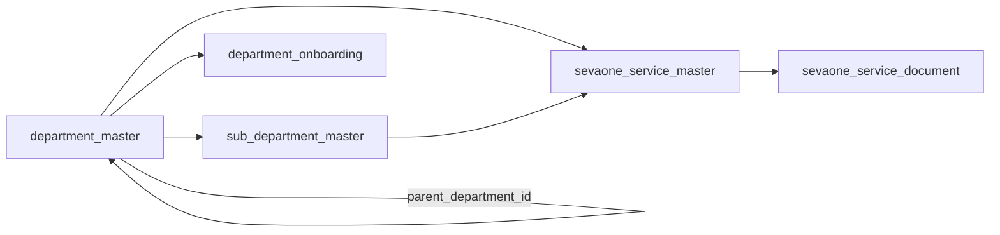

# SevaOne Database Schema

This document explains what SevaOne stores in its database, why it's organized the way it is,
and — for every table — how data actually gets into it. That last part matters: several tables
described below are not written to by the running application at all today. This document says
so plainly, rather than leaving that to be discovered by reading code.

---

## The short version

SevaOne uses one Postgres database, split into six named sections (Postgres calls these
"schemas"). Each section owns one area of the system, so a table's location alone tells you what
it's for:

| Section | Owns | You'd look here to answer |
|---|---|---|
| **discovery** | The list of departments and services citizens can apply for | "What services exist, and who runs them?" |
| **portal** | Citizens, kiosk operators, and the one-time passes used to hand a citizen off to a department | "Who is this citizen, and what pass did we give them?" |
| **orchestration** | Applications a citizen has submitted, and what a department already knows about a citizen | "Has this citizen applied before? What's the status?" |
| **status** | The timeline of status changes on an application, and payment postings | "What happened to this application, and when?" |
| **audit** | A record of who did what, and any errors the database itself caught | "What happened, exactly, and can we prove it?" |
| **notification** | Messages queued to send to a citizen or department | "What are we telling someone, and did it go out?" |

---

## How to read the tables below

A few rules apply to every table in this database, so they're explained once, here, instead of
repeated twenty times:

- **Every table's real identifier is a `uuid`** — a randomly generated 128-bit value, not a
  simple counting number. Anywhere one table needs to point at a row in another table, it stores
  that row's `uuid`, never a human-readable code like `"revenue"` or `"SVC001"`. Those
  human-readable codes still exist, but only as a separate, secondary column — the reason is
  that a code can be renamed later without breaking every table that refers to it.
- **Every timestamp includes a time zone** (`timestamptz`), and every yes/no value is a real
  `boolean` — never a bare date with no zone, and never a `"Y"`/`"N"` flag.
- **The application never writes raw SQL.** Every place a table is read or written, it goes
  through a named Postgres function (for example, `discovery.sp_get_department_by_id`) instead
  of a query built by hand in application code. This means the exact set of ways a table can be
  changed is fixed and visible in one place, not scattered across the codebase.
- **A table file only shows a table's final shape.** The file names look like
  `V3__sevaone_service_master.sql` — that number is the order tables had to be created in
  (because some tables reference others), not a history of changes. If a table changed after it
  was first created, that's a separate, later file — the original file is never edited.

---

## discovery — the service catalog

### department_master — one row per government department, or one of its internal divisions

**What it's for:** the department listing citizens browse — its name, which website it sends
citizens to when they apply, and whether SevaOne actually has a working connection to it yet.
Some departments run more than one citizen-facing portal — for example, the Revenue Department's
Nadakacheri portal handles certificates, while its separate Bhoomi portal handles land records —
so this table can also hold those internal divisions as their own rows, linked back to their
parent department.

| Column | Type | What it holds |
|---|---|---|
| `id` | uuid | The permanent internal identifier |
| `department_id` | text, up to 64 characters | The short code everyone actually uses, e.g. `revenue` — unique across every row in this table, main departments and sub-departments alike |
| `department_name` | text, up to 200 characters | The department's (or sub-department's) name, in English |
| `department_name_kannada` | text | The same name, in Kannada — not filled in yet |
| `portal_name` | text | The name of the portal shown to citizens |
| `portal_name_kannada` | text | The same, in Kannada — not filled in yet |
| `portal_domain` | text | The portal's address |
| `connector_type` | text | Which piece of code handles this row's direct-submission integration, if it has one |
| `is_integrated` | true/false | Whether that direct-submission integration is real, or just a placeholder |
| `hierarchy_level` | whole number, `1` or `2` | `1` for a main department, `2` for a sub-department *of this table* — a distinct concept from `sub_department_master` below (which is what the Service Catalogue actually uses; see its own section). Reserved for a future case where a whole department-level division needs its own portal/connector row, not currently populated by anything |
| `parent_department_id` | uuid, required when `hierarchy_level = 2`, otherwise empty | Which main department a `hierarchy_level = 2` row belongs to |
| `is_active` | true/false, defaults to true | Whether this row is currently shown to citizens |
| `created_at` | timestamp | When this row was created |

**How data gets in:** a one-time setup script (`R__seed_lookup.sql`) inserts twelve main
departments when the database is first created. **Nothing in the running application adds,
edits, or removes a department today** — there is no "create department" feature yet, only ways
to read the list. Anywhere the app lists departments for a citizen to pick from, it only ever
reads `hierarchy_level = 1` rows.

### sub_department_master — a department's internal divisions, as the Service Catalogue uses them

**What it's for:** many departments' real service lists are organized into named divisions (e.g.
Education's 12, Revenue's 5) — this is what the Service Catalogue's department page groups
services by. Originally dropped in favor of `department_master.hierarchy_level` (above) on the
grounds that it was unused with zero live rows; restored once the Service Catalogue actually
populated it with real data and built a full write/read path against it as a first-class table.
Not the same mechanism as `department_master.hierarchy_level = 2` — the two are independent,
and only this table is wired into anything today.

| Column | Type | What it holds |
|---|---|---|
| `id` | uuid | The permanent internal identifier |
| `department_id` | uuid | Which department this belongs to |
| `sub_department_name` | text, up to 200 characters | The sub-department's name, in English |
| `sub_department_name_kannada` | text | The same, in Kannada — not filled in yet |
| `is_active` | true/false, defaults to true | Hide without deleting |
| `display_order` | whole number, defaults to `0` | Admin-controlled ordering for the catalog UI's sub-department rail — never touched by a re-import |
| `created_at` | timestamp | When this row was created |

Unique: `(department_id, sub_department_name)`. Not every department has sub-departments — a
service's `sub_department_id` (below) is nullable, and there's deliberately no synthetic
"fallback" sub-department row for that case — a `NULL sub_department_id` on the service *is*
the "ungrouped" state.

### department_onboarding — internal tracking, not shown to citizens

**What it's for:** this is a checklist for the SevaOne team's own use — who the department's
contact person is, whether a nodal officer has been nominated, and how far along the department
is in actually connecting to SevaOne. It's deliberately kept separate from `department_master`
above: that table is what citizens' browsing depends on, while this one is internal status that
changes constantly and has nothing to do with what a citizen sees.

| Column | Type | What it holds |
|---|---|---|
| `id` | uuid | The permanent internal identifier |
| `department_id` | uuid, one row per department | Which department this tracks |
| `contact_person_name` / `designation` / `contact_number` / `email` | text | Who to contact at this department |
| `cc_emails` | text | Other people to loop in — free text, for reference only |
| `nodal_officer_nomination_requested_at` | timestamp | When SevaOne asked the department to name a nodal officer |
| `nodal_officer_name` | text | Who was actually named, once that happens |
| `ai_enabled` | true/false, defaults to false | Whether this department's services should be searchable through the AI assistant |
| `onboarding_stage` | text, one of `NotStarted` / `ApiImplemented` / `Live` | How far this department has gotten — a single value instead of separate yes/no flags, so an impossible combination (like "live" before "implemented") can't be recorded by mistake |
| `created_at` / `updated_at` | timestamp | When this row was created, and last changed |

**How data gets in:** a database function to save this data exists
(`sp_upsert_department_onboarding`), but nothing in the application calls it yet — no screen or
API endpoint uses it today. It's ready to be wired up whenever that tracking work actually
starts.

### sevaone_service_master — one row per service a citizen can apply for

**What it's for:** this is the actual service catalog — every certificate, license, or benefit a
citizen can search for and apply for, and everything needed to describe it: which department
runs it, what it costs, how long it takes, and where "Apply" actually sends the citizen.

| Column | Type | What it holds |
|---|---|---|
| `id` | uuid | The permanent internal identifier |
| `service_id` | text, up to 32 characters | SevaOne's own short code, e.g. `SVC001` |
| `department_id` | uuid | Which department runs this service |
| `sub_department_id` | uuid, optional | Which of that department's sub-departments (a row in `sub_department_master` above) it belongs to, if any |
| `service_name` | text, up to 300 characters | The service's name, in English |
| `service_name_kannada` | text | The same, in Kannada |
| `category` | text | A broad grouping, e.g. "Certificates" — translated for display by the website itself, not stored per-language here |
| `sakala_days` | whole number | How many days the Karnataka Sakala Act guarantees this service will take |
| `is_sakala_enabled` | true/false, optional | Whether this service is actually Sakala-enabled — distinct from `sakala_days`, since a source spreadsheet can carry a days figure without the service being enabled |
| `sakala_label_raw` | text | The source's own raw label ("Non-Sakala", "non sakala", "Yes", ...), kept for audit even after `is_sakala_enabled` normalizes it |
| `description` | text | The full description shown on the service's page |
| `description_kannada` | text | The same, in Kannada — not filled in yet |
| `short_description` | text | A shorter summary — not filled in yet |
| `short_description_kannada` | text | The same, in Kannada — not filled in yet |
| `department_service_id` | text | The department's *own* internal code for this service — a different value from `service_id` above, since SevaOne and the department each have their own numbering |
| `jurisdiction` | text | How local this service is, e.g. "District" or "State" |
| `mode_of_service` | text, one of `Online` / `Offline` / `Both` | How a citizen can access it |
| `remarks` | text | Internal notes |
| `department_fee` | number | The department's own statutory fee, if any |
| `service_charge` | number | SevaOne's own service charge, if any |
| `required_documents_json` | text, a JSON list | A flat list of document names required (English) — a quick summary; see `sevaone_service_document` below for the fuller version |
| `documents_json_kannada` | text, a JSON list | The same, in Kannada. Checklist-style names, not per-row records — a different concept from `sevaone_service_document`'s `document_url`, which is `NOT NULL` by design and reserved for sources that actually provide a real link |
| `eligibility_json` | text, a JSON list | Who can apply |
| `eligibility_json_kannada` | text, a JSON list | The same, in Kannada |
| `aliases_json` | text, a JSON list | Other names citizens might search for this service by |
| `steps_json` | text, a JSON list | The step-by-step process shown to the citizen |
| `steps_json_kannada` | text, a JSON list | The same, in Kannada |
| `portal` | text | Which specific portal this service is actually processed on |
| `service_url` | text | Where to read more about this service |
| `deeplink_citizen_url` | text | Where "Apply" sends a citizen applying on their own — the department's own apply entry point for this service |
| `deeplink_operator_url` | text | Same, for a citizen applying with help from a SevaOne operator. Falls back to `deeplink_citizen_url` if blank |
| `homepage_url` | text | Plain fallback when neither deep link above is set yet — the citizen/operator is sent here instead, with no token, since there's no department endpoint to redeem one |
| `version` | whole number, defaults to `1` | Bumped on every `sp_upsert_sevaone_service` conflict (i.e. every publish that touches this row) — pairs with `service_change_log` below |
| `is_active` | true/false, defaults to true | Whether this service is currently shown to citizens |
| `created_at` | timestamp | When this row was created |

**How data gets in:** the original one-time setup script seeded a small demo set; the Service
Catalogue's ingestion pipeline (`catalog_import_batch`/`catalog_import_row` below, and the admin
console at `/admin/catalog`) is the real write path now — a staged JSON upload, reviewed, then
published through `sp_upsert_sevaone_service`, which is a true upsert keyed on `(department_id,
service_id)` (see the uniqueness note below), not an insert-or-fail.

Two things that used to be columns here were removed after review, not just left unused:

- `fee` (a free-text value like `"₹15"`) was replaced by the numeric `department_fee` and
  `service_charge` above, once every place that displayed it — the API, the citizen-facing
  website, and the kiosk-operator fee-collection screen — was switched over to the numeric
  values.
- `is_mandatory` at this level was removed because the same idea already exists correctly, one
  level down, on `sevaone_service_document.is_mandatory` — the source data it came from was
  actually describing whether a *document* was mandatory, not the *service*.

Unique: `(department_id, service_id)`. `service_id` alone is **not** globally unique — confirmed
in the Service Catalogue's real migrated data, where the same code means a different service
under a different department (e.g. code `7` is "Caste Certificate" under Revenue-AJSK but
"Occupancy Certificate" under RDPR) — so nothing may look a service up by `service_id` alone
without a department to scope it (a global-uniqueness attempt was tried and reverted; see
`GetSchemeByDepartmentAndServiceCodeAsync` and its callers for the fix that actually closed the
misrouting gap that attempt was after). There is no separate "composite code" column — a display
composite (department business code + `service_id`) is computed at the DTO layer, not persisted.

A count of how many services a department has is never stored as its own column — it's always
counted on the spot from this table (`sp_list_departments_with_scheme_count` does exactly that),
so it can never drift out of date.

### sevaone_service_document — the real, structured version of "required documents"

**What it's for:** `required_documents_json` above is a quick flat list of document *names*.
This table is the fuller version — one row per document, each with its own name, a real web
address to fetch it from, a document type, and whether it's actually mandatory. This is meant to
become the authoritative source for document information, with the JSON list above kept only for
older code paths that haven't switched over yet.

| Column | Type | What it holds |
|---|---|---|
| `id` | uuid | The permanent internal identifier |
| `scheme_id` | uuid | Which service this document belongs to |
| `document_name` | text | The document's name, in English |
| `document_name_kannada` | text | The same, in Kannada |
| `document_url` | text | Where to find or fetch this document |
| `document_type` | text | What kind of document this is |
| `is_mandatory` | true/false, defaults to true | Whether the citizen must provide this document |
| `is_active` | true/false, defaults to true | Whether this row is currently in use |
| `created_at` | timestamp | When this row was created |

**How data gets in:** nothing yet. This table exists and is fully usable, but currently has no
rows — the setup script doesn't populate it, and no part of the application writes to it yet.

### v_sevaone_service_document_flat (a view, not a table)

A read-only convenience: it joins `sevaone_service_document` with `sevaone_service_master` and
`department_master` so a query can get a department code, service code, and document details all
in one row, without writing that join out by hand each time. It has no data of its own — it's
just a saved way of looking at the three tables above together.

---

## portal — citizens, operators, and one-time passes

### sevaone_user — one row per citizen

**What it's for:** everything SevaOne knows about a citizen once they've logged in — their name,
contact details, and address, in both English and Kannada where DigiLocker provided it.

| Column | Type | What it holds |
|---|---|---|
| `id` | uuid | The permanent internal identifier — used everywhere inside SevaOne |
| `sevaone_user_id` | a plain counting number, assigned automatically | The identifier departments actually see, in the web address a citizen is sent to |
| `wso2_subject` | text | The matching identity on WSO2, the system that checks a citizen's login |
| `username` / `name` | text | Login name and display name |
| `mobile` | text, optional | Only counted as "confirmed" once `mobile_verified_at` (below) is set |
| `mobile_verified_at` | timestamp, optional | When SevaOne actually confirmed this number belongs to this citizen — either through DigiLocker or a passed OTP check |
| `email` / `address` / `district` / `taluk` / `state_name` / `village_name` | text, optional | Contact and location details |
| `name_kannada` / `address_kannada` / `district_kannada` / `state_kannada` / `village_kannada` | text, optional | The same details, in Kannada, from DigiLocker |
| `date_of_birth` / `gender` | optional | From DigiLocker, for a new citizen |
| `aadhaar_masked` | text, optional | A partially hidden Aadhaar number, e.g. `XXXX-XXXX-3210`, for display only |
| `aadhaar_hash` | text, optional | A one-way scrambled version of the real Aadhaar number — used only to make sure the same real Aadhaar can't create two accounts, never to recover the original number |
| `digilocker_id` | text, up to 64 characters, optional | This citizen's DigiLocker account id, for whoever logged in that way. Also folded into `wso2_subject` above (prefixed `"digilocker:"`) for lookup — this column is the same value on its own |
| `photo` | binary, optional | The citizen's photo, when DigiLocker's Aadhaar record included one. **Not live-verified against a real DigiLocker response** — DigiLocker has no test/sandbox mode, so this has only been checked against the published Aadhaar KYC XML format, not an actual payload |
| `seva_id` | text | An older identifier, kept for compatibility |
| `profile_completed` / `profile_finish_pct` | true/false and a percentage | How complete this citizen's profile is |
| `created_by_operator_id` | text, optional | Set if a kiosk operator created this account on the citizen's behalf |
| `kgid` | text, up to 50 characters, optional | Karnataka Government ID — marks this row as belonging to a government official rather than an ordinary citizen. Set only by a backend ingestion process ahead of that person's first login, never through any UI |
| `created_at` / `updated_at` | timestamp | When this row was created and last updated |

**How data gets in:** written whenever a citizen logs in for the first time (through mobile OTP
or DigiLocker) or updates their profile — this is a genuinely live, actively-used table, unlike
most of `discovery` above. `digilocker_id` and `photo` are set only by the DigiLocker login path
(never by mobile OTP), and only the first time — once set, a later login never overwrites them.
`kgid` is the one exception: nothing writes it yet — it's reserved for a future backend
ingestion process that pre-creates a row for a government official before they ever log in, so
that when they do log in, SevaOne can recognize them and have them complete the rest of their
profile.

### operator_master — kiosk staff who can apply on a citizen's behalf

**What it's for:** an operator's login details, which kind of kiosk they work at, and how to look
up their wallet — used to collect service fees on a citizen's behalf at the counter. SevaOne
doesn't keep its own running balance for an operator; that lives on the external wallet
provider and gets checked there directly, in real time, using `wallet_id`.

| Column | Type | What it holds |
|---|---|---|
| `id` | uuid | The permanent internal identifier |
| `operator_id` | text, up to 50 characters | The operator's own short code |
| `operator_type` | text, one of `G1` / `K1` / `B1` | Which kind of kiosk this operator works at |
| `operator_name` | text, optional | The operator's name |
| `mobile_no` | text, optional | The operator's phone number |
| `wallet_id` | text, up to 100 characters, optional | This operator's identifier on the external wallet provider — SevaOne uses this to check balance and other wallet info there directly, once that system's API is available. Empty until the operator is provisioned on that side |
| `password_hash` | text, optional | The operator's login password, scrambled one-way — SevaOne manages this login directly rather than through the citizen identity system, since operators aren't citizens |
| `is_active` | true/false, defaults to true | Whether this operator can currently log in |
| `created_at` | timestamp | When this account was created |

**How data gets in:** written when an operator account is created; `wallet_id` is set once that
operator is provisioned on the external wallet provider.

### sevaone_token — the one-time passes themselves

**What it's for:** this single table holds two different kinds of pass, distinguished only by
how long they last:

- an **apply pass**, valid for 30 minutes, created when a citizen clicks "Apply" and used once
  by the department to confirm the citizen's identity;
- a **return pass**, valid for 10 minutes, created once the department reports the application
  is done, and used once to bring the citizen's browser back to SevaOne.

Once either kind of pass is used, it's marked used and can never be used again — the row itself
is never deleted, so there's always a record that it existed and when it was spent.

**How data gets in:** created by SevaOne whenever a citizen applies or a department finishes an
application; marked as used the moment either event actually happens.

---

## orchestration — applications and what departments already know

### applications — one row per application a citizen has actually submitted

**What it's for:** created the moment a department reports "this citizen's application is
done" — not any earlier, so there's nothing to show a citizen until a department has actually
confirmed something happened.

| Column | Type | What it holds |
|---|---|---|
| `id` | uuid | The permanent internal identifier |
| `seva_reference` | text, up to 32 characters | The reference number SevaOne gives the citizen, e.g. `SVK2026123456` |
| `department_reference` | text, optional | The department's own case number for the same application |
| `citizen_id` | uuid | Which citizen this belongs to |
| `scheme_id` | uuid | Which service was applied for |
| `department_id` | uuid | Which department is handling it |
| `status` | a stored status value | The application's current stage — see `application_events` below for the full history |
| `submitted_at` | timestamp | When the department first reported this application |
| `sakala_due_at` | timestamp | Calculated automatically as `submitted_at` plus the service's guaranteed number of days, so a missed deadline is visible without anyone calculating it later |
| `applicant_name` / `address` | text | Copied from the citizen's own profile at the time of submission |
| `purpose` / `district` / `taluk` | text, optional | Additional details about the application |

**How data gets in:** written once, the first time a department reports an application as done;
calling that same reporting step again for the same citizen and service updates the existing row
instead of creating a second one.

### department_sessions, dept_user_ref, operator_wallet_txn, outbox_messages

- **department_sessions** — used only by the older, direct-submission integration path, not the
  one-time-pass handoff described above. Columns: `citizen_id`, `department_id`, an
  `encrypted_payload` holding the session details, and `issued_at`/`expires_at`.
- **dept_user_ref** — one row per (department, citizen) pair, recording that a department has
  already seen this citizen once before, so the next visit can skip straight to confirming the
  pass instead of sending the citizen's full profile again. Columns: `department_id`,
  `citizen_id`, an optional `operator_id` if a kiosk operator was involved, `assisted_mode`, and
  `created_at`. Written the first time a department successfully confirms a citizen.
- **operator_wallet_txn** — a record of every fee an operator collected or reversed on a
  citizen's behalf. Columns: `operator_id`, `citizen_id`, optional `department_id`/`scheme_id`,
  the `amount` (always a positive number — a reversal is its own separate row, not a negative
  one), a `txn_status`, an optional link to the `sevaone_token` involved, a repeat-safe
  `idempotency_key`, and `created_at`. Written whenever an operator collects or reverses a fee.
- **outbox_messages** — events queued for something else to pick up later, such as a status
  change other parts of the system might want to react to. Columns: `topic`, a `payload`,
  `created_at`, `published_at` (empty until it's actually sent), `attempts`, and `last_error`.
  Written whenever such an event happens; nothing currently reads from this table to actually
  publish them onward.

### discovery.catalog_role

The set of audiences a catalog service can be made visible to. Deliberately a table, not a
fixed enum/CHECK constraint — adding a new audience (e.g. a department-specific reviewer
role) is an `INSERT`, not a migration. Seeded (`R__seed_catalog_role.sql`) with `citizen`,
`operator`, `admin`.

| Column | Type | Notes |
|---|---|---|
| `id` | `uuid` | PK |
| `role_key` | `varchar(64)` NOT NULL | Unique (`ix_catalog_role_key`) |
| `display_name` | `varchar(200)` NOT NULL | |
| `description` | `text` | Nullable |
| `created_at` | `timestamptz` NOT NULL DEFAULT `now()` | |

### discovery.service_role_visibility

A service with no row here for a given role is genuinely absent from that role's query
results — a fact about the data, not a filter applied after the fact. Pure join table: the
composite natural key doubles as the PK, unlike the entity tables above.

| Column | Type | Notes |
|---|---|---|
| `service_id` | `uuid` NOT NULL | FK → `sevaone_service_master(id)`, `ON DELETE CASCADE`; part of composite PK |
| `role_id` | `uuid` NOT NULL | FK → `catalog_role(id)`, `ON DELETE CASCADE`; part of composite PK |
| `granted_at` | `timestamptz` NOT NULL DEFAULT `now()` | |
| `granted_by` | `text` | Nullable |

PK: `(service_id, role_id)`. Written via `sp_set_service_visibility` (grant = upsert, revoke =
delete) — never inline SQL.

### discovery.catalog_import_batch

One row per catalog file/JSON upload. An upload never writes `department_master` /
`sub_department_master` / `sevaone_service_master` directly — it lands as
`catalog_import_row` rows an admin reviews, and only a `publish` action (status →
`published`) writes the live tables.

| Column | Type | Notes |
|---|---|---|
| `id` | `uuid` | PK |
| `source_filename` | `varchar(500)` NOT NULL | |
| `source_format` | `varchar(16)` NOT NULL | `CHECK IN ('xlsx','csv','json')` |
| `uploaded_by` | `text` NOT NULL | |
| `uploaded_at` | `timestamptz` NOT NULL DEFAULT `now()` | |
| `status` | `varchar(32)` NOT NULL DEFAULT `'validating'` | `CHECK IN ('validating','ready_to_publish','published','failed','discarded')` |
| `row_count` / `error_count` / `warning_count` | `integer` NOT NULL DEFAULT `0` | |
| `published_at` / `published_by` | `timestamptz` / `text` | Nullable — set only on the transition to `published` |

### discovery.catalog_import_row

One row per parsed service within a batch. Staging only — never read by the live
citizen/operator catalog, purely the admin review surface before publish. JSON columns are
`text`, matching every other JSON-shaped column in this schema (`required_documents_json`, ...) rather
than `jsonb`, so no new Dapper type handling is needed.

| Column | Type | Notes |
|---|---|---|
| `id` | `uuid` | PK |
| `batch_id` | `uuid` NOT NULL | FK → `catalog_import_batch(id)`, `ON DELETE CASCADE` |
| `row_number` | `integer` NOT NULL | Position in the source file, for error messages |
| `raw_payload` | `text` NOT NULL | JSON, exactly as parsed |
| `normalized_payload` | `text` | Nullable — JSON, after normalization rules run |
| `action` | `varchar(16)` | Nullable until validated; `CHECK IN ('insert','update','unchanged','conflict')` |
| `validation_errors` / `validation_warnings` | `text` NOT NULL DEFAULT `'[]'` | JSON arrays of `{field, message}` |
| `created_at` | `timestamptz` NOT NULL DEFAULT `now()` | |

Written in two passes: `sp_insert_import_row` stages the row, then `sp_update_import_row_validation`
fills in `action`/errors/warnings once cross-row checks (e.g. a duplicate composite code
within the same batch) have run over the whole batch.

### discovery.service_change_log

Append-only audit trail — who changed what on which service, when, and (if it came from an
upload) which batch. Independent of `catalog_import_row`: manual single-service edits and
visibility grants/revokes log here too, not just imports. `service_id`/`batch_id` are
nullable and `ON DELETE SET NULL` so the log outlives a deleted service or batch.

| Column | Type | Notes |
|---|---|---|
| `id` | `uuid` | PK |
| `service_id` | `uuid` | Nullable; FK → `sevaone_service_master(id)`, `ON DELETE SET NULL` |
| `batch_id` | `uuid` | Nullable; FK → `catalog_import_batch(id)`, `ON DELETE SET NULL` |
| `changed_at` | `timestamptz` NOT NULL DEFAULT `now()` | |
| `changed_by` | `text` NOT NULL | |
| `change_type` | `varchar(32)` NOT NULL | `CHECK IN ('created','updated','deactivated','reactivated','role_grant','role_revoke')` |
| `diff` | `text` | Nullable — JSON, `{field: {old, new}, ...}` |

### discovery.service_apply_track

One row per apply attempt — a real deep-link token mint **or** a homepage-fallback redirect
(when the department has no deep link configured yet), both count as genuine apply intent.
Never written for department-integration test-token mints (`/dept/test-token`) — synthetic QA
traffic isn't real demand. Log table rather than a counter column on `sevaone_service_master`,
same convention as `service_change_log` above: the count is always reconstructable from what
actually happened (`sp_get_service_apply_count`), and the same rows support "how many total"
today and "trend over time" / "by department" later without a schema change.

| Column | Type | Notes |
|---|---|---|
| `id` | `uuid` | PK |
| `scheme_id` | `uuid` | Nullable; FK → `sevaone_service_master(id)`, `ON DELETE SET NULL` |
| `department_id` | `uuid` | Nullable; FK → `department_master(id)`, `ON DELETE SET NULL` |
| `citizen_id` | `uuid` | Nullable; FK → `portal.sevaone_user(id)`, `ON DELETE SET NULL` |
| `assisted_mode` | `boolean` NOT NULL DEFAULT `false` | Operator-assisted apply vs. self-service |
| `is_homepage_fallback` | `boolean` NOT NULL DEFAULT `false` | `true` when no deep link existed and the citizen was sent to the plain homepage instead |
| `created_at` | `timestamptz` NOT NULL DEFAULT `now()` | |

**How data gets in:** written by `PortalApplyService.MintApplyTokenAsync`, alongside every
citizen self-service (`CreateApplyTokenAsync`) and operator-assisted
(`CreateAssistedApplyTokenAsync`) apply — live, on every real apply click. Read via
`sp_get_service_apply_count(scheme_id)`.

---

## status — what happened to an application, and when

### application_events — the timeline

**What it's for:** every time an application's status changes, a new row is added here — never
edited in place — so an application's full history stays visible, not just its current state.
This is what a citizen's "track my application" screen actually reads from.

| Column | Type | What it holds |
|---|---|---|
| `id` | uuid | The permanent internal identifier |
| `application_id` | uuid | Which application this event belongs to — if the application is ever deleted, its events are deleted with it |
| `status` | a stored status value | What the status changed to |
| `note` | text | A short explanation of the change |
| `at` | timestamp | When the change happened |

**How data gets in:** a new row is added every time an application's status changes — when a
department first reports an application as done, and again every time it reports a further
status update afterward.

### payment_status_post — fee payments a department reports back

**What it's for:** a record of every payment status a department has posted, along with a
repeat-safe key so posting the same payment notification twice doesn't get recorded as two
separate payments.

| Column | Type | What it holds |
|---|---|---|
| `id` | uuid | The permanent internal identifier |
| `citizen_id` / `department_id` / `scheme_id` | uuid, optional | Who and what this payment relates to |
| `sevaone_token_id` | uuid, optional | Which pass this payment was reported against |
| `token_value` | text | The pass value as it was received |
| `token_hash_at_post` | text | A scrambled version of that pass, used to look it up quickly |
| `payment_status` | text, up to 50 characters | What the department reported — e.g. paid, failed |
| `amount` | number, optional | How much was paid, if reported |
| `posted_at` | timestamp | When the department posted this |
| `token_valid_till` | timestamp | Until when this report was allowed to be posted |
| `idempotency_key` | text, optional, unique when present | Lets a department safely resend the same report without it being recorded twice |

**How data gets in:** written whenever a department posts a payment status update.

---

## audit — proof of what happened

### audit_logs — a plain record of actions

**What it's for:** one row per significant action — a login, a pass being issued, an application
being completed — recording who did it, what they did, and from where. This exists specifically
so questions like "did this actually happen, and when" can be answered later without guessing.

| Column | Type | What it holds |
|---|---|---|
| `id` | uuid | The permanent internal identifier |
| `citizen_id` | uuid, optional | Who did this — left empty for actions an operator took, rather than a citizen |
| `action` | text | A short label for what happened, e.g. `auth.login` |
| `resource` | text | What it happened to |
| `detail` | text, optional | Extra context, if any |
| `ip_address` | text, optional | Where the request came from |
| `at` | timestamp | When it happened |

**How data gets in:** written throughout the application, at every point worth being able to
answer "did this happen, and when" about later — logins, passes being issued and redeemed, and
applications being completed.

### db_errors — errors the database itself caught

**What it's for:** every database function is written to catch its own errors, log them here,
and then still fail normally — so this table is for after-the-fact investigation, not the only
way a failure is noticed by the application at the time it happens.

| Column | Type | What it holds |
|---|---|---|
| `id` | a plain counting number, assigned automatically | The permanent internal identifier |
| `proc_name` | text | Which database function caught the error |
| `sql_state` | text, optional | Postgres's own error code for what went wrong |
| `error_message` | text | The error's own description |
| `occurred_at` | timestamp | When it happened |

**How data gets in:** written automatically, by every database function's own error-handling —
nothing in the application code writes here directly.

---

## notification — messages queued to go out

### notifications

**What it's for:** outbound messages — who they're for, what channel they'd go out on, and
whether they've actually been sent yet.

| Column | Type | What it holds |
|---|---|---|
| `id` | uuid | The permanent internal identifier |
| `citizen_id` | uuid, optional | Who this message is for |
| `channel` | text, defaults to `log` | Where this would be sent — today, every message defaults to just being logged, not actually delivered anywhere |
| `recipient` | text | The address or number to send it to |
| `subject` / `body` | text | The message itself |
| `created_at` | timestamp | When this message was queued |
| `sent_at` | timestamp, optional | When it was actually sent — empty until it is |

**How data gets in:** written by two things today — the older direct-submission application
path, and the department status-update endpoint reporting an application's progress. Nothing
currently reads this table to actually deliver these messages onward — they're recorded, not yet
sent.

---

## Where the actual SQL lives

Every table's definition lives in its own file, one per table, under
`database/migrations/tables/<section>/`. Every function lives the same way, one per file, under
`database/migrations/functions/<section>/`. Two special files sit outside that structure:
`V1__schemas.sql`, which creates the six sections themselves, and `R__seed_lookup.sql`, the
one-time script that fills in the starting set of departments and services described above.
