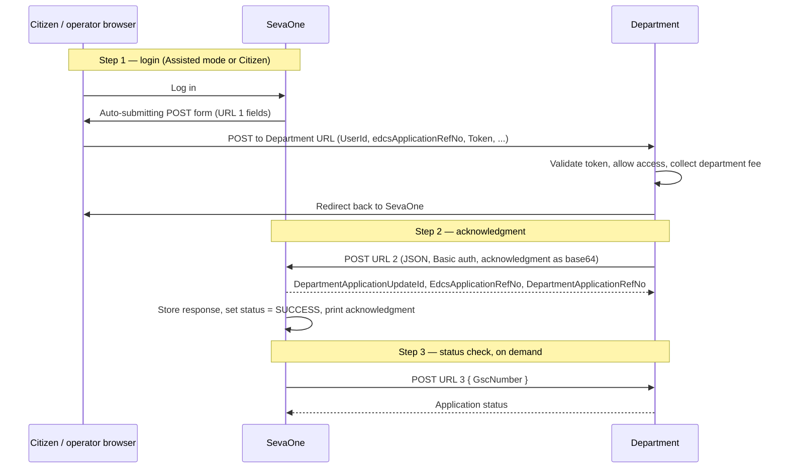

# Department Integration Guide — Token-Based Integration

How a department connects to SevaOne under the **Token-Based Integration** contract
(source: `Token_Based_Integration_V3.pdf`, Seva Sindhu technical integration document, live environment).

> **Status: target contract.** This guide describes the contract in the source document. The
> current SevaOne code (`DeptController`, `PortalDeptFacingService`) still implements the older
> `/api/v1/dept/*` contract. See [§8 Gap from current code](#8-gap-from-current-code). Do not hand
> this guide to a department until the open items in [§7](#7-open-items-the-source-document-does-not-answer) are closed.

---

## 1. Flow at a glance

Three endpoints make up the integration. Two are hosted by the department, one by SevaOne.

| Step | Name in source | Direction | Hosted by | Purpose |
|---|---|---|---|---|
| 1 | URL 1 — Department URL | SevaOne → Department (browser POST form) | **Department** | Hand the citizen (or operator) to the department with a token |
| 2 | URL 2 — Acknowledgment receiver | Department → SevaOne (server-to-server POST, JSON) | **SevaOne** | Report the submitted application, its fee and its acknowledgment |
| 3 | URL 3 — Status check API | SevaOne → Department (server-to-server POST, JSON) | **Department** (or Sakala GSE) | Look up application status by GSC number |



The source flowchart (page 1 of the document) matches this order: login → redirect with token and user
type → department validates token ("API 1") → department fills form and collects fee → redirect to SevaOne
("EDC3") → SevaOne saves the response ("API 2") → status set to SUCCESS and acknowledgment printed.

---

## 2. Login modes

Citizens and operators reach the department through one of two login modes in SevaOne:

| Mode | Who | `assistedmode` value sent in URL 1 |
|---|---|---|
| Assisted mode | Operator (franchise / kiosk) acting for a citizen | `true` |
| Citizen | Citizen logging in directly | `false` |

The source flowchart names the login types as K1 / B1 / G1 / AJSK / BSK. Confirm with the source team
whether those are login types, user types, or both (see [§7](#7-open-items-the-source-document-does-not-answer)).

---

## 3. URL 1 — Department URL (hosted by the department)

**Provider:** Department.

SevaOne sends the citizen's browser to this URL as an auto-submitting **POST form**. The
department's URL must accept the following form inputs and return **HTTP 200** to indicate success.

| Field | Required | Description |
|---|---|---|
| `UserId` | Yes | Citizen / user identifier from SevaOne |
| `edcsApplicationRefNo` | Yes | SevaOne (EDCS) application reference number. Unique per application |
| `Token` | Yes | Token issued by SevaOne for this handoff. Format and lifetime: see §7 |
| `assistedmode` | Yes | `true` or `false` (see §2) |
| `mobile` | Optional | Sent only to departments that need it |
| `digilockerid` | Optional | Sent only to departments that need it |
| `ServiceId` | Optional | Sent only to departments that need it |

Optional fields are sent only to departments that require them. Ask SevaOne which optional fields apply
to your department before you build against this.

**Network rules.** The department's server IP must be whitelisted on SevaOne's server, and SevaOne's
server IP must be whitelisted on the department's servers. Both directions are required.

**Redirect code.** The source document says "Refer to Image 1 for the redirection code." Image 1 is not
included in the document copy we have. See §7.

---

## 4. URL 2 — Acknowledgment receiver (hosted by SevaOne)

**Provider:** EDCS (SevaOne).

After the citizen submits the application on your site, your server posts the final acknowledgment to
this endpoint. This is what marks the application SUCCESS in SevaOne.

```
POST https://<SevaOne host>/<base path>/api/TokenIntegration/department-update
Content-Type: application/json
Authorization: Basic <base64(clientId:clientSecret)>
```

The source document shows the UAT path as
`https://sevasindhu.karnataka.gov.in/EP0115_SevaOne_API_UAT/api/TokenIntegration/department-update`.
Confirm the production host and path before go-live (§7).

### 4.1 Request

```json
{
  "UserId": "12345",
  "DepartmentApplicationRefNo": "RD01112342342",
  "EdcsApplicationRefNo": "EDCS100100000001",
  "Token": "<access_token>",
  "DepartmentPaymentStatus": "Paid",
  "DepartmentFeeCollectionDate": "2024-08-17T10:30:00",
  "DepartmentFee": 10.00,
  "DepartmentPaymentRefNumber": "PAYREF1001",
  "AcknowledgmentFileType": "jpeg",
  "AcknowledgmentDate": "2024-08-17T10:31:00",
  "Acknowledgment": "<base64>"
}
```

| Field | Type | Description |
|---|---|---|
| `UserId` | string | Same `UserId` the citizen was handed in URL 1 |
| `DepartmentApplicationRefNo` | string | The department's own application number |
| `EdcsApplicationRefNo` | string | Same `edcsApplicationRefNo` received in URL 1 |
| `Token` | string | Token received in URL 1 |
| `DepartmentPaymentStatus` | string | Example: `Paid`. Full value list not in the source (§7) |
| `DepartmentFeeCollectionDate` | ISO-8601 datetime | When the department collected the fee |
| `DepartmentFee` | decimal | Amount collected, e.g. `10.00` |
| `DepartmentPaymentRefNumber` | string | Department's payment reference |
| `AcknowledgmentFileType` | string | Example: `jpeg`. Full list not in the source (§7) |
| `AcknowledgmentDate` | ISO-8601 datetime | When the acknowledgment was generated |
| `Acknowledgment` | string | Acknowledgment file, base64-encoded |

### 4.2 Success response

```json
{
  "DepartmentApplicationUpdateId": 1,
  "EdcsApplicationRefNo": "EDCS100100000001",
  "DepartmentApplicationRefNo": "RD01112342342"
}
```

### 4.3 Failure response

```json
{ "Message": "Data Not Inserted" }
```

The source does not state the HTTP status code for failure. Treat any non-success response as a failure
and retry (see §4.4).

### 4.4 Retry behaviour

If URL 2 fails, SevaOne shows the transaction as **`Failed`** until the department successfully calls
URL 2 again. The department must retry until it gets the success response.

Re-sending the same `EdcsApplicationRefNo` after a success is not described in the source (§7).

---

## 5. URL 3 — Status check API (hosted by the department)

**Provider:** Department / Sakala (GSE).

SevaOne calls the department's status-check API with the GSC number.

```json
{
  "GscNumber": "123456"
}
```

The source gives the request shape only. Response shape, HTTP status codes, and auth are not defined (§7).

---

## 6. Error handling summary

| Situation | What happens | What the department does |
|---|---|---|
| URL 1 does not return HTTP 200 | Handoff not confirmed (behaviour not defined in source, §7) | Return 200 only when the form was accepted |
| URL 2 returns `Message: "Data Not Inserted"` or any non-success | SevaOne status = `Failed` | Retry URL 2 until success |
| URL 2 never succeeds | SevaOne status stays `Failed` | Escalate to SevaOne; do not mark the application complete on your side |
| URL 3 unreachable | Status check fails | Retry later |

---

## 7. Open items the source document does not answer

These need answers from the Seva Sindhu / SevaOne side before this guide can be published to a
department. Do not guess them.

1. **Token:** format, lifetime, single-use or not, and how the department validates it. The flowchart says
   "Department to verify the validity of the token received from Sevasindhu," but no validation API is documented.
2. **Redirect code:** "Refer to Image 1 for the redirection code". Image 1 is missing from the document we have.
3. **URL 1 transport:** confirm the form content type (`application/x-www-form-urlencoded` vs multipart) and
   the expected success response beyond HTTP 200.
4. **URL 2 auth:** who issues the Basic-auth `clientId` / `clientSecret`, and whether they are per department.
5. **URL 2 status codes:** HTTP status for success and for failure. The source shows only the response bodies.
6. **URL 2 idempotency:** what happens if the same `EdcsApplicationRefNo` is posted twice (duplicate, update, or reject).
7. **Enumerations:** full lists for `DepartmentPaymentStatus` and `AcknowledgmentFileType`.
8. **URL 3:** the request is defined, the response is not. Confirm who hosts it (department or Sakala GSE), its
   auth, and its status codes.
9. **Login types:** meaning of K1 / B1 / G1 / AJSK / BSK in the flowchart.
10. **Environments:** UAT path is documented; production host and path are not.
11. **IP whitelisting:** the list of IPs to whitelist on each side, and who requests it.

---

## 8. Gap from current code

This section is for SevaOne engineering. Remove it before publishing the guide to departments.

| Area | Current code (`/api/v1/dept/*`) | Target (this guide) |
|---|---|---|
| Citizen handoff | Browser `GET` redirect with `?Token=` to `applyUrl` (`PortalApplyService`) | Auto-submitting `POST` form to the department URL with `UserId`, `edcsApplicationRefNo`, `Token`, `assistedmode`, optional fields |
| Department → SevaOne | `user-details`, `payment-status`, `get-acknowledgement`, `status-update`, `test-token` (`DeptController`) | Single `POST .../TokenIntegration/department-update` (URL 2) |
| Department auth | `ApiKey` header + OAuth2 `client_credentials` Bearer token | HTTP Basic auth (URL 2) |
| Completion return | `returnUrl` with a second one-time token, citizen redirected back to SevaOne | Not in source. Source shows the department redirecting the citizen back, with no token |
| Status to citizen | `status-update` webhook from department | URL 3: SevaOne pulls status by GSC number |
| Token | Encrypted JWS, 30 min, single-use (`DeptTokenGate`) | Not defined in source (§7) |

Work implied by the table above:
- Add the URL 2 endpoint (`TokenIntegration/department-update`) with Basic auth and the request/response shape in §4.
- Add an outbound POST-form handoff for URL 1, replacing the GET redirect in `PortalApplyService`.
- Add a client for URL 3, keyed by GSC number.
- Keep the old `/dept/*` endpoints until every department has moved, then retire them.
- Update the test script (`scripts/test-dept-integration.sh`) and the test-credentials sheet
  (`docs/secrets/dept-integration-test-credentials.md`); both reference the old contract.
