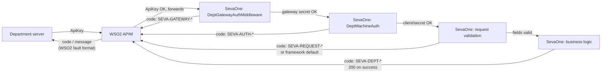

# Department error codes

A department integrating against `/api/v1/dept/*` can hit an error from **three different
layers**, in a fixed order — APIM rejects first, SevaOne's machine-auth check second, SevaOne's
own business logic last. Each layer has its own error shape. Knowing which shape you got tells
you which layer rejected you, before you even look at the code inside it.

**Scope**: this doc covers `/api/v1/dept/*` only. Citizen-facing endpoints (`/api/v1/me`,
`/api/v1/schemes`, etc.) still return `{ "title": "..." }` with no `code` — see
[Why citizen-facing endpoints don't have this yet](#why-citizen-facing-endpoints-dont-have-this-yet)
at the bottom.

## The three layers, in the order a bad request actually gets rejected



| Layer | Who checks it | Example response | Code prefix |
|---|---|---|---|
| 1. APIM gateway | WSO2 APIM itself — request never reaches SevaOne | `{ "code": "900901", "message": "Invalid Credentials", "description": "Invalid Credentials. Make sure you have provided the correct security credentials" }` | numeric, WSO2's own format |
| 2. Gateway-secret | SevaOne, `DeptGatewayAuthMiddleware` — proves the request really came through APIM | `{ "code": "SEVA-GATEWAY-4001", "title": "Request did not come through the department gateway." }` | `SEVA-GATEWAY-` |
| 3. Machine auth | SevaOne, `DeptMachineAuth` — proves *which* department this is | `{ "code": "SEVA-AUTH-4001", "title": "Department machine credentials missing or invalid." }` | `SEVA-AUTH-` |
| 4. Request validation | SevaOne, FluentValidation on the request body | `{ "code": "SEVA-REQUEST-4001", "title": "Validation failed", "errors": [...] }` — or, for a field missing entirely rather than present-but-invalid, ASP.NET's own default shape with **no `code`** at all | `SEVA-REQUEST-` (when present) |
| 5. Business logic | SevaOne, `PortalDeptFacingService` — token/scheme/department validity | `{ "code": "SEVA-DEPT-4001", "title": "Token is invalid or does not belong to this department." }` | `SEVA-DEPT-` |

**The fastest way to tell which layer rejected you**: if `code` is a bare number (`"900901"`),
it's APIM — you never reached SevaOne, don't bother retrying with the same `ApiKey`. If `code`
starts with `SEVA-`, SevaOne ran and rejected you for a specific, documented reason below.

## Layer 1 — APIM gateway fault codes

Not something SevaOne controls the format of — these are WSO2 APIM's own standard fault
response, the same shape for every API on this gateway, not specific to SevaOne. Verified live
against this system:

| HTTP | `code` | `message` | Real cause |
|---|---|---|---|
| 401 | `900902` | `Missing Credentials` | No `ApiKey` header sent at all |
| 401 | `900901` | `Invalid Credentials` | `ApiKey` header sent but not a valid/subscribed key |
| 429 | `900800` | `Message Throttled Out` | Over the department's Bronze-tier rate limit (1000 req/min) or the shared 20K/min gateway ceiling |

Fix: check the `ApiKey` value first — it's generated per-department in APIM's Devportal
(Applications → Production Keys → Generate Key) and stored in the department's own secret
store, never in a repo file. No retry helps until the key itself is fixed.

## Layer 2 — Gateway-secret codes (`SEVA-GATEWAY-*`)

Proves the request genuinely passed through APIM (APIM stamps a header automatically —
departments never send this themselves). Seeing this code at all is unusual: it means either
APIM's header-injection policy isn't wired correctly, or something bypassed APIM and hit
SevaOne's backend port directly.

| Code | HTTP | Meaning |
|---|---|---|
| `SEVA-GATEWAY-4001` | 401 | `X-SevaOne-Dept-Gateway-Secret` missing or doesn't match — this request did not genuinely come through APIM |

`SevaOne.Services/Middleware/DeptGatewayAuthMiddleware.cs:32`

## Layer 3 — Machine-auth codes (`SEVA-AUTH-*`)

Proves *which* department is calling — independent of the `ApiKey` layer above, checked by
SevaOne itself via `X-SevaOne-Dept-Client`/`X-SevaOne-Dept-Secret`, or the equivalent
`Authorization: Basic base64(clientId:clientSecret)` — either form works, SevaOne checks both.

| Code | HTTP | Meaning | Fix |
|---|---|---|---|
| `SEVA-AUTH-4001` | 401 | `X-SevaOne-Dept-Client`/`-Secret` (or Basic auth) missing entirely | Send both headers, or a valid `Authorization: Basic` |
| `SEVA-AUTH-4002` | 401 | Credentials sent but don't match any configured department (wrong client ID, wrong secret, or malformed Basic auth) | Verify with SevaOne's team which `client_id`/`client_secret` pair your department was issued |
| `SEVA-AUTH-4003` | 403 | Request body's `departmentId` doesn't match the department your credentials actually belong to | Don't send `departmentId` in the body at all (it's optional, a cross-check only), or make it match |
| `SEVA-AUTH-4004` | 401 | No departments configured at all on this SevaOne instance (server-side misconfiguration) | Not fixable department-side — contact SevaOne's team |

`SevaOne.Services/Controllers/DeptController.cs:80` (`TryResolveDepartment`) →
`SevaOne.Services/Auth/DeptMachineAuth.cs:16`

## Layer 4 — Request validation (`SEVA-REQUEST-*`)

Both auth layers passed — this is FluentValidation checking the request body's fields before
any business logic runs (`Token` non-empty, `SevaOneUserId` positive, etc.).

| Code | HTTP | Meaning | Fix |
|---|---|---|---|
| `SEVA-REQUEST-4001` | 400 | A required field was present in the JSON body but invalid (empty string, wrong format) | Check the `errors` array in the response — it names the exact field |

**This code does not cover every 400.** A field missing from the JSON body entirely (not sent
at all, as opposed to sent empty) is rejected earlier, by ASP.NET's own automatic model-binding
validation, before FluentValidation — and before this middleware — ever runs. That response has
a completely different, framework-generated shape and **no `code` field**:
```json
{
  "type": "https://tools.ietf.org/html/rfc9110#section-15.5.1",
  "title": "One or more validation errors occurred.",
  "status": 400,
  "errors": { "Token": ["The Token field is required."] },
  "traceId": "00-650ba15af045302dd6591e7386ab3c92-88eab0a55b3becfa-01"
}
```
Both are real, both mean "fix your request body," neither is retryable as-is — the only
practical difference is whether `code` is present. This is a known asymmetry, not a bug to be
worked around silently: unifying it would mean suppressing ASP.NET's default model validation
globally (every controller, not just `/dept/*`), a bigger change than has been made so far.

`SevaOne.Business/Portal/Validators/DeptFacingValidators.cs` — one validator per dept-facing
request DTO, auto-registered via `services.AddValidatorsFromAssembly(...)`
(`SevaOne.Business/DependencyInjection.cs:19`). Wired in per-action in
`SevaOne.Services/Controllers/DeptController.cs` via `await ValidateAsync(request, ct)`, same
pattern already used by `CatalogController.Search`.

## Layer 5 — Business-logic codes (`SEVA-DEPT-*`)

Auth and request validation both passed — this is SevaOne's own validation of the token itself,
or the scheme/department/payment referenced in the request.

| Code | HTTP | Meaning | Where | Fix |
|---|---|---|---|---|
| `SEVA-DEPT-4001` | 401 | Token invalid — decrypt failed, hash not found, already revoked, or belongs to a different department | `user-details`, `payment-status` | Get a fresh token — this one is permanently dead |
| `SEVA-DEPT-4002` | 401 | Token expired — past the 30-minute window | `user-details` | Get a fresh token; the citizen took too long to arrive |
| `SEVA-DEPT-4003` | 401 | Token already used — one-time redeem, this exact token was already spent | `user-details` | Get a fresh token; don't call it twice with the same one |
| `SEVA-DEPT-4004` | 404 | Citizen record not found for this token (internal-data inconsistency) | `user-details` | Not fixable department-side — contact SevaOne's team |
| `SEVA-DEPT-4005` | 404 | `serviceId`/scheme code doesn't match any SevaOne scheme | `user-details`, `get-acknowledgement` | Check the `serviceId` you're sending matches SevaOne's catalog |
| `SEVA-DEPT-4006` | 404 | `departmentId` isn't registered in SevaOne's department catalog | `get-acknowledgement` | Config mismatch on SevaOne's side — contact their team |
| `SEVA-DEPT-4007` | 400 | `status` value on `get-acknowledgement` doesn't match any known status (unrecognized values are treated as `Submitted`, not rejected — this code means the field itself was missing/unparseable, not "unusual value") | `get-acknowledgement` | Send one of `Submitted`/`DocumentVerification`/`UnderReview`/`Approved`/`Rejected` |
| `SEVA-DEPT-4008` | 401 | Token has no payment-status validity window at all (wrong token type sent to `payment-status`) | `payment-status` | This endpoint needs the original apply-token, not a `user-details` result |
| `SEVA-DEPT-4009` | 401 | Past the token's midnight-of-issue-day validity window for `payment-status` | `payment-status` | The payment happened too late relative to when the citizen applied — contact SevaOne's team, this shouldn't normally happen |

`SevaOne.Business/Portal/Services/PortalDeptFacingService.cs` — codes attached at each throw
site via `SevaErrorCodes.Dept.*` (`SevaOne.Domain/Common/SevaErrorCodes.cs`).

## Response envelope

Every SevaOne-origin `/dept/*` error is now:
```json
{ "code": "SEVA-DEPT-4002", "title": "Token has expired. The 30-minute session has ended." }
```
`title` is unchanged from before — human-readable, safe to log or show in an error toast.
`code` is new and additive — the stable thing to branch integration logic on. Once a code
ships, it's permanent: never renumber or reuse one, even if the underlying condition is later
removed, since a department may already be branching on it in production.

## Live-verified examples

Captured directly against this system, through the real APIM gateway
(`https://localhost:8244/sevaone/1.0.0`):

**Missing `ApiKey` (Layer 1, APIM):**
```json
{ "code": "900902", "message": "Missing Credentials", "description": "Invalid Credentials. Make sure your API invocation call has a header: 'Authorization : Bearer ACCESS_TOKEN' or 'Authorization : Basic ACCESS_TOKEN' or 'ApiKey : API_KEY'" }
```

**Invalid `ApiKey` (Layer 1, APIM):**
```json
{ "code": "900901", "message": "Invalid Credentials", "description": "Invalid Credentials. Make sure you have provided the correct security credentials" }
```

**Missing `DeptMachineAuth` (Layer 3, SevaOne):**
```json
{ "code": "SEVA-AUTH-4001", "title": "Department machine credentials missing or invalid." }
```

**Wrong `DeptMachineAuth` secret (Layer 3, SevaOne):**
```json
{ "code": "SEVA-AUTH-4002", "title": "Department machine credentials missing or invalid." }
```

**Empty-string `token` field, present but invalid (Layer 4, SevaOne):**
```json
{ "code": "SEVA-REQUEST-4001", "title": "Validation failed", "errors": [{ "propertyName": "Token", "errorMessage": "'Token' must not be empty." }] }
```

**`token` field missing entirely, not even present in the JSON (also 400, but ASP.NET's own
default shape — no `code`, caught before Layer 4 even runs):**
```json
{ "type": "https://tools.ietf.org/html/rfc9110#section-15.5.1", "title": "One or more validation errors occurred.", "status": 400, "errors": { "Token": ["The Token field is required."] }, "traceId": "00-650ba15af045302dd6591e7386ab3c92-88eab0a55b3becfa-01" }
```

**Invalid token (Layer 5, SevaOne):**
```json
{ "code": "SEVA-DEPT-4001", "title": "Token is invalid or does not belong to this department." }
```

## Why citizen-facing endpoints don't have this yet

Citizen-facing errors (`/api/v1/me`, `/api/v1/schemes`, `/api/v1/apply/return`, etc.) are
consumed by SevaOne's own frontend — same team, same codebase, and the frontend can already
inspect the raw response in the network tab. `/api/v1/dept/*` is the actual external contract
with people who can't read SevaOne's source when something breaks, so it went first. The
underlying mechanism (`DomainException.Code`, optional and additive) already supports adding
codes to citizen-facing exceptions the same way — nothing architecturally blocks widening scope
later, it just hasn't been asked for yet.
