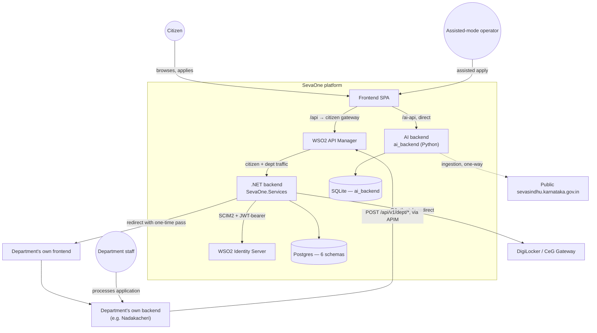
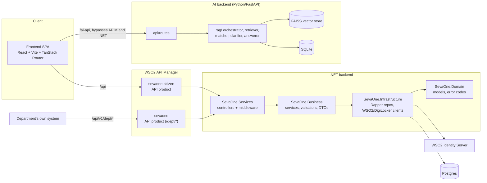
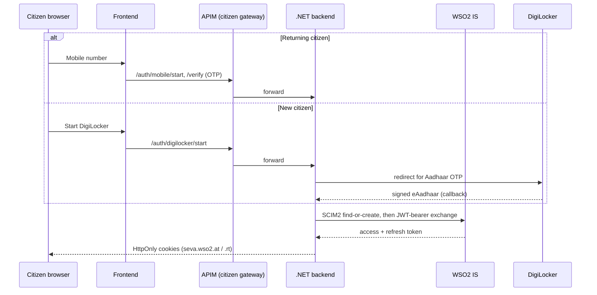
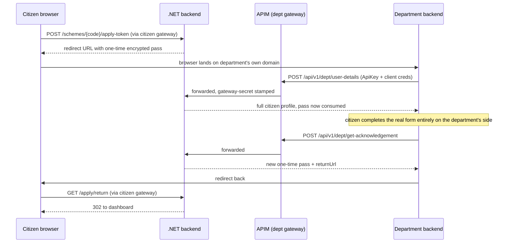
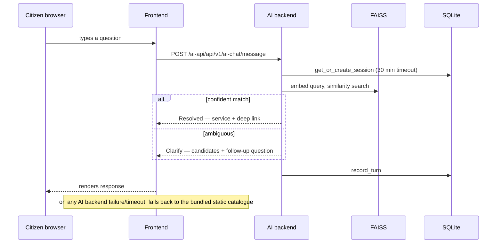
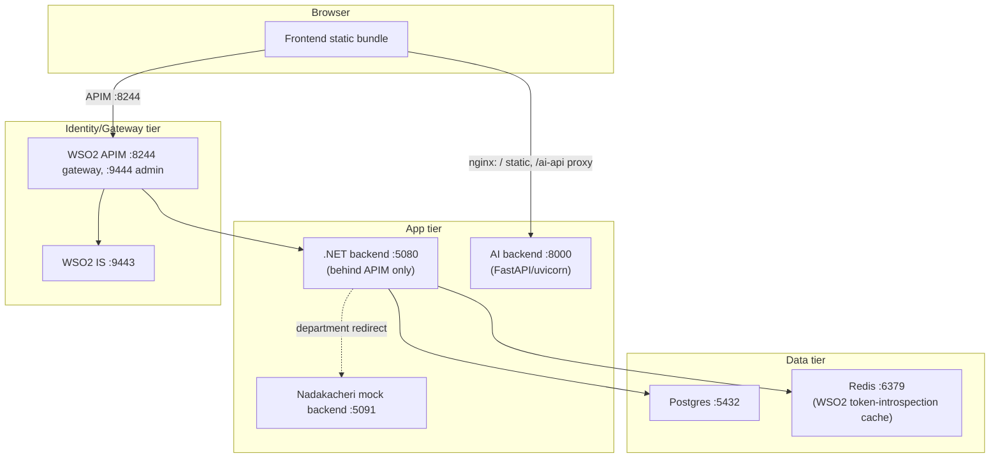

# SevaOne — High-Level Design (Application Architecture)

Verified against the current codebase (all three backend services, the frontend, and the
department reference implementation) — not a proposed design, a description of what's built.

---

## Contents

1. [System context](#1-system-context)
2. [Component architecture](#2-component-architecture)
3. [Tech stack summary](#3-tech-stack-summary)
4. [Major data flows](#4-major-data-flows)
5. [Security architecture](#5-security-architecture)
6. [Data architecture](#6-data-architecture)
7. [Deployment topology](#7-deployment-topology)
8. [Cross-cutting concerns and known seams](#8-cross-cutting-concerns-and-known-seams)

---

## 1. System context

**Four kinds of user**: citizens (self-service), assisted-mode operators (Grama One/Karnataka
One/Bangalore One-style kiosk staff applying on a citizen's behalf), department staff (own
system, own login, entirely outside SevaOne), and department developers (integrate once against
a published contract).

---

## 2. Component architecture

**Independence, stated explicitly**: the AI backend is not a module of the `.NET` backend and
does not call it. It has its own database, its own vector index, and its own ingestion pipelines
reading directly from the public Seva Sindhu site and two Excel trackers. The frontend talks to
it directly over a separate proxy path (`/ai-api`), and falls back to a bundled static catalogue
if it's unreachable. See §8 for why this matters.

---

## 3. Tech stack summary

| Layer | Technology |
|---|---|
| Citizen frontend | React, Vite, TanStack Router, Tailwind |
| `.NET` backend | ASP.NET Core (`SevaOne.Services`), Dapper (no ORM), FluentValidation, AutoMapper |
| AI backend | Python, FastAPI, SQLAlchemy (async), FAISS, `BAAI/bge-m3` embeddings, pluggable LLM (Ollama local / OpenAI) |
| Citizen identity | WSO2 Identity Server — self-hosted, SCIM2 + OAuth2 JWT-bearer |
| Department gateway | WSO2 API Manager — two API products (citizen, department) |
| Primary database | PostgreSQL — 6 schemas, function-only access (no inline SQL, no stored procedures — see the Postgres functions-vs-procedures rationale) |
| AI backend database | SQLite — independent of Postgres |
| Document identity source | DigiLocker (Karnataka CeG Gateway) |
| Reference department integration | `Seva.Mocks.Nadakacheri` (.NET) + its own React frontend |

---

## 4. Major data flows

### 4.1 Citizen identity

### 4.2 Apply → department handoff → return

### 4.3 AI-assisted service discovery

---

## 5. Security architecture

**Two separate APIM API products**, not one shared gateway:
- `sevaone-citizen` — fronts all `/api/*` citizen traffic. Frontend never calls the backend port
  directly; `CitizenGatewayAuthMiddleware` rejects anything that didn't come through this product.
- `sevaone` — fronts all `/api/v1/dept/*` department traffic, protected by three independent,
  stacked checks before any business logic runs:
  1. **APIM's own API key** check (per-department, generated once at onboarding).
  2. **`DeptGatewayAuthMiddleware`** — a shared secret APIM stamps automatically, proving the
     request genuinely passed through the gateway and didn't hit the backend port directly.
     Fails closed outside Development even when unconfigured.
  3. **`DeptMachineAuth`** — department-specific client ID/secret, resolving *which* department
     is calling; a body `departmentId` is a cross-check only, never a source of trust.

**Citizen identity** never touches a WSO2 password — mobile OTP or DigiLocker-verified Aadhaar
OTP proves identity first, and only then does SevaOne provision/exchange for a WSO2 session,
via RFC 7523 JWT-bearer, entirely server-side.

**Department handoff** uses opaque, encrypted, single-use, time-bound tokens — never a shared
session, never a password, never something the department verifies itself. Two different tokens
are minted for the two directions of the trip (apply-token, 30 min; completion-token, 10 min),
so a captured completion redirect can't be replayed as a fresh apply.

**Error contract** — every failure at every layer resolves to a stable, documented code
(`SEVA-GATEWAY-*`, `SEVA-AUTH-*`, `SEVA-REQUEST-*`, `SEVA-DEPT-*`, or APIM's own numeric codes)
so an integrating department can branch on `code`, never on message text.

---

## 6. Data architecture

**Postgres — one database, six schemas**, each owned by a bounded context: `discovery`
(department/service catalog), `portal` (citizens, operators, tokens), `orchestration`
(applications, department sessions), `status` (timelines, payments), `audit` (who-did-what),
`notification` (outbound messages, mostly unused today). Every table has a `uuid` surrogate key,
every foreign key targets a `uuid` (never a business code), and every read/write goes through a
named Postgres function — no inline SQL, no ORM.

**SQLite — a second, independent database**, owned entirely by the AI backend: conversation
sessions/turns, ingested knowledge documents, embedding-chunk-to-vector mappings, and a raw
mirror of one ingestion source. Nothing here is a foreign key into Postgres; the two databases
share no schema, no identifiers, and no sync mechanism.

**FAISS vector store** — local index files on disk, one embedding model (`BAAI/bge-m3`, 1024-dim,
`IndexFlatIP`), separate index files per active knowledge source.

---

## 7. Deployment topology

The AI backend ships its own `Dockerfile`/`docker-compose.yml`, independent of the `.NET`
backend's `docker/` setup — it's deployed and scaled as a completely separate unit. In local
development, WSO2 IS/APIM and Postgres run natively (not containerized); the `.NET` backend, the
AI backend, and both frontends run as separate local processes.

---

## 8. Cross-cutting concerns and known seams

- **Two catalogs, no sync.** Postgres `discovery.sevaone_service_master` (the `.NET` backend's
  own, authoritative service catalog) and the AI backend's SQLite tables (independently ingested
  from the public Seva Sindhu site and two Excel trackers) are not connected — no shared key, no
  sync job, no single source of truth between them. A service can exist, or differ, in one
  without the other knowing.
- **The AI path is best-effort, not load-bearing.** The frontend's AI chat client has a hard
  35-second timeout and falls back to a bundled static catalogue on any failure — the citizen
  journey through the rest of the platform (login, apply, department handoff) has no dependency
  on the AI backend being up at all.
- **One identity provider, two different jobs, kept separate on purpose.** WSO2 IS only ever
  proves citizen identity. WSO2 APIM only ever fronts department traffic. Neither is used for
  the other's job, and departments never receive a citizen's WSO2 tokens.
- **Reference implementation exists for exactly one integration pattern.** `Seva.Mocks.Nadakacheri`
  proves the department contract end-to-end; a second mock (`Seva.Mocks.DepartmentHub`) exists
  in the repo but hasn't been exercised to the same depth.
