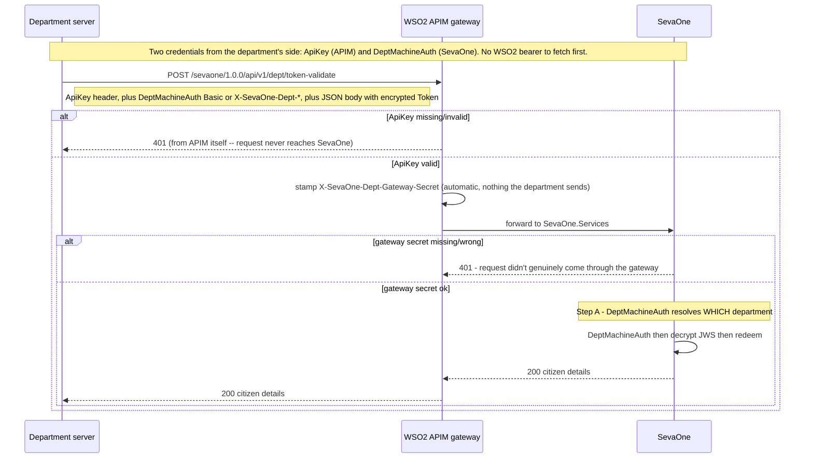
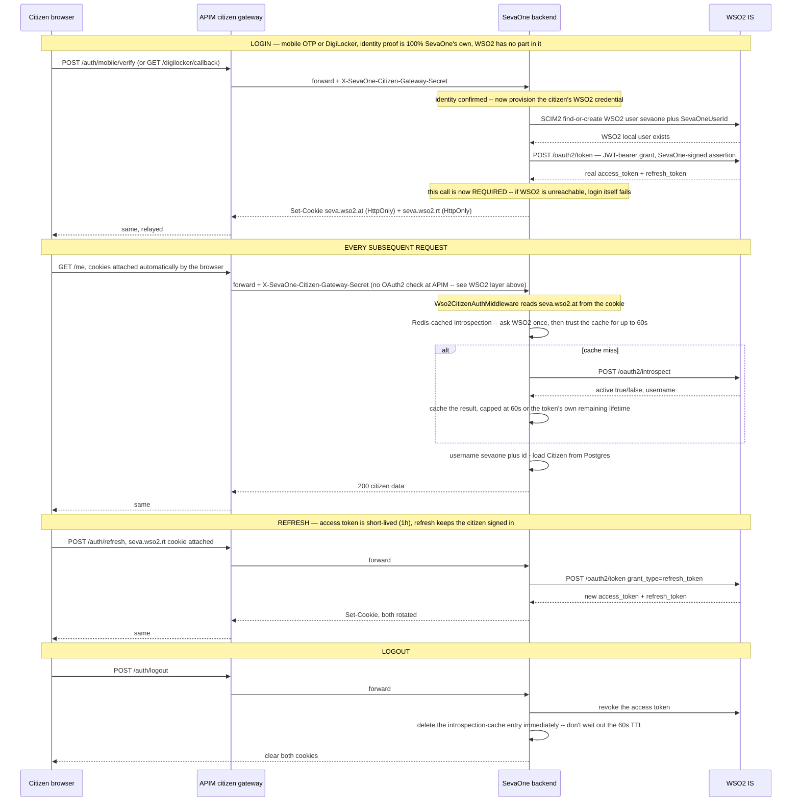
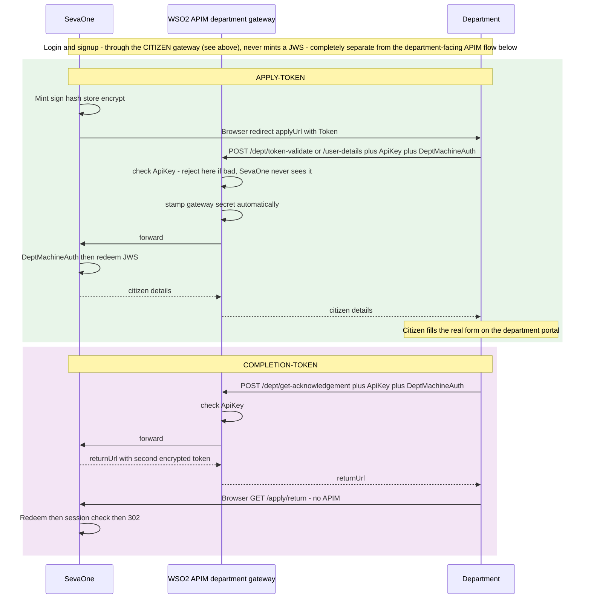
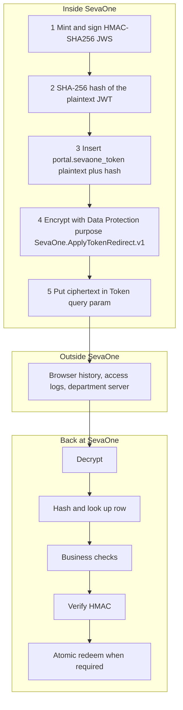
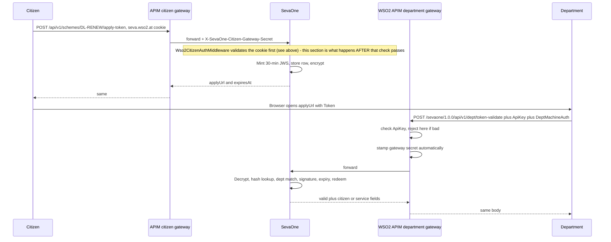
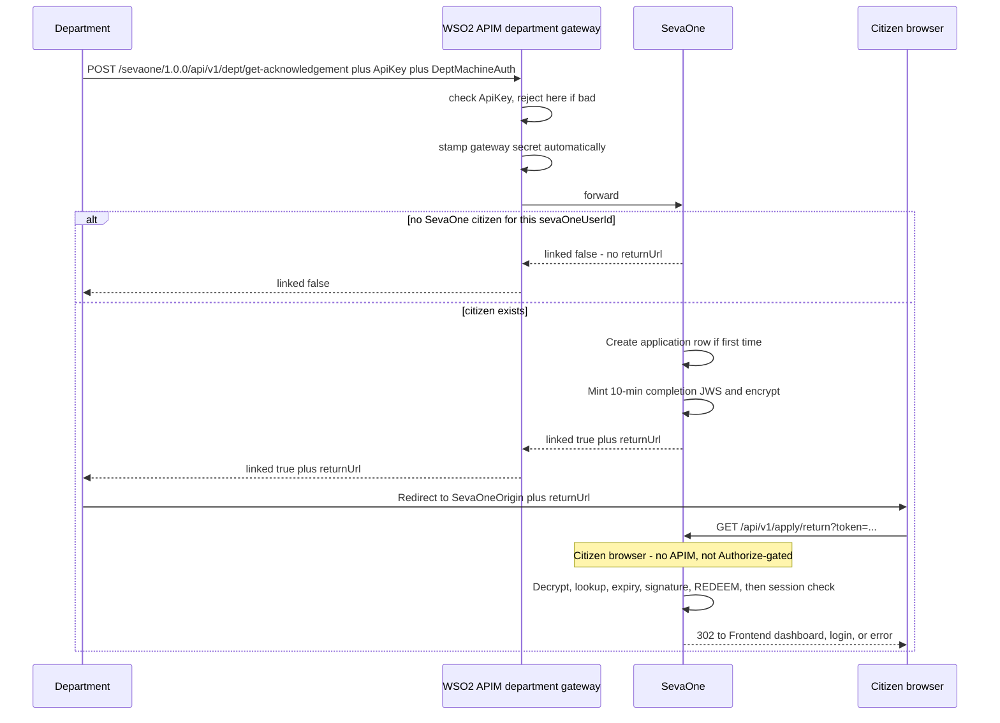

# Token flow

How a citizen is handed from SevaOne to a department portal, and how the different credentials in this system stay out of each other's way.

---

## Start here (the whole story in one pass)

A citizen logs in, browses, and clicks Apply. Two completely different token systems are involved, for two completely different jobs — don't conflate them.

**Citizen ↔ SevaOne, end to end:** the citizen's *only* credential is a real WSO2 IS access/refresh token pair, held in two `HttpOnly` cookies (`seva.wso2.at`/`seva.wso2.rt`) the browser can never read. Every citizen-facing call — login itself, browsing, apply-token, `/me`, everything — now goes through a dedicated APIM gateway (`sevaone-citizen`), same as department traffic already did, though for a different reason (see [WSO2 layer](#wso2-layer---two-gateways-one-pattern) below). SevaOne's backend is the only thing that actually validates the token (Redis-cached WSO2 introspection); APIM's job here is purely "only I can reach the backend" plus a shared-secret stamp on every forwarded request.

**SevaOne → department handoff, when the citizen clicks Apply:**

1. **SevaOne mints an apply-token** (a signed JWT, then encrypted, completely unrelated to the citizen's WSO2 token above). It is put in the department URL as `Token=...`. The citizen's browser goes to the department site.
2. **The department server** calls the department APIM gateway with `Token=` in the request body, plus an `ApiKey` header and `DeptMachineAuth` headers — no WSO2 login step, no bearer to fetch first. **APIM checks `ApiKey` itself** — a bad or missing key is rejected at the gateway, SevaOne never runs. Once that passes, APIM stamps a fixed secret (`X-SevaOne-Dept-Gateway-Secret`) onto the forwarded request, invisibly, before it reaches SevaOne.
3. **SevaOne** checks that gateway-secret stamp first, then `DeptMachineAuth` so it knows *which* department called, decrypts `Token=`, and **redeems the apply-token once**. The department gets the citizen's details and the citizen fills the real form on the department site.
4. When the department is done, it calls SevaOne again (same gateway, same checks — `ApiKey` at APIM, then gateway-secret and `DeptMachineAuth` at SevaOne). SevaOne mints a **new** completion-token. The department redirects the browser to `GET /apply/return`. SevaOne redeems the completion-token and sends the citizen to the dashboard (or login, if their WSO2 token expired and refresh also failed).

Four things that all say "token" and mean different things:

| If you see | Who issued it | Who validates it, and how | What it proves |
|---|---|---|---|
| `seva.wso2.at` / `seva.wso2.rt` cookies | **WSO2 IS**, via a JWT-bearer exchange SevaOne runs on every citizen login | **SevaOne's own backend**, via Redis-cached introspection — never APIM, never the browser | This browser is a logged-in citizen. The *only* citizen credential — nothing else does this job anymore |
| `Token=` on a URL, or JSON `"token"` on `/dept/*` | **SevaOne** (HMAC JWS, then encrypted) | `DeptTokenGate` — decrypt, hash-lookup, verify signature, redeem | This handoff is for this citizen, this department, this service |
| `ApiKey` header on `/dept/*` | **APIM**, per-department (a Devportal Application key) | **APIM itself**, before the request ever reaches SevaOne | This department's application is allowed to call this gateway at all |
| `X-SevaOne-Citizen-Gateway-Secret` / `X-SevaOne-Dept-Gateway-Secret` / `DeptMachineAuth` headers | A fixed shared secret per gateway (citizen or department) / per-department secret (`Jws:DeptClients`) | **SevaOne's own backend** | This request genuinely came through APIM, not a direct call bypassing it (gateway secrets) / this is *which* department (`DeptMachineAuth`) |

The rest of this file is the same story with lifetimes, check order, and why sign **and** encrypt — for the *department-handoff* JWS specifically. The citizen's own WSO2 token mechanics are their own section below.

---

## What this document covers

One citizen application uses **two independent SevaOne JWS tokens**, plus a **third validity rule** on the first token for payment.

| Token | When it is minted | Lifetime | Who redeems it | Job |
|---|---|---|---|---|
| **Apply-token** | Citizen (or operator) calls `POST /api/v1/schemes/{code}/apply-token` | 30 minutes (`expire_at`) | Department, once, via `POST /dept/token-validate` or `/dept/user-details` | Prove this browser was sent to this department for this service |
| **Completion-token** | Department calls `POST /api/v1/dept/get-acknowledgement` | 10 minutes | Citizen browser, once, via `GET /api/v1/apply/return` | Prove the department confirmed completion, then send the citizen home |
| **Payment window** *(orphaned — see [Payment status](#payment-status))* | Same row as the apply-token (`midnight_valid_until`) | Until midnight UTC of the issue day | Not redeemed | Still set at mint time, but nothing reads it anymore — the only endpoint that used it is unreachable |

They share one pipeline (sign, hash, store, encrypt, embed). They are **never reused**. The apply-token is already spent before the completion-token is minted.

These are **not** WSO2 tokens, OTP challenges, or the citizen's session cookies. WSO2 does not mint or decrypt the SevaOne JWS — it plays no role in `/dept/*` at all anymore (see [WSO2 layer](#wso2-layer---two-gateways-one-pattern) below). It only gates **citizen-browser** calls, via `Wso2CitizenAuthMiddleware`, before they reach SevaOne.

---

## WSO2 layer — two gateways, one pattern

WSO2 **Identity Server (IS)** and WSO2 **API Manager (APIM)** are two products. This system runs **two separate APIM APIs** in front of the same backend — one for departments, one for citizens. Both are a network perimeter plus a shared-secret stamp, with SevaOne's own backend doing the identity check that matters (`DeptMachineAuth` / the WSO2 cookie) — but the department gateway also does one *real* credential check of its own at APIM, the citizen gateway doesn't (see why below). WSO2 IS's only remaining job anywhere in this system is minting/refreshing the citizen's own access token (see [Citizen authentication](#citizen-authentication--the-wso2-token-is-the-only-credential) below) — it has no involvement in `/dept/*` at all, `ApiKey` is a pure-APIM construct with zero WSO2 IS behind it.

| | Department gateway (`sevaone`) | Citizen gateway (`sevaone-citizen`) |
|---|---|---|
| **Why it exists** | A network perimeter for an *external* system SevaOne doesn't control — the backend refuses direct connections, only the gateway can reach it | Purely a network perimeter — stop anyone from reaching the backend except through APIM, plus a shared-secret stamp. SevaOne's own first-party traffic, not a third party |
| **Who calls it** | The department's own server, server-to-server | The citizen's browser, on every request |
| **What proves the caller's identity** | Two layers: `ApiKey` (which application is calling, checked by APIM) then `DeptMachineAuth` (which department, checked by SevaOne itself) | The citizen's WSO2 access token — carried in an `HttpOnly` cookie, checked by SevaOne itself |
| **APIM-level auth check** | **Real** — `ApiKey`, operations are `authType: "Application"`, `securityScheme: ["api_key"]`. Bad/missing key never reaches SevaOne | **None** — every operation is `authType: "None"` at APIM |
| **Gateway-stamped secret** | `X-SevaOne-Dept-Gateway-Secret` (`DeptGatewayAuthOptions`), checked by `DeptGatewayAuthMiddleware` before `DeptMachineAuth` runs | `X-SevaOne-Citizen-Gateway-Secret`, checked by `CitizenGatewayAuthMiddleware` before the WSO2 cookie is validated |
| **Rate limit** | `Bronze` subscription tier per department (1000 req/min), plus a shared 20,000 req/min flood cap across the whole gateway | Same 20,000 req/min flood cap, no per-citizen tier (no application context to key off under `authType: "None"`) |

**Why doesn't APIM validate the citizen's identity itself, the way an OAuth2-gated API normally would?** It's structural: APIM's built-in OAuth2 policy checks the `Authorization` header — it has no built-in way to pull a bearer token out of a cookie, which is where the citizen's token has to live (an `HttpOnly` cookie is what keeps it safe from a malicious script on the page; a header the browser sets itself would mean JavaScript can read it). Building that cookie-to-header bridge would need custom Java gateway code. So the citizen gateway's job stays narrow: be the only path in, and stamp every forwarded request with a secret only APIM knows.

**Why does the department gateway get a real APIM-level check, then?** Because `DeptMachineAuth` rides in ordinary headers (`Authorization: Basic` or custom headers) — something APIM *can* actually read, unlike a cookie. Departments used to also fetch a WSO2 `client_credentials` bearer and have APIM introspect it before forwarding, on top of `DeptMachineAuth` — a second, independent proof that added a WSO2 round-trip for comparatively little value, since SevaOne's backend already has to check `DeptMachineAuth` to know *which* department is calling either way. That WSO2 layer was dropped. In its place, each department now gets its own APIM **Application** and a static **`ApiKey`** (see `DEPARTMENT_INTEGRATION_GUIDE.md` and `WSO2_IS_APIM_SETUP.md`'s "Department onboarding" section) — APIM validates that key itself, no WSO2 IS involved, before the request is even forwarded. SevaOne's backend still independently checks `DeptMachineAuth` afterward — the two checks answer different questions ("is this a subscribed application" vs. "which department is this"), so neither one is redundant with the other.

The department does **not** call SevaOne on port 5080 for `/dept/*`. It calls the APIM gateway, for example `https://localhost:8244/sevaone/1.0.0/api/v1/dept/token-validate`. Neither does a citizen's browser call port 5080 anymore — it calls `https://localhost:8244/sevaone-citizen/1.0.0/api/v1/...`. **Port 5080 direct is rejected outright** for both kinds of traffic now (see [Citizen authentication](#citizen-authentication--the-wso2-token-is-the-only-credential) below for the citizen-side proof).

### Department calls: three checks, in this order

**Step 0 — APIM `ApiKey` is the first check, and the only one APIM does itself**

Each department has its own APIM **Application**, subscribed to `SevaOne-API` with a generated `ApiKey`. APIM checks this before forwarding — a bad or missing key never reaches SevaOne at all, and gets WSO2's own error shape back (`code`/`message`/`description`, e.g. `900902 Missing Credentials`), not one of SevaOne's `{ "title": ... }` bodies. See `DEPARTMENT_INTEGRATION_GUIDE.md` for the department-facing detail and `WSO2_IS_APIM_SETUP.md`'s "Department onboarding" section for how a new department's Application/key gets provisioned.

**Step A — SevaOne `DeptMachineAuth` is the second check, and the one that resolves *which* department**

APIM proving "this is a subscribed application, and this came through the gateway" is not enough to know **which department**. SevaOne requires HTTP Basic or `X-SevaOne-Dept-Client` / `X-SevaOne-Dept-Secret` against `Jws:DeptClients`. That resolved `departmentId` is what `DeptTokenGate` matches to the JWS. The JSON body's `departmentId` is a cross-check only. The secret comparison itself is fixed-time (`CryptographicOperations.FixedTimeEquals`), not a plain `string.Equals` — same reasoning as the OTP hash comparisons elsewhere, since this is a real credential and ordinary string comparison leaks timing information byte-by-byte.

Citizen browser hops (`POST /schemes/.../apply-token`, `GET /apply/return`, everything else citizen-facing) go through the **citizen** gateway instead — a different check entirely, see [below](#citizen-authentication--the-wso2-token-is-the-only-credential). `ApiKey`/`DeptMachineAuth` are department-only; the citizen side has its own equivalent secret, checked without an APIM-level credential at all.

Setup and gateway URLs: `WSO2_IS_APIM_SETUP.md`. Full request/response detail for a department integration: `DEPARTMENT_INTEGRATION_GUIDE.md`.

---

## Citizen authentication — the WSO2 token is the only credential

There is **no SevaOne-issued session anymore**. Earlier versions of this system minted their own `seva.sid` cookie backed by a Redis session object; that's gone. Today, the moment a citizen logs in, WSO2 IS mints a real OAuth2 token pair, and *that* — not anything SevaOne itself generated — is the credential every later request presents.

**Why hand session-issuing over to WSO2 instead of keeping SevaOne's own?** So the token is useful beyond SevaOne. A citizen who proves their identity once (DigiLocker or mobile OTP) ends up holding a real, standards-based WSO2 credential that a *different* system — another government department, a future mobile app — could in principle validate directly against WSO2, without going through SevaOne at all and without the citizen re-proving their identity there. See `WSO2_IS_APIM_SETUP.md` for the full statewide-identity rationale.

**What each piece is actually for, in plain terms:**

- **`HttpOnly` cookies, not a header the frontend sets.** A page script can never read `seva.wso2.at`/`seva.wso2.rt` — the browser just attaches them automatically. This is what keeps the real WSO2 token safe from XSS, the same security property `seva.sid` used to have.
- **Redis-cached introspection, not a live WSO2 call on every request.** Asking WSO2 "is this token still good?" on every single citizen action would make WSO2 a hard dependency for all citizen traffic and add real latency. Instead, the backend asks once, caches the answer (`active`, `username`) for at most 60 seconds, and just reads the cache after that. Logout deletes the cache entry immediately so revocation doesn't have to wait out that window.
- **The shared-secret header is not about the citizen at all.** It proves the request came through APIM and not directly to the backend on port 5080 — a citizen (or an attacker) presenting a stolen cookie straight to the backend, bypassing the gateway, gets rejected regardless of whether the cookie itself is valid.
- **Provisioning is now required, not best-effort.** Earlier, if WSO2 was unreachable, login would still succeed using a synthetic placeholder token, and the whole WSO2 step was invisible/dormant. That's gone — `EstablishAsync` now treats a failed WSO2 exchange as a failed login, because the WSO2 token isn't a side feature anymore, it's the actual credential.

**The one-time WSO2-side setup (Trusted Token Issuer registration, the exact `iss`/`aud` matching rules, the citizen APIM gateway config) is documented in full in `WSO2_IS_APIM_SETUP.md` → Citizen authentication.**

---

## End-to-end picture

SevaOne mints the JWS. Login and signup never mint a JWS. WSO2 IS has no role anywhere in this picture — it's only the citizen's own identity provider (see [Citizen authentication](#citizen-authentication--the-wso2-token-is-the-only-credential) above).

---

## The shared pipeline

Every JWS in this document is produced the same way. Signing proves SevaOne wrote it. Encryption hides the claims while the value sits in a URL.

### 1. Mint and sign

`JwsTokenService.Mint` builds a `JwtSecurityToken`:

- **Issuer:** `sevaone` (`Jws:Issuer`)
- **Audience:** department code
- **Claims:** `sub` (SevaOneUserId), `dept_id`, `service_id`, `assisted_mode`, `operator_id`
- **Algorithm:** HMAC-SHA256 with `Jws:SigningKey`

SevaOne is the only party that signs or verifies. The department never receives the signing key.

The JWS is **tamper-evident, not confidential**. Anyone who sees the raw string can base64-read the claims. That is acceptable in `portal.sevaone_token`. It is not acceptable in a URL.

### 2. Hash

`JwsTokenService.ComputeHash` is SHA-256 of the signed JWT string, hex-encoded, stored in `token_hash` (unique index). Lookups never scan the full JWT.

### 3. Database write

`PortalRepository.InsertTokenAsync` stores the **plaintext** JWT plus hash, `expire_at`, optional `midnight_valid_until`, and `return_url` (default `/dashboard`).

Rows are never deleted. Spend is `revoked_at` + `is_active = false`.

### 4. Encrypt for transit

`IApplyRedirectProtector.Protect` (`DataProtectionApplyRedirectProtector`) encrypts the JWT with ASP.NET Core Data Protection (AES), purpose `SevaOne.ApplyTokenRedirect.v1`. That purpose is isolated from `orchestration.department_sessions`, so a stolen key for one cannot unwrap the other.

The department **does not decrypt**. It relays the opaque `Token=` string back to SevaOne.

### 5. Embed

The ciphertext is URL-escaped into `Token=`. `DepartmentID`, `ServiceID`, and `SevaOneUserID` stay plaintext next to it so the department portal can route without calling SevaOne first.

**Why both sign and encrypt?** Signature stops tampering. Encryption stops a URL, log, or Referer header from leaking SevaOneUserId and service identity. If a future department must decrypt itself with its own algorithm, that is a different protector on that connector — not a change to this default.

---

## Apply-token

Minted by `PortalApplyService.MintApplyTokenAsync`.

- Citizen: `POST /api/v1/schemes/{code}/apply-token` (auth: citizen WSO2 token cookie, through the citizen gateway)
- Operator-assisted: `POST /api/v1/operator/apply-token` (auth: SevaOperator, its own separate cookie — not through either APIM gateway) — same token, `assisted_mode=true` and a real `operator_id`

`expire_at` = now + 30 minutes. `midnight_valid_until` = next UTC midnight (set for a payment callback that's now orphaned — see [Payment status](#payment-status)). `return_url` = `/dashboard`.

### Two checks before the JWS is touched

Every `/api/v1/dept/*` call needs `ApiKey` — checked by **APIM itself**, before the request reaches SevaOne — and `DeptMachineAuth` — HTTP Basic or `X-SevaOne-Dept-Client` / `X-SevaOne-Dept-Secret`, matched to `Jws:DeptClients`, checked by **SevaOne**. `ApiKey` proves the calling application is allowed to hit this gateway; `DeptMachineAuth` is **which department** is calling. The SevaOne JWS is not trusted for either. (The gateway-secret stamp runs between the two, see [WSO2 layer](#wso2-layer---two-gateways-one-pattern) above — that's proving the request came through APIM, not identifying the caller.)

### Resolve, then redeem

`DeptTokenGate.ResolveAsync` then `TryRedeemAsync`:

1. Decrypt (`TryUnprotect` — null on failure, never throws) — `redirect_decrypt_failed`
2. Hash lookup — `token_not_found`
3. `is_active` and `revoked_at` — `token_revoked`
4. Token department must equal the **authenticated** client (body `departmentId` is a cross-check only) — `department_mismatch`
5. HMAC verify (`ValidateLifetime = false`; expiry is a caller rule) — `signature_invalid`
6. Caller checks `expire_at` (30 minutes) for validate / user-details
7. `portal.sp_try_redeem_token` — `UPDATE ... WHERE revoked_at IS NULL`. Second caller loses. No read-then-write race.

`token-validate` is for a citizen the department already knows. `user-details` is for a new citizen (masked Aadhaar only, never the hash). Both consume the token. A second call with the same `Token=` fails.

After a successful redeem, the citizen applies on the department site. That is outside SevaOne.

---

## Completion-token

Minted by `PortalDeptFacingService.CompleteApplicationAsync`. Same pipeline, new row, 10-minute `expire_at`, `midnight_valid_until` left null.

The apply-token cannot be reused here: it was already redeemed at `token-validate` / `user-details`.

Before minting, this same call also creates the `orchestration.applications` tracking row if one
doesn't already exist for this citizen+scheme+department (guarded by a unique index against
concurrent duplicate calls) — a token-flow side effect, not part of the token mechanics itself.
See `COMPLETE_FLOW_WITH_PAYLOADS.md` Phase 6 and `DATABASE_SCHEMA.md`'s `orchestration.applications`
section for the full detail.

`GET /api/v1/apply/return` is **not** `[Authorize]`. The handler must distinguish “no cookie” from “wrong citizen”. A blanket 401 would hide that.

`PortalApplyService.CompleteReturnAsync` **redeems before** the session check:

1. Decrypt — `apply.return.decrypt_failed`
2. Hash lookup — `apply.return.token_not_found`
3. Already used — `apply.return.already_used`
4. Past `expire_at` — `apply.return.expired`
5. Signature — `apply.return.signature_invalid`
6. Atomic redeem — race → `apply.return.already_used`
7. Session (`ICurrentCitizen`):
   - none → `apply.return.no_session` → `/login?returnTo=/dashboard`
   - different citizen → `apply.return.citizen_mismatch` → hard reject (stolen return URL)
   - same citizen → `apply.return.success` → frontend + `return_url`

Redeem-first is intentional. The URL is one-shot even if the cookie expired while the citizen was on the department site. Expired session is not treated as an attack; a mismatched session is.

`linked: false` is a normal outcome (citizen logged into the department directly, never through SevaOne). It is not an integration error.

---

## Payment status

**Orphaned, unreachable code — not a live endpoint.** `POST /api/v1/dept/payment-status` (`DeptController.PaymentStatus`) still physically exists in the codebase, but it was deliberately removed from the department APIM gateway's operation list, along with all other payment-related surface, per an explicit decision to keep the department gateway scoped to auth-flow and apply-complete only. There is no route configured for it at APIM, and direct port-5080 access is rejected outright by `DeptGatewayAuthMiddleware` regardless — no department can reach this endpoint through any path today. It is not wired up in `DEPARTMENT_INTEGRATION_GUIDE.md` either.

The `midnight_valid_until` column it used to read is still set at apply-token mint time (see the Apply-token section above), but nothing reads it anymore.

---

## Quick reference

| | Apply-token | Completion-token |
|---|---|---|
| Minted by | `PortalApplyService.MintApplyTokenAsync` | `PortalDeptFacingService.CompleteApplicationAsync` |
| Ciphertext lives in | `applyUrl` `Token=` | `returnUrl` `token=` |
| `expire_at` | 30 min | 10 min |
| `midnight_valid_until` | Next UTC midnight (orphaned, see [Payment status](#payment-status)) | null |
| Decrypt / verify | `DeptTokenGate.ResolveAsync` | `CompleteReturnAsync` |
| Redeem | Yes, atomic | Yes, atomic, then session check |
| Extra check | `ApiKey` (APIM) then department matches `DeptMachineAuth` (SevaOne) | Citizen's WSO2 token identity matches the token's citizen |
| Through APIM? | Mint: citizen gateway. Redeem: department gateway | Mint (`/dept/get-acknowledgement`): department gateway. Redeem (`/apply/return`): citizen gateway |

`VerifySignature` never checks lifetime (`ValidateLifetime = false`) so each caller can apply its own window.

---

## Other “tokens” in this system

`TokenJourneyLog` tags log lines with a stage. Do not mix these with the JWS above.

| Stage | What | Role |
|---|---|---|
| T1 | WSO2 IS access / refresh (OIDC redirect / password grant) | **Deleted.** Legacy citizen login mechanism — the client code, config, and DI wiring were removed entirely, not just retired. The four controller actions (`/auth/login`, `/auth/callback`, `/auth/password`, `/auth/otp`) were themselves deleted from `AuthController.cs`, not left as `410 Gone` stubs — those routes now 404 like any other unmapped path |
| T2 | OTP challenge (`LoginState.OtpHash` in Redis) | Mobile OTP only now — the Email-OTP variant (part of the deleted password-grant flow) is gone with it |
| T3 | `seva.op.sid` | Operator's own opaque Redis session cookie — unaffected by any of this, operators were never on WSO2. (There is no citizen equivalent anymore — see T7) |
| T6 | SevaOne apply-token and completion-token | The JWS in `Token=` — this document |
| T7 | WSO2 IS access / refresh, real, via JWT-bearer exchange | **The citizen's only credential**, held in `seva.wso2.at`/`seva.wso2.rt` `HttpOnly` cookies. See [Citizen authentication](#citizen-authentication--the-wso2-token-is-the-only-credential) above — this replaced T3's old citizen role entirely, it's not a side channel anymore |
| API-KEY | Per-department APIM `ApiKey` (Devportal Application) | **APIM's own real identity check** on `/dept/*`, before SevaOne runs at all — the one credential in this whole table that APIM itself validates, not SevaOne |
| MACHINE | Department `Jws:DeptClients` secret (`DeptMachineAuth`) | SevaOne's real identity check on `/dept/*`, after `ApiKey` (APIM) and the gateway-secret stamp below. Not the only department credential anymore — `ApiKey` is checked first, at APIM |
| CITIZEN-GW | `CitizenGatewayAuth:Secret` (`X-SevaOne-Citizen-Gateway-Secret`) | SevaOne's second gate on every citizen-facing route, after the citizen APIM gateway — proves the request came through APIM, not directly to the backend |
| DEPT-GW | `DeptGatewayAuth:Secret` (`X-SevaOne-Dept-Gateway-Secret`) | SevaOne's second gate on every `/dept/*` route, after the department APIM gateway — same pattern as CITIZEN-GW, stamped by APIM automatically, invisible to the department |

Only T6 has sign → encrypt → embed → decrypt → verify → redeem. Neither gateway-secret stamp (CITIZEN-GW, DEPT-GW) is introspected by APIM — they're both fixed values APIM stamps onto every forwarded request, and SevaOne's own backend is what checks them. API-KEY is different: APIM validates that one itself, against the Application it belongs to — no introspection call, no WSO2 IS involved, just APIM checking its own key store. T7 is the one real OAuth2 token pair left in the system: the backend validates it itself via Redis-cached introspection against WSO2 IS (APIM never sees it — it lives in a cookie, not a header — see [WSO2 layer](#wso2-layer---two-gateways-one-pattern) above).
