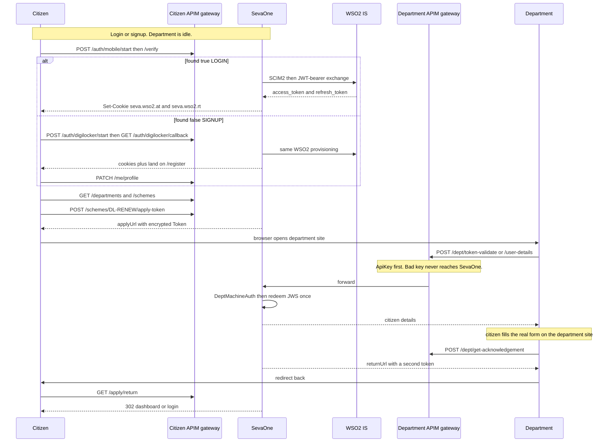
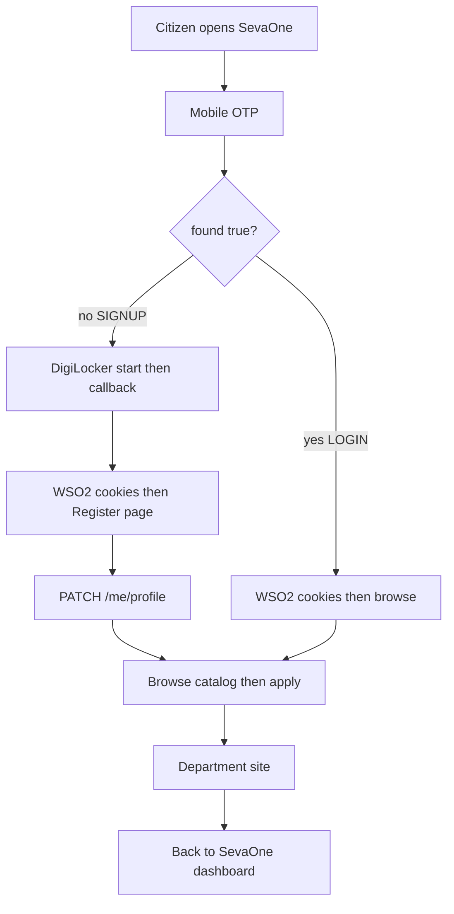
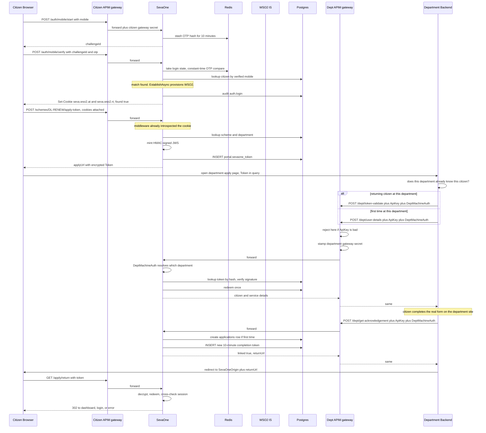
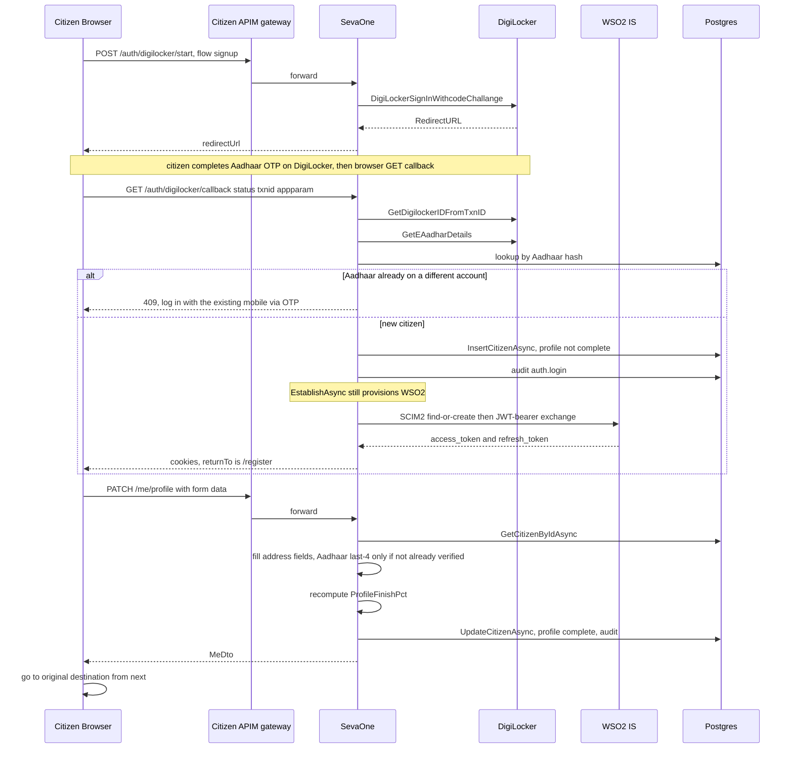
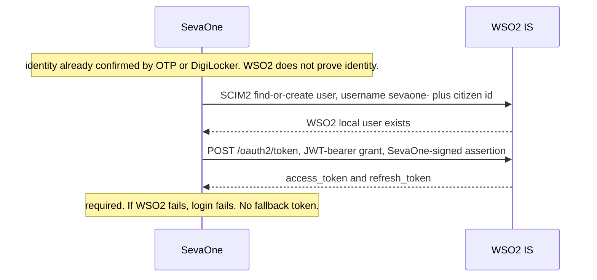
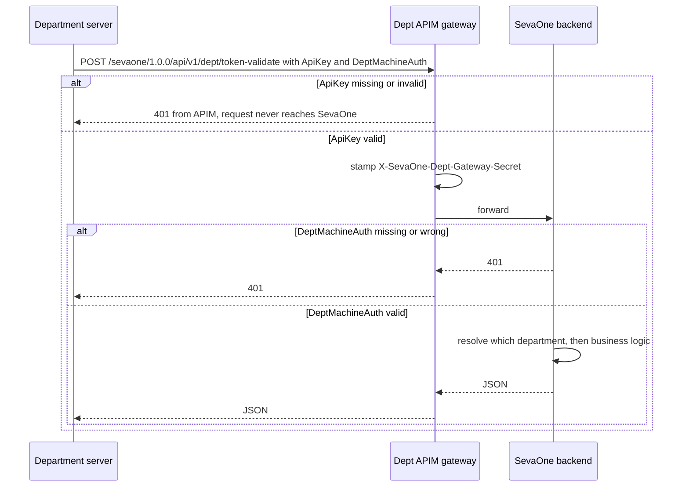

# Citizen journey

What happens from the moment a citizen opens SevaOne until they are back on the dashboard after applying on a department site — and which files in this repo do each step.

Two credentials. Do not mix them up:

| | Citizen login | Department handoff |
|---|---|---|
| What | WSO2 IS access + refresh tokens | SevaOne signed JWT, then encrypted |
| Where | Cookies `seva.wso2.at` and `seva.wso2.rt` (HttpOnly) | Postgres `portal.sevaone_token` |
| Who holds it | The citizen's browser | The department server |
| Lifetime | Access ~1 hour, then refresh | Apply-token 30 min, completion-token 10 min, each used once |
| Who checks it | SevaOne, Redis-cached WSO2 introspection | SevaOne `DeptTokenGate` |
| Proves | This browser is that citizen | SevaOne sent this citizen to this department for this service, once |

There is no `seva.sid` session anymore. Identity is proven by **mobile OTP** (returning citizen) or **DigiLocker** (new citizen). Only after that does SevaOne ask WSO2 for the cookies.



**Login vs signup:** `POST /auth/mobile/verify` with `found: true` sets cookies. `found: false` means no account for that verified mobile — next step is DigiLocker, not another OTP.



**Two gateways:** citizen calls go through `sevaone-citizen` (CG). Department `/dept/*` calls go through `sevaone` (G). CG stamps a shared secret; SevaOne checks the cookie. G checks a per-department `ApiKey`; SevaOne then checks `DeptMachineAuth`.

The numbered sections below are the same journey with the C# call sites.

---

## Quick summary (plain language)

Two short flows below, no code. The numbered sections after them are the same journey with
file and line references.

### A. Login → apply → department

1. Citizen opens SevaOne. If they already have an account and a mobile number on file, they log
   in with a 6-digit OTP sent to that number. If not (first time, or the number doesn't match an
   existing account), they go through DigiLocker instead — a real Aadhaar/OTP consent flow
   hosted by DigiLocker itself, not typed into SevaOne.
2. Either way, **SevaOne proves who the citizen is entirely on its own** — WSO2 has no part in
   confirming identity. Only *after* SevaOne is satisfied does it turn around and ask WSO2 to
   issue the citizen a real, standards-based login token — two cookies in their browser, good
   for about an hour before a silent refresh.
3. Citizen browses services (certificates, licenses, etc.) — no login needed just to browse.
4. Citizen picks one and clicks Apply. SevaOne checks the login cookie is still good, then
   creates a one-time pass — a signed, tamper-proof ticket — good for 30 minutes, usable exactly
   once.
5. Citizen's browser gets redirected to the department's own website, carrying that ticket in
   the link.
6. Department's system calls SevaOne in the background (not through the citizen's browser),
   through a dedicated gateway, and says "here's the ticket, is it real?" Two separate checks
   have to pass before SevaOne even looks at the ticket: a static key only that department has
   (checked by the gateway itself, before SevaOne runs at all), and a second static secret
   (checked by SevaOne) that says *which* department this is.
7. If both check out, and the ticket itself is genuine and unexpired, SevaOne stamps the ticket
   as **used** right then — so if anyone tries to reuse the exact same ticket again, it's
   rejected.
8. SevaOne hands the department the citizen's basic details (name, mobile, etc. — never
   sensitive stuff like full Aadhaar).
9. Department now trusts this citizen and lets them continue applying on the department's own
   site.
10. When the department finishes processing, it tells SevaOne once more, gets a fresh one-time
    pass, and redirects the citizen's browser back to SevaOne, which lands them on their
    dashboard.

### B. First-time registration

1. Citizen goes through mobile OTP (if the number matches nobody, they're routed to DigiLocker
   next) or DigiLocker directly — there's no separate "Sign Up" button; registration happens
   automatically the first time SevaOne sees this identity.
2. SevaOne checks: have we seen this citizen before? No → this is a brand-new citizen.
3. SevaOne creates a bare-bones account right then — whatever the login source actually proved
   (name/mobile from OTP, or name/mobile/DOB/gender/address/real masked Aadhaar from
   DigiLocker). Anything not proven stays empty.
4. This new account is marked **profile incomplete**.
5. SevaOne still provisions the citizen's real WSO2 login token at this point — registration
   being incomplete doesn't block getting a real credential, it only blocks the destination.
6. Instead of sending them to the normal homepage, the frontend sends them to a **Register**
   page — carrying along wherever they originally wanted to go, so they land there once
   registration finishes.
7. Citizen fills in whatever's still missing (address, district, taluk, and — only if DigiLocker
   didn't already provide a *verified* one — the last 4 digits of Aadhaar; SevaOne never stores
   the full number).
8. Citizen submits — SevaOne saves it, marks the profile **complete**, and computes a 0–100%
   "profile completeness" score.
9. A record of "registration completed" gets logged.
10. Citizen lands wherever they originally wanted to go — now as a fully registered citizen,
    free to apply for services.

---

## 1. Citizen signs in

There are exactly two login paths today — both funnel through the same identity-establishment
step (§1c below) and both end with the same real WSO2 token pair set as cookies. There is no
password/OTP-email alternate path, no OIDC browser-redirect path, and no admin/password-grant
fallback anymore — those routes were deleted; they now 404. Why they were removed is in the
note after §1c.

### 1a. Mobile OTP — returning citizens

`AuthController.MobileStart` / `MobileVerify` —
`SevaOne.Services/Controllers/AuthController.cs:43-62`:
```csharp
[HttpPost("auth/mobile/start")]
public async Task<IActionResult> MobileStart([FromBody] MobileStartBody body, CancellationToken ct)
{
    var result = await _auth.StartMobileLoginAsync(new StartMobileOtpRequest(body.Mobile), ct);
    return Ok(new { challengeId = result.ChallengeId });
}

[HttpPost("auth/mobile/verify")]
public async Task<IActionResult> MobileVerify([FromBody] MobileVerifyBody body, CancellationToken ct)
{
    var result = await _auth.VerifyMobileLoginAsync(new VerifyMobileOtpRequest(body.ChallengeId, body.Otp), ct);
    if (result.Found && result.Tokens is not null)
    {
        AppendTokenCookies(result.Tokens);
    }

    return Ok(new { found = result.Found, mobile = result.Mobile, returnTo = result.ReturnTo });
}
```

`PortalAuthService.StartMobileLoginAsync` (`SevaOne.Business/Portal/Services/PortalAuthService.cs:124-144`)
generates a 6-digit OTP, hashes it, stashes the hash + pending mobile in Redis for 10 minutes,
and sends it via `ISmsOtpSender` (currently `LoggedSmsOtpSender` — logs only, no real SMS
provider chosen yet).

`VerifyMobileLoginAsync` (`PortalAuthService.cs:146-197`) checks the OTP with a constant-time
compare (`CryptographicOperations.FixedTimeEquals`, line 164), then looks up a citizen by that
**verified** mobile (`GetCitizenByMobileAsync` — only matches rows where `mobile_verified_at` is
already set). **Mobile OTP is deliberately login-only, not registration**: no match means
`found:false` and no cookies — the frontend routes to DigiLocker instead. A match rebuilds a
`Wso2UserInfo` from the citizen's own existing record and calls the same `EstablishAsync` every
login path uses (line 195, see §1c below).

### 1b. DigiLocker — new citizens, and identity proof

`AuthController.DigiLockerStart` / `DigiLockerCallback`.
Start calls CeG `DigiLockerSignInWithcodeChallange` and returns `redirectUrl`. After DigiLocker
OTP the browser hits `GET /auth/digilocker/callback`. `CompleteDigiLockerLoginAsync` loads the
DigiLocker id via `GetDigilockerIDFromTxnID`, enriches Aadhaar via `GetEAadharDetails` (soft-fail),
then `EstablishAsync` — same shared path as mobile OTP.

**409 Conflict** — if the fetched Aadhaar hash already belongs to a different SevaOne account,
`EstablishAsync` rejects the login with a hint pointing at the existing account's mobile
(`CitizenSessionService.cs:71-82`) rather than silently creating a duplicate account for the
same real person.

### 1c. Session establishment — shared by every login path

`CitizenSessionService.EstablishAsync` — `SevaOne.Business/Portal/Services/CitizenSessionService.cs:55-238`:
- Looks up the citizen by `Wso2Subject` (line 59); if none exists, checks for an Aadhaar-hash
  collision first (line 71-82, the 409 case above), then inserts a new `Citizen` row (line
  84-98) — `ProfileCompleted` starts `false`
- Fills in only what the *this* login source actually proved: mobile is never silently
  overwritten once set (line 116), Aadhaar/DOB/address only ever move from unverified →
  verified, never overwritten with a different value (line 136-161, with a loud
  `auth.aadhaar_mismatch` audit row if a DigiLocker login ever disagrees with an already-verified
  Aadhaar on file)
- Writes `audit.audit_logs` row `action = "auth.login"` (line 211-220)
- **Provisions the citizen's real WSO2 identity and exchanges it for the actual login token** —
  `IWso2CitizenIdentityClient.ProvisionAndExchangeAsync` (line 227-229). This is **required, not
  soft-fail**: if WSO2 is unreachable or the exchange fails, the whole login throws and no
  cookies get set — there's no fallback token, because the WSO2 token *is* the credential now
- Returns the token pair, plus where the browser should land next (`/register?next=...` if the
  profile isn't complete yet)

Back in `AuthController` (`AppendTokenCookies`, `AuthController.cs:114-141`), the token pair
becomes the two `HttpOnly` cookies `seva.wso2.at` / `seva.wso2.rt`.

> **Deleted this engagement, not just retired:** `GET /api/v1/auth/login`,
> `GET /api/v1/auth/callback`, `POST /api/v1/auth/password`, `POST /api/v1/auth/otp` — the old
> WSO2 OIDC browser-redirect flow and the password-grant + Email-OTP fallback. The controller
> actions were deleted outright from `AuthController.cs` (not left as `410 Gone` stubs), along
> with everything they called — `Wso2OidcClient`, `Wso2Options`, `PortalAuthService.PasswordLoginAsync`/
> `CompletePasswordOtpAsync`, the demo-user fallback. Those four routes now `404` like any other
> unmapped path. Password grant plus email OTP never proved identity as strongly as mobile OTP
> or DigiLocker, and the old OIDC browser-redirect mixed WSO2 into identity proof instead of
> keeping it as the session issuer only.

### 1d. Finishing registration

**Submitting the registration form** — `PATCH /api/v1/me/profile` → `AuthController.UpdateProfile`
(`AuthController.cs:106-112`, `[Authorize]`) → `PortalAuthService.UpdateProfileAsync`
(`PortalAuthService.cs:263-314`):
```csharp
citizen.Name = request.Name.Trim();
citizen.Mobile = request.Mobile.Trim();
citizen.Address = request.Address.Trim();
citizen.District = request.District.Trim();
citizen.Taluk = request.Taluk.Trim();
```
A citizen who already has a DigiLocker-verified Aadhaar keeps it — the last-4 field from the
request is only used as a fallback for citizens with no verified Aadhaar source at all
(line 286-290). `ProfileCompleted = true`, `ProfileFinishPct` recomputed
(`ProfileCompleteness.Calculate`, `SevaOne.Business/Common/ProfileCompleteness.cs`), an
`auth.profile.complete` audit row written (line 299-308). No session cache to patch afterward —
`Wso2CitizenAuthMiddleware` loads the citizen fresh from Postgres on every request, so the edit
is visible on the very next call with nothing extra to keep in sync.

---

## 2. Every subsequent request: `Wso2CitizenAuthMiddleware`

`SevaOne.Services/Middleware/Wso2CitizenAuthMiddleware.cs:18-66` — replaces the old
`SevaSessionMiddleware` entirely. Runs on every request:
```csharp
if (context.Request.Cookies.TryGetValue(AccessTokenCookieName, out var token) && !string.IsNullOrWhiteSpace(token))
{
    var result = await introspection.ValidateAsync(token, context.RequestAborted);
    if (result.Active && result.Username.StartsWith("sevaone-", ...) && ...)
    {
        var citizen = await portal.GetCitizenBySevaOneUserIdAsync(sevaOneUserId, context.RequestAborted);
        if (citizen is not null)
        {
            var identity = new ClaimsIdentity([citizen_id, session_id, Name, seva_id claims...], "Seva");
            context.User.AddIdentity(identity);
        }
    }
}
```
Reads `seva.wso2.at`, validates it via `IWso2TokenIntrospectionCache` (Redis-cached WSO2
introspection — ask WSO2 once, trust the cache for up to 60 seconds, not a live call on every
request), then loads the citizen fresh from Postgres off the token's `username` claim. No JWT
parsing here — the cookie value is opaque to SevaOne, WSO2 is the only party that actually
understands it. `SevaAuthHandler` (`SevaOne.Services/Auth/SevaAuthHandler.cs`) is still the thin
`[Authorize]`-scheme wrapper on top, unchanged.

Every citizen-facing route — including `/auth/mobile/start` and login itself — goes through the
citizen APIM gateway (`sevaone-citizen`). A direct call to the backend port is rejected.

---

## 3. Citizen browses the catalog and requests to apply

`GET /api/v1/departments`, `/api/v1/schemes`, `/api/v1/search`, `/api/v1/schemes/{code}` —
`SevaOne.Services/Controllers/CatalogController.cs:22-39`, all anonymous, backed by
`CatalogService` (`SevaOne.Business/Discovery/Services/CatalogService.cs`). `/departments`,
`/schemes`, and `/schemes/{code}` are served from an in-process 5-minute `IMemoryCache` inside
`CatalogService` — this data changes rarely, so repeat browsing skips Postgres entirely after
the first hit. `/search` is deliberately not cached (query-driven, not repeat-friendly).

Once the citizen picks a scheme: **`POST /api/v1/schemes/{code}/apply-token`** —
`CatalogController.cs:41-44`, `[Authorize]`-gated (needs the WSO2 cookie from §2 to have
validated).

---

## 4. Minting the department handoff token (JWS)

`PortalApplyService.CreateApplyTokenAsync` → `MintApplyTokenAsync` —
`SevaOne.Business/Portal/Services/PortalApplyService.cs:44-183`:
1. Resolve the authenticated citizen (`_current.CitizenId`, line 46-52) and the target
   scheme/department (line 73-76)
2. Reject if the scheme/department is inactive. Pick a deep link for the audience
   (`DeeplinkOperatorUrl` falling back to `DeeplinkCitizenUrl` when assisted, else
   `DeeplinkCitizenUrl` directly); if that's blank, fall back further to `HomepageUrl` with no
   token minted, and only throw `ConflictException` if that's blank too (line 78-104)
3. Compute expiries — 30-minute normal expiry (line 89); a `midnightValidUntil` column is still
   set (line 93) but nothing reads it anymore, see §9 below
4. **Mint the JWS**:
```csharp
var (tokenValue, tokenHash) = _jws.Mint(new JwsClaims(
    SevaOneUserId: citizen.SevaOneUserId,
    DepartmentId: department.Code,
    ServiceId: scheme.ServiceCode,
    AssistedMode: assistedMode,
    OperatorId: operatorCode,
    IssuedAt: now,
    ExpireAt: expireAt));
```
(`PortalApplyService.cs:95-102`)

`JwsTokenService.Mint` — `SevaOne.Infrastructure/Security/JwsTokenService.cs:19-43`. Builds an
HMAC-SHA256-signed JWT (`sub`=SevaOneUserId, `dept_id`, `service_id`, `assisted_mode`,
`operator_id`, `aud`=department code, `iss`="sevaone"), and separately computes a SHA-256 hex
**hash** of the finished token string (`ComputeHash`, line 45-46) — the hash, not the raw JWS,
is what gets indexed in Postgres.

5. Insert a `portal.sevaone_token` row (`PortalApplyService.cs:104-124`) — `TokenValue` +
   `TokenHash` + expiries, `IsActive=true`, `RevokedAt=null`
6. Write an audit log row (`action="apply.token.issued"`, line 126-137)
7. Build the redirect URL to the department's own apply page, with the **encrypted** token
   embedded as a query param (line 146-152) — the JWS itself is only signed
   (tamper-evident), not confidential, so it's encrypted via `IApplyRedirectProtector`
   (ASP.NET Core Data Protection/AES) before it ever touches a URL, browser history, or an
   access log

---

## 5. Browser is handed off to the department

The frontend redirects the citizen's browser to `applyUrl` above — the department's own site.
SevaOne's WSO2-token cookies never leave the citizen's browser and play no further part from
here; the department only ever sees the four query params, most importantly the encrypted
`Token`.

---

## 6. Department calls back into SevaOne — machine authentication

Everything from here on is **server-to-server** (department backend → SevaOne backend), not the
citizen's browser. There is no `[Authorize]`-gated citizen cookie on these calls
(`DeptController.cs:10-17`). Two independent checks stack at two layers. Departments used to
fetch a WSO2 `client_credentials` bearer as well; that step is gone. `ApiKey` at APIM is what
replaced it:

**Check #1 — APIM `ApiKey`, before SevaOne runs.** Each department has its own APIM Application
and a static `ApiKey`. A bad or missing key is rejected by APIM — SevaOne never sees the request.

**Check #2 — SevaOne `DeptMachineAuth`, which department.**
`DeptMachineAuth.TryAuthorize` — `SevaOne.Services/Auth/DeptMachineAuth.cs:16-80`. Accepts
either HTTP Basic (`Authorization: Basic base64(client_id:client_secret)`) or the
`X-SevaOne-Dept-Client` / `X-SevaOne-Dept-Secret` header pair, matched against the configured
`Jws:DeptClients` list. Returns the `DepartmentId` the caller is allowed to act as — **not**
whatever the request body claims.

Called from `DeptController.TryResolveDepartment` — `DeptController.cs:80-102`, invoked at the
top of every dept-facing action. If the body *does* include a `DepartmentId`, it's cross-checked
against the authenticated client's own department and rejected on mismatch (line 90-97) — the
body value is a sanity check, never the source of truth. The secret comparison itself is
fixed-time (`CryptographicOperations.FixedTimeEquals`, `DeptMachineAuth.cs:82-83`), not a plain
`string.Equals`, for the same timing-side-channel reason as the OTP hash comparisons in §1a.

APIM also stamps `X-SevaOne-Dept-Gateway-Secret` onto every forwarded request, checked by
`DeptGatewayAuthMiddleware` before `DeptMachineAuth` — so a direct call to the backend port
fails even with a valid department secret.

---

## 7. One-time redemption (the atomic part)

Both Token Validate and Get User Details are meant to work **exactly once** — the department
establishes its own local session off this one call, so a replayed token must fail the second
time. `DeptTokenGate.TryRedeemAsync` — `SevaOne.Business/Portal/Services/DeptTokenGate.cs:74-75`:
```csharp
public Task<bool> TryRedeemAsync(SevaOneToken token, CancellationToken ct) =>
    _portal.TryRedeemTokenAsync(token.Id, _clock.UtcNow, ct);
```
delegates to `PortalRepository.TryRedeemTokenAsync` —
`SevaOne.Infrastructure/Repositories/Portal/PortalRepository.cs:188-196`, which calls the
Postgres function `portal.sp_try_redeem_token(@tokenId, @redeemedAt)` and returns whether it
actually flipped the row (`is_active = false`, `revoked_at` set) — an atomic
`UPDATE ... WHERE revoked_at IS NULL` inside the function, so if two requests race to redeem the
same token, only one can win; the other gets `Success = false`. This is a Postgres function
rather than a Dapper `UPDATE` so the flip is one statement inside the database — two racing
HTTP requests cannot both see `revoked_at IS NULL` and both succeed.

`DeptTokenGate.ResolveAsync` (`DeptTokenGate.cs:32-72`) runs first — decrypt, hash-lookup,
active/revoked check, department match, HMAC signature verify — then each caller (§8a/§8b below)
enforces its own `ExpireAt` window before calling `TryRedeemAsync`.

---

## 8a. Token Validate — department already knows this citizen

`POST /api/v1/dept/token-validate` → `DeptController.ValidateToken` (`DeptController.cs:32-41`)
→ `PortalDeptFacingService.ValidateTokenAsync` —
`SevaOne.Business/Portal/Services/PortalDeptFacingService.cs:99-140`:
1. `_gate.ResolveAsync` (line 101)
2. Check the 30-minute `ExpireAt` window explicitly (line 108-112)
3. `_gate.TryRedeemAsync` (line 114) — one-time redeem; replay → `ForbiddenException`
4. Look up the scheme's `ServiceCode` and, if Assisted Mode, the operator's business code
   (line 120-126)
5. Return `ValidateTokenResult` (line 132-139) — this is what the department uses to open its
   own 30-minute session

## 8b. Get User Details — department does NOT yet know this citizen

`POST /api/v1/dept/user-details` → `DeptController.GetUserDetails` (`DeptController.cs:43-52`)
→ `PortalDeptFacingService.GetUserDetailsAsync` — `PortalDeptFacingService.cs:55-96`. Same
resolve → expiry-check → one-time-redeem sequence (line 57-76) as Token Validate, then
additionally:
- Records that this citizen is now known to this department: `UpsertDeptUserRefAsync`
  (line 81-89) — `ON CONFLICT DO NOTHING` upsert into `orchestration.dept_user_ref`
- Returns a **minimized** citizen profile (line 95) — masked Aadhaar only, never the hash

---

## 9. Department finishes, sends the citizen back

`POST /api/v1/dept/get-acknowledgement` → `DeptController.CompleteApplication` (`DeptController.cs:69-79`)
→ `PortalDeptFacingService.CompleteApplicationAsync` — `PortalDeptFacingService.cs:151-261`.
Mints a **second, separate, 10-minute** one-time completion token (the original apply-token was
already spent in §8a/§8b), and — the first time this is called for a given
citizen+scheme+department — creates the `orchestration.applications` tracking row Phase 7 and
the status webhook both read from (line 174-220). `linked:false` (no `ForbiddenException`,
line 158-165) is a normal outcome when the citizen has no SevaOne relationship at all, not an
integration error.

The citizen's browser is redirected to the returned `returnUrl`, which lands on
`GET /api/v1/apply/return` — decrypts, hash-looks-up, checks expiry, verifies signature,
**atomically redeems**, then cross-checks the browser's *current* session against the token's
citizen (`PortalApplyService.CompleteReturnAsync`, `PortalApplyService.cs:165-234`). A missing
session is treated as "expired while on the department's site" (→ login); a session that
resolves to a *different* citizen than the token is the real attack case, flagged distinctly as
`apply.return.citizen_mismatch` (line 221-229) rather than a generic rejection.

> **`POST /api/v1/dept/payment-status` (`DeptController.PaymentStatus`) is orphaned, unreachable
> code, not a live endpoint.** It still physically exists (`DeptController.cs:54-64` →
> `PortalDeptFacingService.PostPaymentStatusAsync`, `PortalDeptFacingService.cs:264-313`), but it
> was deliberately removed from the department APIM gateway's operation list along with all
> other payment-related surface — there is no route configured for it at APIM, and direct
> port-5080 access is rejected outright regardless. No department can reach it through any path
> today. The `midnight_valid_until` column it used to read is still set at apply-token mint
> time (§4), but nothing reads it anymore.

The department can also push a plain status update independent of the token-based calls above —
`POST /api/v1/internal/webhooks/status`, a shared-secret header
(`X-Seva-Webhook-Secret`/`Seva:WebhookSecret`), not `DeptMachineAuth` or APIM — but it only
resolves anything because `get-acknowledgement` already created the tracking row.

---

## 10. Logout — closing department sessions too

`POST /api/v1/auth/logout` → `AuthController.Logout` (`AuthController.cs:64-72`) →
`PortalAuthService.LogoutAsync` — `PortalAuthService.cs:199-249`. Walks every still-open
`orchestration.department_sessions` row for that citizen (line 209-227) and best-effort closes
each — a *separate* concept from the JWS apply-token handoff, used by the direct-connector
integration mode (`POST /api/v1/departments/{code}/sessions`). Then revokes the WSO2 access
token itself and deletes its introspection-cache entry immediately, so revocation doesn't wait
out the cache's own TTL (line 246-247), and writes an `action="auth.logout"` audit row
(line 229-237, only if a citizen was actually resolved from the cookie in the first place).

---

## FAQ: identity vs department-ticket responsibilities

**Does WSO2 confirm the citizen's identity, or just issue a token?** Just the token, and only
*after* the fact. Mobile OTP and DigiLocker are what actually prove who the citizen is — 100%
SevaOne's own logic (§1a/§1b), zero WSO2 involvement. Only once SevaOne is already satisfied
does it ask WSO2 (via SCIM2 find-or-create + a JWT-bearer token exchange) to issue a real,
standards-based credential the citizen then presents on every later request. WSO2 never talks to
the department either, and never even knows the department-facing JWS exists.

| | Who issues it | Who checks it | WSO2 involved? |
|---|---|---|---|
| Citizen credential | WSO2 IS, after SevaOne already confirmed identity | SevaOne's own backend, via cached introspection | Yes — that's its whole remaining job |
| Department ticket (JWS) | SevaOne | SevaOne, whenever a department asks | No — never, at any point |

**Why doesn't the department validate directly against WSO2 instead of going through SevaOne?**
1. **WSO2 doesn't know what "department" or "scheme" means.** No concept of "30-minute window"
   or "one-time use" — those are SevaOne's own business rules, never told to WSO2.
2. **Departments aren't registered with WSO2 at all**, and never have been for this specific
   handoff — only SevaOne's own citizen-identity app talks to WSO2. Every department only ever
   needs a static `ApiKey` (from APIM) and a `DeptMachineAuth` secret (from SevaOne) — no WSO2
   client of their own to register or rotate.
3. **Only SevaOne can enforce "used once."** The one-time-redemption rule lives in SevaOne's own
   Postgres table (§7). WSO2 has no ledger of which department tickets have been redeemed — it
   isn't aware they exist, so it could never stop a replay.
4. **Keeps departments fully decoupled from the citizen identity provider.** If a department
   were wired directly to WSO2 for anything, swapping identity providers later would mean
   touching every department integration. Departments only ever talk to SevaOne.

**If the citizen never fills out anything on the department's own site, how does the department
"register" them?** This is exactly what Get User Details (§8b) is for, versus Token Validate
(§8a) — first-time-at-this-department gets the fuller profile and no form typed by the citizen;
every later visit uses the cheaper Token Validate call instead, since the department already has
a local record.

---

## Sequence diagrams

Same journey as the numbered sections, split so each picture has one job. Left side is SevaOne
(citizen, citizen gateway, backend, WSO2, Redis, Postgres). Right side is the department
(department gateway, department backend).

### Login (mobile OTP) then apply then department



### DigiLocker signup — new citizen



### WSO2 provisioning — inside every EstablishAsync



### Department gateway — ApiKey then DeptMachineAuth

No WSO2 IS in this chain. Departments used to fetch a `client_credentials` bearer first; that
step is gone. Today the whole story is `ApiKey` at APIM plus `DeptMachineAuth` at SevaOne.


