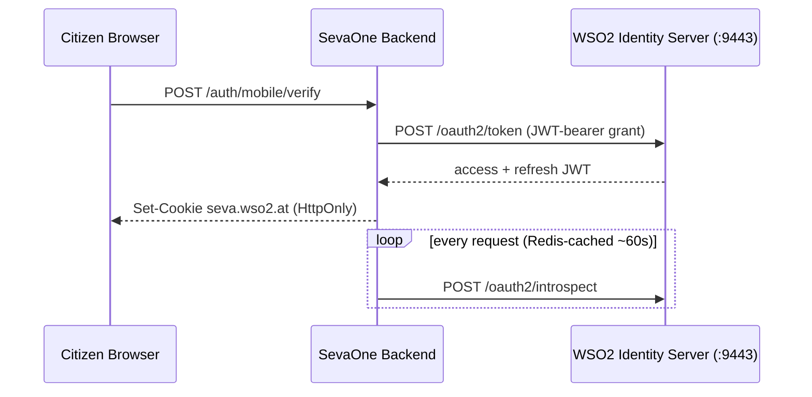
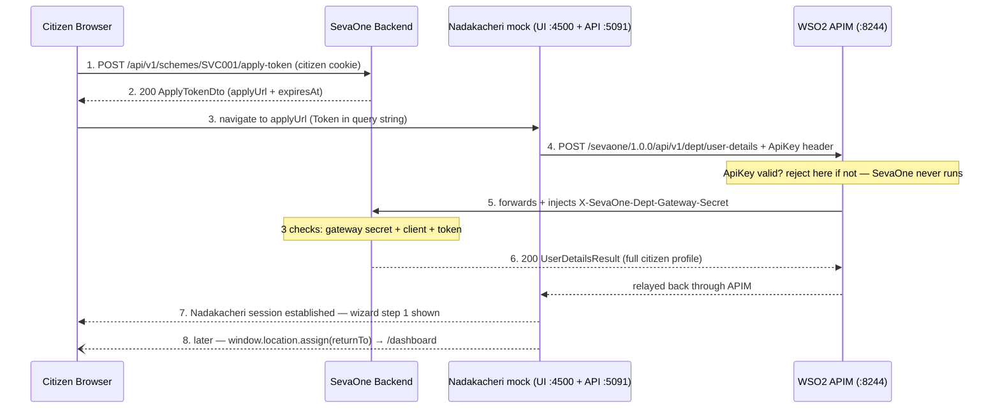

# WSO2 IS + APIM — how login and department handoff actually work

Two separate WSO2 products do two separate jobs here. **Identity Server (IS)** is the citizen's
identity provider — it issues the cookie that keeps a citizen logged into SevaOne. **API Manager
(APIM)** is the gateway a *department's own backend* calls through to reach SevaOne — it's what
stands between a department server and your API, checking a key before your code ever runs.

Nothing about department traffic ever touches WSO2 IS, and nothing about citizen login ever
touches APIM. Keep that split in mind for everything below.

## Open these tabs for a live demo

| # | URL | Why |
|---|-----|-----|
| 1 | `http://localhost:5174` | SevaOne — citizen app |
| 2 | `http://localhost:5080/dev/otp-inbox` | watch OTPs live, no log grepping |
| 3 | `https://localhost:9443/console` | WSO2 IS — citizen users live here (`admin`/`admin`) |
| 4 | `https://localhost:9444/devportal` | APIM Devportal — where departments are provisioned (`admin`/`admin`) |
| 5 | `https://localhost:9444/carbon` | APIM Admin — throttling tiers, Key Manager |

## 1. The mental model

| System | Job | Who talks to it | Proves |
|---|---|---|---|
| **WSO2 IS** | Citizen identity provider — issues/refreshes/introspects the access token behind SevaOne's session cookie. | Only SevaOne's own backend calls it directly. A citizen's browser never talks to IS. | "This browser is logged in as this citizen." |
| **WSO2 APIM** | API gateway a department's server calls through to reach SevaOne's `/api/v1/dept/*` endpoints. Rejects bad callers before SevaOne ever runs. | Only a department's backend calls it. A citizen's browser never talks to it either. | "This server really is *this* department, allowed to call SevaOne." |

## 2. Flow A — citizen login (WSO2 IS)

Mobile-OTP for a returning citizen, shown here — DigiLocker is the same shape with an extra hop
through CeG for a *new* citizen, then it lands on the same `EstablishAsync` call.



1. **Citizen submits OTP** — `POST /api/v1/auth/mobile/verify` → `PortalAuthService.VerifyMobileLoginAsync`
   `SevaOne.Business/Portal/Services/PortalAuthService.cs:198`
2. **Citizen record found-or-created, WSO2 user resolved** — merges DB fields (name/mobile/aadhaar/address), finds-or-creates the citizen's WSO2 IS user via SCIM2.
   `SevaOne.Business/Portal/Services/CitizenSessionService.cs:55` (`EstablishAsync`)
3. **SevaOne exchanges a signed assertion for real tokens** — `POST https://localhost:9443/oauth2/token`, JWT-bearer grant (not password grant). Returns an access + refresh token pair.
   `SevaOne.Infrastructure/ExternalAuth/Wso2CitizenIdentityClient.cs`
4. **Tokens land in two HttpOnly cookies** — `seva.wso2.at` (access) and `seva.wso2.rt` (refresh), never readable by page JS.
   `SevaOne.Services/Middleware/Wso2CitizenAuthMiddleware.cs:20`
5. **Every later request is validated by introspection, not re-login** — `POST /oauth2/introspect` via `IWso2TokenIntrospectionCache`, cached in Redis so this isn't a live WSO2 round-trip on every click.
   `SevaOne.Services/Middleware/Wso2CitizenAuthMiddleware.cs:30`

## 3. Flow B — Apply → department handoff (WSO2 APIM)

This is the "click Apply now, land on the department's own portal" flow. APIM sits *between* the
department's server and SevaOne — it never sits between the citizen and anything.



Steps 4–6 are the part that was broken today: the mock was skipping APIM (step 4) entirely and
calling step 6 directly, which the gateway-secret check now correctly rejects.

1. **Citizen (already logged in) clicks Apply now** — frontend mints a one-time JWS apply-token, scoped to this citizen + this service.
   `frontend/src/pages/PortalHandoff.tsx:68` (applyToken mutation) → `SevaOne.Business/Portal/Services/PortalApplyService.cs:70` (`MintApplyTokenAsync`)

   **Response** (`ApplyTokenDto`, `SevaOne.Business/Portal/DTOs/ApplyDtos.cs:8`):
   ```json
   {
     "applyUrl": "http://localhost:4500/apply?DepartmentID=revenue&ServiceID=SVC001&SevaOneUserID=8&Token=CfDJ8O9cJcDtiy1AkmAaFS6k4yjCKdpD1FSLsJ32VsIfB2dwcKDMoljpM6d9t07pjbwbVQC7UEg6kHt2dvYjhikaS45mV8V2pD9-5UlNiL6JvCMx28kPvxDHKd9LyhxTKNixwPGSookxo6whWjqUzrXrpxHalUfBVkkfCHYecg3TIP45vX37oGvSgHoCF1E7DBVHLOD4boPhotc2Hk9jvfRmFzUkeKgQ9iUN_YX51YjSr8oAowsmoXsFKCOUgoolUPpn3ZLcKl8q51jVlnuxhXlab4gDYX376BZntJa3nTeUBhllyt0Jw9PyTgQmVYq8kuOK38ygz5s83TjQrQCkA6D69E9VMQtxGURVnWU0I6nfMnsqWi1g9Jdf45E8AMTF36tBoYMQRLeKNfs-aTKBetZVRV4aa2H-70Bg5FY-0ttXe7259qI3KdD-qV1DhiBGaVXa1NCHBfuasqWKw1ydvCmpdMdDRHePEaA7DoFYgMatL3qBNSJ8MaYVbqV4PT9hTtqLPQ",
     "expiresAt": "2026-08-18T12:19:29.4590210+00:00"
   }
   ```
   `Token` is the encrypted, one-time JWS — SevaOne mints and encrypts it, the department never
   decrypts it, only relays it back verbatim in step 4. `SevaOneUserID` and `DepartmentID`/`ServiceID`
   in the URL are informational hints for the department UI; the *authoritative* identity comes
   back from SevaOne itself in step 6, only after `Token` is verified.

2. **applyUrl is built from the scheme's own configured deep link** — `discovery.sevaone_service_master.deeplink_citizen_url` (or `deeplink_operator_url` for an operator-assisted apply, falling back to the citizen one if that's blank) + `DepartmentID` / `ServiceID` / `SevaOneUserID` / `Token` query params appended. If neither deep link is configured yet, SevaOne skips minting a token entirely and sends the browser to `homepage_url` instead.
   `SevaOne.Business/Portal/Services/PortalApplyService.cs:169-172`
3. **Browser navigates there directly** — `window.location.assign(target)`, same tab.
   `frontend/src/pages/PortalHandoff.tsx:107`
4. **Department portal UI reads the query string and redeems it** — calls its *own* backend, never SevaOne directly; the citizen's browser never sees a SevaOne credential.
   `Mocks/nadakacheri/src/lib/sso.ts:107` (`redeemSevaHandoff`) → `App.tsx:236` (bootstrap effect)
5. **Department backend calls SevaOne *through APIM*, not directly** — `POST https://localhost:8244/sevaone/1.0.0/api/v1/dept/user-details` with an `ApiKey` header — this is the one APIM checks itself, before SevaOne ever runs.
   `Mocks/Seva.Mocks.Nadakacheri/Program.cs:195-208` (`RedeemHandoffAsync`)

   **Request headers**, sent by the department's backend:
   ```
   ApiKey: eyJ4NXQjUzI1NiI6...  (this department's APIM key — see §5)
   X-SevaOne-Dept-Client: nadakacheri_portal
   X-SevaOne-Dept-Secret: nadakacheri_secret
   Content-Type: application/json
   ```
   **Request body**:
   ```json
   {
     "token": "CfDJ8O9cJcDtiy1AkmAaFS6k4yjCKdpD1FSLsJ32VsIfB2dwcKDMoljpM6d9t07pjbwbVQC7UEg6kHt2dvYjhikaS45mV8V2pD9-5UlNiL6JvCMx28kPvxDHKd9LyhxTKNixwPGSookxo6whWjqUzrXrpxHalUfBVkkfCHYecg3TIP45vX37oGvSgHoCF1E7DBVHLOD4boPhotc2Hk9jvfRmFzUkeKgQ9iUN_YX51YjSr8oAowsmoXsFKCOUgoolUPpn3ZLcKl8q51jVlnuxhXlab4gDYX376BZntJa3nTeUBhllyt0Jw9PyTgQmVYq8kuOK38ygz5s83TjQrQCkA6D69E9VMQtxGURVnWU0I6nfMnsqWi1g9Jdf45E8AMTF36tBoYMQRLeKNfs-aTKBetZVRV4aa2H-70Bg5FY-0ttXe7259qI3KdD-qV1DhiBGaVXa1NCHBfuasqWKw1ydvCmpdMdDRHePEaA7DoFYgMatL3qBNSJ8MaYVbqV4PT9hTtqLPQ",
     "departmentId": "revenue",
     "serviceId": "SVC001",
     "sevaOneUserId": "8"
   }
   ```
6. **APIM injects the gateway secret, SevaOne runs its own two checks** —
   (a) `X-SevaOne-Dept-Gateway-Secret` proves the request really came through APIM,
   (b) `X-SevaOne-Dept-Client`/`-Secret` proves *which* department,
   (c) the JWS token itself — signature, expiry, one-time redeem.
   `SevaOne.Services/Middleware/DeptGatewayAuthMiddleware.cs:32` → `SevaOne.Services/Auth/DeptMachineAuth.cs:16` → `SevaOne.Services/Controllers/DeptController.cs:32`

   **Response 200** (`UserDetailsResult`, `SevaOne.Business/Portal/DTOs/DeptFacingDtos.cs:7`) —
   every field this call can possibly return, in the exact order SevaOne serializes them:
   ```json
   {
     "sevaOneUserId": 8,
     "sevaId": "SO1234KA",
     "name": "Samarth D Shetty",
     "mobile": "9740017809",
     "email": null,
     "aadhaarMasked": "XXXX-XXXX-5939",
     "dateOfBirth": "2001-10-06",
     "gender": "Male",
     "stateName": "Karnataka",
     "districtName": "Dharwad",
     "taluk": "Dharwad",
     "villageName": "Keshwapur",
     "address": "Flat No 21, 2nd floor, Kuteer Apartment, Bhaavani Nagar, Hubli Keshwapur",
     "returnUrl": "http://localhost:5174/dashboard"
   }
   ```
   `email` is `null` here because this citizen never supplied one — every field the citizen
   didn't provide/verify comes back `null`, not omitted; don't assume a field is always present.
   `aadhaarMasked` is the only Aadhaar-shaped field ever returned — the real Aadhaar hash never
   leaves SevaOne. This is the exact response the Nadakacheri mock now parses field-by-field
   (`Mocks/Seva.Mocks.Nadakacheri/Program.cs:238-247`) and forwards into its own wizard form.

   **`POST /api/v1/dept/token-validate`** (returning-citizen path, called instead of
   `user-details` once the department already has a `DEPT_USER_REF` for this citizen) returns a
   smaller, different shape — no profile fields at all, since the department captured those the
   first time:
   ```json
   {
     "valid": true,
     "sevaOneUserId": 8,
     "serviceId": "SVC001",
     "assistedMode": false,
     "operatorId": null,
     "expiresAt": "2026-08-18T12:49:29.4590210+00:00",
     "returnUrl": "http://localhost:5174/dashboard"
   }
   ```
7. **Later: department tells SevaOne the application is done** — same APIM path, different endpoint — mints a one-time *return* token so the citizen's own browser can redirect back and resume its SevaOne session.
   `SevaOne.Services/Controllers/DeptController.cs:69` (get-acknowledgement) → `SevaOne.Services/Controllers/ApplicationsController.cs:68` (apply/return, citizen-facing)
   *Not currently wired by the mock* — it fabricates a reference number locally and does a bare `window.location.assign` back to `/dashboard` instead of calling `get-acknowledgement` first. The endpoint and the citizen-facing redeem both work; nothing calls the mint step yet.

   **Request** the mock *would* send, if it called this:
   ```json
   {
     "departmentId": "revenue",
     "sevaOneUserId": 8,
     "serviceId": "SVC001",
     "status": "Submitted",
     "acknowledgementId": "KAR-REV-1042"
   }
   ```
   **Response 200** (`CompleteApplicationResult`, `SevaOne.Business/Portal/DTOs/DeptFacingDtos.cs:61`):
   ```json
   {
     "linked": true,
     "returnUrl": "/api/v1/apply/return?token=CfDJ8BsUrJGGgzZPjteto41HVaEh00rlYfCnEdazLRv8W0puIrAev7NSMO87zoU-Cumxw9ENpoMHqh9YhrmzFVHsMTTyKFz79WlYB0hjyJRHNql0bDGorlrDEYvYAeK0_dL9Zo-X77yRnj_UILj67Hy2I4yhixhe4_pkSsWJlfJpfn3DMIA8cjNgT70hKBymO49VapMIwzF9f7mNjdAmTjLUybX7W0AFLdM-8pqim2agyf156mD5teCFoKJf1XpQNftFZH3vgImN5Y1MwyJz0_TJ2W-PFALUFvHn6LGAvH78ueOm",
     "expiresAt": "2026-08-18T12:59:29.4590210+00:00"
   }
   ```
   The department redirects the citizen's browser to `{SevaOneOrigin}` + this `returnUrl` verbatim
   — never decrypt `token=`, just append and 302. If the citizen has no SevaOne relationship at
   all (never came through an apply-token handoff), this instead returns
   `{ "linked": false, "returnUrl": null, "expiresAt": null }` — not an error, just nothing to
   redirect back to.

## 4. Where a department is "registered" — three different places

These answer three different questions and none of them substitute for another.

| Place | Answers | Where |
|---|---|---|
| **Postgres** (business data) | Display name, portal domain, which services it offers, whether it's "integrated" at all. | `discovery.department_master` — `department_id='revenue'`, `portal_domain='nadakacheri.karnataka.gov.in'`, `is_integrated=true` |
| **APIM Devportal** (gateway identity) | Who's allowed to call `/api/v1/dept/*` through the gateway at all, at what rate. | an **Application** named `SevaOne-Dept-Revenue`, subscribed to the `SevaOne-API` product on the `Bronze` tier — `https://localhost:9444/devportal` → Applications |
| **SevaOne appsettings** (machine identity) | Which department a given client_id/secret pair is allowed to claim to be — the `DeptMachineAuth` check, independent of APIM entirely. | `Jws:DeptClients` array — `SevaOne.Services/appsettings.json` |

`SevaOne.Services/appsettings.json`:
```json
"Jws": {
  "DeptClients": [
    { "ClientId": "nadakacheri_portal", "ClientSecret": "nadakacheri_secret", "DepartmentId": "revenue" },
    { "ClientId": "health_dept_portal",  "ClientSecret": "health_dept_secret",  "DepartmentId": "health"  }
  ]
}
```

## 5. Generating a department's ApiKey

The Application already exists per department (created once). Generating a fresh key is the
one-command part — this is exactly what was run to fix today's handoff. All three responses
below are the real, current data for the `SevaOne-Dept-Revenue` Application on this system —
fetched live from `https://localhost:9444/api/am/devportal/v3`, not fabricated examples.

**Step 1 — create the Application** (one-time, per department):
```powershell
curl -k -u admin:admin -X POST "https://localhost:9444/api/am/devportal/v3/applications" `
  -H "Content-Type: application/json" `
  -d '{"name":"SevaOne-Dept-Revenue","throttlingPolicy":"Unlimited","tokenType":"JWT","description":"Nadakacheri/Revenue department server - APIM API-key application"}'
```
**Response 200**:
```json
{
  "applicationId": "d10496ad-1bf0-4c38-a84b-a2516a93fb2a",
  "name": "SevaOne-Dept-Revenue",
  "throttlingPolicy": "Unlimited",
  "description": "Nadakacheri/Revenue department server - APIM API-key application",
  "tokenType": "JWT",
  "status": "APPROVED",
  "groups": [],
  "subscriptionCount": 0,
  "keys": [],
  "attributes": {},
  "owner": "admin",
  "hashEnabled": false,
  "createdTime": "1787023500435",
  "updatedTime": "1787023500435",
  "visibility": "PRIVATE"
}
```
`applicationId` is what steps 2 and 3 below need — it's the Application's permanent identity in
APIM, distinct from `discovery.department_master`'s own `id` (Postgres) and `DepartmentId` in
`Jws:DeptClients` (SevaOne's machine-auth config) — three separate identifiers for the same
department, per §4 above.

**Step 2 — subscribe it to `SevaOne-API`, Bronze tier**:
```powershell
curl -k -u admin:admin -X POST "https://localhost:9444/api/am/devportal/v3/subscriptions" `
  -H "Content-Type: application/json" `
  -d '{"applicationId":"d10496ad-1bf0-4c38-a84b-a2516a93fb2a","apiId":"597a4e89-8c70-4183-ab6f-9d111e1f85e3","throttlingPolicy":"Bronze"}'
```
**Response 200**:
```json
{
  "subscriptionId": "c52dadc5-4d5a-4348-93ba-75e2f0f8f7dd",
  "applicationId": "d10496ad-1bf0-4c38-a84b-a2516a93fb2a",
  "apiId": "597a4e89-8c70-4183-ab6f-9d111e1f85e3",
  "apiInfo": {
    "id": "597a4e89-8c70-4183-ab6f-9d111e1f85e3",
    "name": "SevaOne-API",
    "context": "/sevaone",
    "version": "1.0.0",
    "type": "HTTP",
    "lifeCycleStatus": "PUBLISHED",
    "throttlingPolicies": ["Bronze"],
    "isSubscriptionAvailable": true
  },
  "throttlingPolicy": "Bronze",
  "status": "UNBLOCKED"
}
```
`status: "UNBLOCKED"` means the subscription is live immediately — no separate approval step on
this system. `throttlingPolicies: ["Bronze"]` on the API itself confirms Bronze is a tier this
API actually offers; requesting a tier the API doesn't publish would 400 here.

**Step 3 — generate the ApiKey** (note the `/generate` suffix — a bare `.../api-keys/PRODUCTION`
POST 404s):
```powershell
curl -k -u admin:admin -X POST `
  "https://localhost:9444/api/am/devportal/v3/applications/d10496ad-1bf0-4c38-a84b-a2516a93fb2a/api-keys/PRODUCTION/generate" `
  -H "Content-Type: application/json" `
  -d '{"validityPeriod":315360000,"additionalProperties":{}}'
```
**Response 200**:
```json
{
  "apikey": "<header>.<payload>.<signature>",
  "validityTime": 315360000
}
```
`apikey` is a signed JWT itself — three dot-separated base64url segments — and this doc
deliberately does **not** print the real encoded value (it's a live, working credential; pasting
it into a git-tracked file would leak it the moment this doc is pushed). What's actually useful
to see is what's *inside* it once decoded — the header:
```json
{
  "x5t#S256": "MWUxYmNkZWIwYTQ2NDcyMTUwYzU1NTQyYTljYzAyZjM5NDgxZTVkZDFlNmVhNDkzYzgyYjAyM2NiZTAzYjQ0Yw==",
  "kid": "gateway_certificate_alias",
  "typ": "JWT",
  "alg": "RS256"
}
```
and the payload:
```json
{
  "sub": "admin@carbon.super",
  "application": { "id": 33, "uuid": "d10496ad-1bf0-4c38-a84b-a2516a93fb2a" },
  "iss": "https://localhost:9444/oauth2/token",
  "keytype": "PRODUCTION",
  "exp": 2102413459,
  "token_type": "apiKey",
  "iat": 1787053459,
  "jti": "cb4065e0-22fb-4ebe-b968-9603ef39991a"
}
```
This is exactly why a bad or forged key never reaches SevaOne: APIM verifies the `RS256`
signature against its own gateway certificate on every request — no database lookup, no network
call, just signature math — and the `application.id`/`uuid` pair inside is how it knows which
Application (and therefore which department) the key belongs to. `exp` (`2102413459` = year
2036) reflects `validityTime: 315360000` seconds — 10 years, chosen deliberately long for this
dev/PoC setup so the key never needs rotating mid-demo; a real production integration would use
a much shorter validity and a rotation process. There is no reliable way to revoke a single
already-issued API-key JWT after the fact (unlike an OAuth2 access token, it isn't looked up in
a database — it's self-verifying) — treat generating one as handing out a long-lived secret, not
a temporary code.

This is exactly the value that goes into `Seva:DeptApiKey` (or whatever config key the
department's own server reads it from — see §6 below) and gets sent as the literal `ApiKey:`
header on every `/dept/*` call.

Same three steps, click-by-click instead of curl: `https://localhost:9444/devportal` →
Applications → Add New Application → subscribe to `SevaOne-API` → Production Keys tab →
Generate Key. The key is shown **once** in the UI — copy it straight into the department's own
secret store, never into a repo file.

## 6. The 3 credentials, and exactly where each one lives

This is the part that's easy to conflate — three different secrets, three different owners,
three different checkers.

### ApiKey
- **Proves:** "this server is a real, subscribed department"
- **Checked by:** WSO2 APIM itself — SevaOne's code never sees this value
- **Owned by:** the department's own system
- **Stored at (mock):** `dotnet user-secrets` for `Seva.Mocks.Nadakacheri`, key `Seva:DeptApiKey`
- **Used in code:** `Mocks/Seva.Mocks.Nadakacheri/Program.cs:199`

### Gateway secret
- **Proves:** "this request genuinely passed through APIM"
- **Header:** `X-SevaOne-Dept-Gateway-Secret`
- **Set by:** APIM's own header-modification policy — automatic, nothing the department sends
- **Checked by:** `DeptGatewayAuthMiddleware.cs:32`
- **Stored at (SevaOne):** `dotnet user-secrets` for `SevaOne.Services`, key `DeptGatewayAuth:Secret`

### Machine client
- **Proves:** "specifically *which* department this is"
- **Headers:** `X-SevaOne-Dept-Client` / `-Secret`
- **Checked by:** `DeptMachineAuth.cs:16` — independent of APIM entirely
- **Stored at (SevaOne):** `Jws:DeptClients` in appsettings.json (dev-only plaintext defaults)
- **Stored at (mock):** `Seva__DeptClientId`/`Seva__DeptClientSecret` env vars, defaults `nadakacheri_portal`/`nadakacheri_secret` baked into `Program.cs:127-128`

**Today's fix, in this language:** the mock had **ApiKey** pointed at nothing (calling SevaOne
on `:5080` directly, skipping APIM) — so it never had a chance to earn the **Gateway secret**,
which is only ever handed out by APIM. Pointing `Seva:BffBaseUrl` at
`https://localhost:8244/sevaone/1.0.0` and generating a real ApiKey closed that gap.

### Reading these user-secrets yourself

`dotnet user-secrets` needs to be run from inside the project folder, or pointed at its
`.csproj` with `--project` — running it from anywhere else (e.g. your home folder) fails with
`Could not find a MSBuild project file in '...'`.

```powershell
# SevaOne backend — DeptGatewayAuth:Secret, CitizenGatewayAuth:Secret, DigiLocker keys
dotnet user-secrets list --project "C:\Users\ishuk\Downloads\SevaOneMono\SevaOneMono\backend\SevaOne.Services\SevaOne.Services.csproj"

# Nadakacheri mock — Seva:DeptApiKey
dotnet user-secrets list --project "C:\Users\ishuk\Downloads\SevaOneMono\SevaOneMono\backend\Mocks\Seva.Mocks.Nadakacheri\Seva.Mocks.Nadakacheri.csproj"
```

Same `--project` flag works for `set`/`remove` too:

```powershell
dotnet user-secrets set "Seva:DeptApiKey" "<value>" --project "C:\Users\ishuk\Downloads\SevaOneMono\SevaOneMono\backend\Mocks\Seva.Mocks.Nadakacheri\Seva.Mocks.Nadakacheri.csproj"
```

Or `cd` into the project folder first and drop `--project` entirely:

```powershell
cd "C:\Users\ishuk\Downloads\SevaOneMono\SevaOneMono\backend\SevaOne.Services"
dotnet user-secrets list
```

## 7. Full URL reference

**Runtime** — hit automatically during the flows above, nobody opens these by hand.

| URL | Who calls it |
|---|---|
| `https://localhost:9443/scim2/Users` | SevaOne backend only, during `EstablishAsync` — find-or-create the citizen's WSO2 user |
| `https://localhost:9443/oauth2/token` | SevaOne backend only — mints the cookie pair, and on `/auth/refresh` |
| `https://localhost:9443/oauth2/introspect` | SevaOne backend only, Redis-cached — citizen session validation |
| `https://localhost:8244/sevaone/1.0.0/api/v1/dept/...` | Department's server — token-validate, user-details, get-acknowledgement |
| `https://localhost:8244/sevaone-citizen/1.0.0/api/v1/...` | Citizen's browser — every citizen-facing call, via the citizen gateway |

**Management** — where *you* go to provision or inspect the system. Nobody in a real
citizen/department journey ever opens these.

| URL | For |
|---|---|
| `https://localhost:9443/console` | WSO2 IS Console — inspect a citizen user (`sevaone-{id}`) directly |
| `https://localhost:9444/devportal` | Create a department Application, subscribe it, generate its ApiKey |
| `https://localhost:9444/publisher` | Edit the API definition itself — operations, security, throttling tiers |
| `https://localhost:9444/carbon` | Admin — throttling policy definitions, Key Manager registration |
| `https://localhost:9444/api/am/devportal/v3` | Scriptable Devportal — the curl commands above |

## 8. Querying the auth tables directly

Everything above is provable in Postgres. Two ways to run the same queries below — pick whichever's open.

**pgAdmin4** — connect once, then paste any query block below straight into the Query Tool
(right-click the `sevaone` database → Query Tool):

| Field | Value |
|---|---|
| Host name/address | `localhost` |
| Port | `5432` |
| Maintenance database | `sevaone` |
| Username | `sevaone` |
| Password | `sevaone` |

**psql** — same queries, from a terminal. All commands assume `PGPASSWORD=sevaone` is set and
use the local `psql` at `C:\Program Files\PostgreSQL\17\bin\psql.exe`:

```powershell
$PSQL = "C:\Program Files\PostgreSQL\17\bin\psql.exe"
$env:PGPASSWORD = "sevaone"
& $PSQL -h localhost -U sevaone -d sevaone -c "<query>"
```

### `portal.sevaone_user` — the citizen record itself

The row a WSO2 IS login resolves to. `mobile_verified_at` is what gates the "known mobile → OTP
signs you in directly" branch vs. "unknown mobile → DigiLocker" — `NULL` here means WSO2 IS will
never be able to skip straight to a session for that mobile.

```sql
SELECT sevaone_user_id, wso2_subject, mobile, mobile_verified_at, aadhaar_hash IS NOT NULL AS aadhaar_verified,
       profile_completed, created_at
FROM portal.sevaone_user
ORDER BY created_at DESC
LIMIT 10;
```

### `discovery.department_master` — department registration (business side)

The Postgres half of "where a department is registered" from §4 — display data, not the
gateway credential.

```sql
SELECT department_id, department_name, portal_domain, connector_type, is_integrated, is_active
FROM discovery.department_master
ORDER BY department_name;
```

### `orchestration.dept_user_ref` — DEPT_USER_REF, "does this department already know this citizen"

Written once per (department, citizen) pair the first time `user-details` succeeds for them —
this is what makes a *second* handoff for the same citizen take the `token-validate` path
instead of `user-details` (Fig. 2, the returning-user branch).

```sql
SELECT d.department_name, u.mobile, u.wso2_subject, r.assisted_mode, r.created_at
FROM orchestration.dept_user_ref r
JOIN discovery.department_master d ON d.id = r.department_id
JOIN portal.sevaone_user u ON u.id = r.citizen_id
ORDER BY r.created_at DESC
LIMIT 10;
```

### `orchestration.department_sessions` — a department's live session for a citizen

Written by `PortalDeptFacingService` when `token-validate`/`user-details` succeeds through
APIM — `encrypted_payload` is opaque on purpose (departments never see plaintext).

```sql
SELECT d.department_name, u.mobile, s.issued_at, s.expires_at,
       (s.expires_at > now()) AS still_valid
FROM orchestration.department_sessions s
JOIN discovery.department_master d ON d.id = s.department_id
JOIN portal.sevaone_user u ON u.id = s.citizen_id
ORDER BY s.issued_at DESC
LIMIT 10;
```

### `portal.sevaone_token` — the apply-token / return-token itself

One row per `MintApplyTokenAsync` call (§3, step 1-2). `is_active = false` or a non-null
`revoked_at` means it's already been redeemed — one-time-use by design (`TryRedeemTokenAsync`).

```sql
SELECT t.token_hash, d.department_name, u.mobile, t.issued_at, t.expire_at,
       t.is_active, t.revoked_at, t.assisted_mode
FROM portal.sevaone_token t
JOIN discovery.department_master d ON d.id = t.department_id
JOIN portal.sevaone_user u ON u.id = t.citizen_id
ORDER BY t.issued_at DESC
LIMIT 10;
```

### `audit.audit_logs` — auth-relevant security events

Not every request — just the notable ones: the Aadhaar-mismatch warning from
`CitizenSessionService.cs`, `apply.return.*` outcomes from `PortalApplyService.CompleteReturnAsync`
(§3 step 7), etc.

```sql
SELECT at, action, resource, detail, citizen_id, ip_address
FROM audit.audit_logs
WHERE action LIKE 'auth.%' OR action LIKE 'apply.return.%'
ORDER BY at DESC
LIMIT 20;
```
