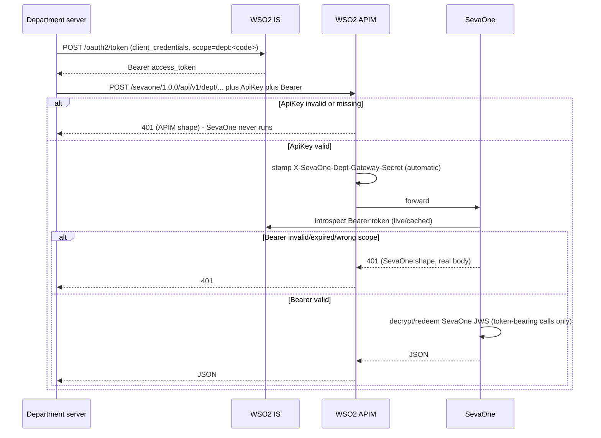
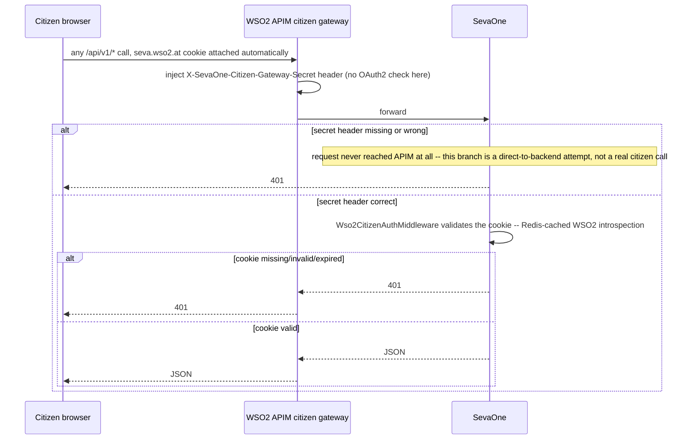
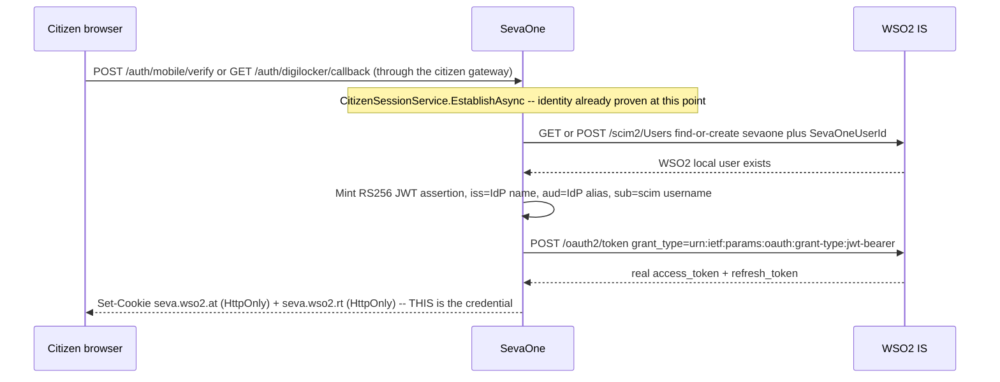

# WSO2 Identity Server and API Manager

How SevaOne uses WSO2, which product does which job, and how to run the stack so both department `/api/v1/dept/*` calls **and** all citizen-facing calls actually reach the .NET backend.

**Citizen identity proof** (mobile OTP / DigiLocker — *proving who someone is*) still does **not** touch WSO2 at all. **Citizen session** (*staying logged in afterward*) is a real WSO2 IS access/refresh token pair in `HttpOnly` cookies; every citizen-facing call goes through its own APIM gateway. The old SevaOne-issued `seva.sid` session is gone. This file covers **two gateways**: department servers, and citizens.

---

## Start here

WSO2 is two products. Do not treat them as one box. And this system now runs **two separate APIM APIs** — `sevaone` (department) and `sevaone-citizen` (citizen) — that share the same WSO2 IS but serve opposite purposes.

| Product | What SevaOne uses it for | What it does not do |
|---|---|---|
| **WSO2 Identity Server (IS)** | Issues the **citizen's actual session credential** (access/refresh token pair via a JWT-bearer exchange, on every login) **and** a per-department **`client_credentials`** Bearer token (`dept:<code>` scope) that identifies which department is calling `/api/v1/dept/*` — see below | Does not sign the SevaOne apply-token JWS. Is not on the citizen *identity-proof* path (mobile-OTP / DigiLocker still prove identity with zero WSO2 involvement — WSO2 only issues the session token *after* that's done) |
| **WSO2 API Manager (APIM)** | Public front door for **both** `/api/v1/dept/*` (real `ApiKey` validation — see below) and all citizen-facing routes (perimeter + shared-secret only, no real credential check — see [why](#why-two-gateways-that-work-so-differently) below) | Does not decrypt the apply-token `Token=`. Does not validate the citizen's WSO2 token itself — that's the backend's job now. Does not itself validate the department's WSO2 IS Bearer token either — SevaOne does that via live introspection (see below); APIM's only real check on department traffic is `ApiKey` |

### Department call: three checks, in order

**Historical note:** an earlier design used a static per-department Basic-auth credential list (internally called `DeptMachineAuth`) instead of a WSO2 IS Bearer token, and a later note (visible in some code comments) claimed the *opposite* swap — that the Bearer step was dropped in favor of that static list. Neither is what's live today. Commit `228910c` ("Replace static department credentials with WSO2 Bearer-token auth") replaced the static list with the WSO2 IS `client_credentials` Bearer token described below, and this has been verified live (see [Prove the department chain](#prove-the-department-chain)) — trust the checklist below and the code (`DeptController.TryResolveDepartmentAsync`) over any comment that still says otherwise; several are stale and disagree with each other.

1. **APIM: `ApiKey`.** Rejects the request outright if missing or invalid — this department's own APIM Application is what that key belongs to. Response is APIM's own shape (`code`/`message`/`description`), and SevaOne never runs.
2. **APIM: gateway secret stamp.** APIM injects `X-SevaOne-Dept-Gateway-Secret` onto the forwarded request (automatic, nothing a department sends or sees) — `DeptGatewayAuthMiddleware` checks this proves the request genuinely came through APIM, not straight to port 5080.
3. **SevaOne: WSO2 IS Bearer token.** `DeptController` reads `Authorization: Bearer <token>`, introspects it live against WSO2 IS (cached — `IWso2TokenIntrospectionCache`), and reads the department's identity off its `dept:<code>` scope. Missing/invalid/wrong-scope token → SevaOne's own `401` with a real JSON body (`SEVA-AUTH-4001`/`4002`), not a silent rejection. For token-bearing calls (`test-token`, `user-details`, `payment-status`), SevaOne then also decrypts and redeems the SevaOne apply-token JWS itself.

Get the Bearer token first, before any `/dept/*` call:

```
POST https://<wso2is>/oauth2/token
Authorization: Basic base64(deptClientId:deptClientSecret)
Content-Type: application/x-www-form-urlencoded

grant_type=client_credentials&scope=dept:<code>
```



### Citizen call: two checks, in order — but a different shape



### Why two gateways that work so differently

The department gateway exists for **governance over an external system** SevaOne doesn't control — rate limits, revocable per-department credentials, an audit boundary for a genuine third party. The citizen gateway exists for a completely different reason: it's SevaOne's own first-party browser traffic, and the only thing it needs from APIM is "make sure nothing can reach the backend except through here."

Both gateways route through APIM without APIM *itself* checking a WSO2 OAuth2 token (APIM's own security scheme on both APIs is `ApiKey`/`None`, not OAuth2) — but the department chain still puts WSO2 IS in the loop one hop later: SevaOne itself fetches a Bearer token's validity from WSO2 IS via introspection before trusting a department call. The department credential (`ApiKey`) rides in an ordinary header, which APIM can read and validate directly — so APIM does a real, independent check on every department call, rejecting bad keys before SevaOne ever sees them. The citizen's credential can't get that treatment: it has to live in an `HttpOnly` cookie (so a malicious script on the page can never read it — a header the browser attaches itself would mean JavaScript can see it, which defeats the whole point), and APIM's policies read the `Authorization` **header**, not cookies, with no built-in way to bridge the two. Building that bridge would need custom Java gateway code; since the backend already has to validate the citizen's token itself either way, that would just be a slower, redundant copy of a check already happening correctly one hop later. So the citizen API's operations stay `authType: "None"` at APIM, and the backend's own `Wso2CitizenAuthMiddleware` is the sole real validator — while the department API's operations are `authType: "Application"` with `ApiKey` as the only security scheme, and APIM genuinely is the first real gate.

**Team default:** run IS + APIM from `backend/docker/docker-compose.yml` (section [Docker](#docker-the-supported-path)). Manual install is only if you cannot use Docker.

Placeholders used below (set these on your machine; never commit personal home directories):

| Placeholder | Meaning |
|---|---|
| `$JAVA_HOME` | JDK **21** install root |
| `$WSO2IS_HOME` | Unpacked Identity Server directory (contains `bin/wso2server`) |
| `$WSO2AM_HOME` | Unpacked API Manager directory (contains `bin/api-manager`) |
| `<deptApiKey>` | API Key generated for a department's own APIM Application (see [Department onboarding](#department-onboarding-two-separate-credentials-from-two-separate-products) below) |
| `<deptBearer>` | Access token from `POST /oauth2/token` (`client_credentials`, `scope=dept:<code>`) using that department's WSO2 IS `SevaOne_Dept_<CODE>_Client` application's `clientId`/`clientSecret` — see [Department onboarding](#department-onboarding-two-separate-credentials-from-two-separate-products) below. There is no `Jws:DeptClients` config section anymore; that static credential list was removed entirely |

---

## Versions

| Component | Version | JDK | Notes |
|---|---|---|---|
| WSO2 Identity Server | **7.3.0** for a manual IS 7 install; **6.1.0** in the repo Docker image | **21** to run IS 7 / APIM 4.5 | IS 6.1 Docker image follows that image’s own JDK |
| WSO2 API Manager | **4.5.0** (4.7.0 also works) | **21** | Offset ports when IS already owns 9443 |
| `apim-km-wso2is` connector | **2.1.8** on IS 7.x; **1.8.10** on IS 6.x (Docker) | — | **Required.** Without it, Dev Portal generate-keys / map-keys returns 500 |

IS 7 and APIM 4.5 must run on **JDK 21**. JDK 11 fails with `UnsupportedClassVersionError`. `keytool` from either JDK 11 or 21 is fine for cert import.

Downloads: [WSO2 IS releases](https://github.com/wso2/product-is/releases), [WSO2 APIM releases](https://github.com/wso2/product-apim/releases). If a GitHub asset URL fails, retry with `curl -L -C -`.

---

## Local URLs (after IS + APIM are up)

Shipped WSO2 default for a **local** console is `admin` / `admin`. Change it on any shared or non-dev host.

| Server | URL |
|---|---|
| WSO2 IS Console | https://localhost:9443/console |
| APIM Publisher | https://localhost:9444/publisher |
| APIM Dev Portal | https://localhost:9444/devportal |
| APIM Admin (Carbon) | https://localhost:9444/carbon |
| APIM gateway — **department** | https://localhost:8244/sevaone/1.0.0/... |
| APIM gateway — **citizen** | https://localhost:8244/sevaone-citizen/1.0.0/... |
| SevaOne .NET backend (internal only — see below) | http://localhost:5080 |
| SevaOne via Caddy (Docker) | http://localhost:8080 |

Self-signed certs: accept the browser warning locally.

**Nobody calls port 5080 directly anymore, department or citizen.** Both `DeptGatewayAuthMiddleware` (the department gateway-secret stamp check) and the citizen-side `CitizenGatewayAuthMiddleware` reject any request that didn't come through their respective APIM gateway — a direct call to port 5080 for a citizen or department route gets a 401 regardless of what credential it carries. Port 5080 is useful only for isolating backend logic during development (e.g. testing `Wso2CitizenAuthMiddleware`'s cookie validation with the gateway secret supplied manually via curl); it's never production-shaped traffic.

```
Department: https://localhost:8244/sevaone/1.0.0/api/v1/dept/user-details
Citizen:    https://localhost:8244/sevaone-citizen/1.0.0/api/v1/me
```

---

## Docker (the supported path)

IS, APIM, the Key Manager connector, and SevaOne provisioning live in compose. From the repo:

```bash
cd backend/docker
docker compose up -d --build
docker compose logs -f wso2is wso2apim wso2-provision wso2apim-provision
```

First boot takes several minutes. If the gateway 404s after provision finishes:

```bash
docker compose restart wso2apim
```

What the repo already wires:

| Path | Role |
|---|---|
| `backend/deploy/wso2/` | IS image extras: connector jars/war, Email OTP overrides |
| `backend/deploy/wso2/apim-connector/` | `apim-km-wso2is` **1.8.10** (IS 6.x line). Binaries committed so `docker build` does not need Maven |
| `backend/deploy/wso2/apim-connector-overrides.toml` | Event listener + DCR access control; `notification_endpoint` uses Docker service name `wso2apim` |
| `backend/deploy/wso2-apim/` | APIM 4.5.0 image, entrypoint imports IS TLS cert at **container start**, `provision.sh` registers the Key Manager and publishes SevaOne OpenAPI |
| `backend/docker/docker-compose.yml` | `wso2apim` (`9444→9443`, `8244→8243`) and one-shot `wso2apim-provision` |

If `wso2apim-provision` fails, read `docker compose logs wso2apim-provision` before changing product config.

**Not fully proven on every laptop:** APIM’s deployment-sync JMS (see [Gateway cache](#gateway-cache-restart-after-publish)) may or may not be broken in the official `wso2/wso2am:4.5.0` image. If Key Manager or the API does not appear, restart `wso2apim` once. The connector 1.8.10 layout matches 2.1.8; the Base64 DCR shim was proven on IS 7.x locally and is the same class of fix on IS 6.1.

---

## Manual install (no Docker)

Unpack IS and APIM into directories you choose. Point the shell at JDK 21, then start IS first (it owns 9443). Start APIM with a port offset so management becomes 9444 and the gateway 8244.

PowerShell:

```powershell
$env:JAVA_HOME = "<your JDK 21 root>"
$env:Path = "$env:JAVA_HOME\bin;" + $env:Path

cd $env:WSO2IS_HOME\bin
.\wso2server.bat

cd $env:WSO2AM_HOME\bin
.\api-manager.bat -DportOffset=1
```

Bash:

```bash
export JAVA_HOME="<your JDK 21 root>"
export PATH="$JAVA_HOME/bin:$PATH"

"$WSO2IS_HOME/bin/wso2server.sh" &
"$WSO2AM_HOME/bin/api-manager.sh" -DportOffset=1
```

There is no Windows/Linux service wrapper in this repo. If the shell dies, the processes die. Config and the embedded H2 databases stay on disk under each product home; you only need to start the processes again (IS, then APIM, then SevaOne).

---

## Required: `apim-km-wso2is` connector

Vanilla IS cannot satisfy APIM’s WSO2-IS Key Manager client.

**Symptom:** Dev Portal Generate Keys or map-keys → HTTP 500 / `900967`. APIM log:

```
ERROR - AbstractKeyManager Some thing went wrong while getting OAuth application for given consumer key
KeyManagerClientException: Received status code: 401
```

**Cause:** APIM calls `GET /api/identity/oauth2/dcr/v1.1/register/{clientId}` with `{clientId}` **Base64-encoded** in the path. IS’s stock DCR endpoint does not accept that and returns 401. Reproduced on APIM 4.5.0 and 4.7.0 against IS 7.0.0 and 7.3.0. It is not a one-version regression.

**Fix:** install WSO2’s connector **on IS** (`org.wso2.km.ext.wso2is`). It exposes `/keymanager-operations/dcr/register`, which understands APIM’s encoding. GitHub: `wso2-extensions/apim-km-wso2is` (`2.x` for IS 7, `1.x` for IS 6).

### Install on IS 7 (manual)

```powershell
curl -s -o connector.zip https://repo1.maven.org/maven2/org/wso2/km/ext/wso2is/distribution/2.1.8/distribution-2.1.8.zip
Expand-Archive connector.zip -DestinationPath connector-extracted
```

Copy onto **IS**, not APIM:

```
dropins/wso2is.key.manager.core-2.1.8.jar
  -> $WSO2IS_HOME/repository/components/dropins/
dropins/wso2is.notification.event.handlers-2.1.8.jar
  -> $WSO2IS_HOME/repository/components/dropins/
webapps/keymanager-operations.war
  -> $WSO2IS_HOME/repository/deployment/server/webapps/
```

Append the block in `backend/deploy/wso2/apim-connector-overrides.toml` to IS `repository/conf/deployment.toml`. For a manual laptop, set:

`notification_endpoint = "https://localhost:9444/internal/data/v1/notify"`

(Docker compose already points that at the `wso2apim` service name.)

Restart IS. The shim is live if this is **401**, not **404**:

```powershell
curl -k https://localhost:9443/keymanager-operations/dcr/register/test -u admin:admin
```

Point APIM’s Key Manager `clientRegistrationEndpoint` and `userInfoEndpoint` at `/keymanager-operations/...`. Leave `tokenEndpoint` / `introspectionEndpoint` on `/oauth2/...`. Restart APIM after that change ([Gateway cache](#gateway-cache-restart-after-publish)).

### Wire capture if map-keys still 500s

In `$WSO2AM_HOME/repository/conf/log4j2.properties`, add `httpclient-wire` to `loggers =` and:

```properties
logger.httpclient-wire.name = org.apache.http.wire
logger.httpclient-wire.level = DEBUG
```

Restart APIM, retry the failing call, grep logs for `dcr/v1.1/register` vs `keymanager-operations`. You will see the encoded path APIM actually sent.

---

## TLS between APIM and IS

IS 7.0.0 shipped a demo `wso2carbon` cert that expired 2025-01-07. IS still serves TLS; APIM’s Feign client then fails with `PKIX path building failed`. IS 7.3.0’s shipped cert was already valid.

If APIM cannot talk to IS over HTTPS, regenerate IS’s keypair (from `$WSO2IS_HOME/repository/resources/security`) and import the cert into APIM’s client truststore. `keytool` store password for the WSO2 demo keystores is `wso2carbon`.

```powershell
# run from the IS security directory; use .jks or .p12 depending on the IS version
keytool -exportcert -alias wso2carbon -keystore wso2carbon.p12 -storetype PKCS12 `
  -storepass wso2carbon -file wso2is-cert.cer -rfc

keytool -importcert -alias wso2is-cert `
  -keystore "$env:WSO2AM_HOME\repository\resources\security\client-truststore.jks" `
  -storepass wso2carbon -file wso2is-cert.cer -noprompt
```

Restart APIM; the truststore is read at JVM start. The Docker APIM entrypoint does the equivalent at container start (`openssl s_client` against the `wso2is` service).

APIM also will not trust ASP.NET Core’s HTTPS dev certificate. Point the published API’s backend at SevaOne’s **HTTP** listener (`http://localhost:5080` locally, or the compose service URL). For HTTPS backends, import that cert into APIM’s `client-truststore.jks` the same way.

---

## Gateway cache (restart after publish)

Deploying an API revision or changing Key Manager config is supposed to hot-reload via Siddhi-JMS. Some APIM distributions have that broker pointed at an unreachable host, so:

- Publisher says the revision is deployed, gateway still 404s (`Invalid URL` in synapse logs).
- Admin API GET shows new Key Manager fields, runtime still uses the old ones.

**Workaround:** restart APIM after any publish or Key Manager change. On boot, `InMemoryAPIDeployer` reads artifacts from the database and skips the event bus. Docker: `docker compose restart wso2apim`.

---

## Key Manager registration (working shape)

Register via Admin REST (`POST /api/am/admin/v4/key-managers`). Bearer needs `apim:admin`. Docker `provision.sh` does this. Manual equivalent:

```powershell
curl -k -u admin:admin -H "Content-Type: application/json" `
  -d '{"callbackUrl":"","clientName":"admin_script","owner":"admin","grantType":"password client_credentials refresh_token","saasApp":true}' `
  https://localhost:9444/client-registration/v0.17/register

curl -k -u "<apimAdminClientId>:<apimAdminClientSecret>" `
  -d "grant_type=password&username=admin&password=admin&scope=apim:admin apim:api_create apim:api_publish apim:api_view apim:subscribe" `
  https://localhost:9444/oauth2/token
```

Key Manager body (`type`: `WSO2-IS`):

```json
{
  "name": "WSO2-IS-KM",
  "displayName": "WSO2 Identity Server",
  "type": "WSO2-IS",
  "enabled": true,
  "issuer": "https://localhost:9443/oauth2/token",
  "authorizeEndpoint": "https://localhost:9443/oauth2/authorize",
  "tokenEndpoint": "https://localhost:9443/oauth2/token",
  "revokeEndpoint": "https://localhost:9443/oauth2/revoke",
  "userInfoEndpoint": "https://localhost:9443/keymanager-operations/user-info/claims/generate",
  "introspectionEndpoint": "https://localhost:9443/oauth2/introspect",
  "clientRegistrationEndpoint": "https://localhost:9443/keymanager-operations/dcr/register",
  "wellKnownEndpoint": "https://localhost:9443/oauth2/token/.well-known/openid-configuration",
  "scopeManagementEndpoint": "https://localhost:9443/api/identity/oauth2/v1.0/scopes",
  "availableGrantTypes": ["client_credentials", "password", "authorization_code", "refresh_token"],
  "enableTokenGeneration": true,
  "enableOAuthAppCreation": true,
  "enableMapOAuthConsumerApps": true,
  "additionalProperties": {
    "Username": "admin",
    "Password": "admin",
    "self_validate_jwt": "false",
    "Certificate_type": "JWKS",
    "certificate_value": "https://localhost:9443/oauth2/jwks"
  }
}
```

---

## Department onboarding: two separate credentials, from two separate products

A department needs **both** of these — neither one alone is enough (see [Department call: three
checks](#department-call-three-checks-in-order) above):

1. A WSO2 IS `client_credentials` **Application**, scoped `dept:<code>` — this is what Section 1
   of `DEPARTMENT_INTEGRATION_GUIDE.md` calls "WSO2 Client ID / Client Secret." `Docker-deploy/wso2/provision.sh`
   provisions one per department automatically (named `SevaOne_Dept_<CODE>_Client`) as part of
   `setup-stack.sh`; to fetch an existing one's credentials or provision a new department by hand:

   ```bash
   # Register the dept:<code> scope if it doesn't exist yet, then create/fetch the app -- see
   # Docker-deploy/wso2/provision.sh's department loop for the exact idempotent sequence.
   APP_ID=$(curl -sk -u admin:admin \
     "https://<wso2is>/api/server/v1/applications?filter=name+eq+SevaOne_Dept_<CODE>_Client" \
     | jq -r '.applications[0].id')
   curl -sk -u admin:admin "https://<wso2is>/api/server/v1/applications/${APP_ID}/inbound-protocols/oidc"
   # -> { "clientId": "...", "clientSecret": "...", ... } -- hand both to the department
   ```

2. An APIM **Application**, subscribed to `SevaOne-API`, with its own generated `ApiKey` (the
   steps below) — this is Section 1's `ApiKey`.

Every department's APIM Application must be subscribed to `SevaOne-API` (context `/sevaone`; the
API's id is whatever the current import produced — look it up with `GET
/api/am/devportal/v3/apis?query=name:SevaOne-API` rather than hardcoding one, it changes on
reimport). Which subscription tiers are actually selectable depends on the subscriber account's
own role permissions in this APIM instance — `Unlimited` is what's live and worked for the `admin`
account in this deployment; a `Bronze` tier also exists (`1000 req/min` per docs and the
integration guide) but may need a subscriber role/permission granted before `admin` can use it.
Confirm live with `GET /api/am/devportal/v3/throttling-policies/subscription` before assuming
either one is available. The whole API also has a 20,000 req/min gateway-wide flood cap
(`apiThrottlingPolicy: "20KPerMin"`, same value set on every individual operation's
`throttlingPolicy`) — a shared ceiling across *all* departments together, on top of whatever
per-department subscription tier applies.

**Two ways to do the steps below: the Devportal web UI, or curl against its REST API directly.**

- **Web UI** (no scripting, point-and-click): `https://localhost:9444/devportal` — log in as
  `admin`/`admin` (or a real publisher account), **Applications → Add New Application** (name it
  `SevaOne-Dept-<code>`, throttling tier doesn't matter here — set on the *subscription* next),
  then open the new Application → **Subscriptions → Subscribe API** → pick `SevaOne-API` →
  tier `Bronze`, then **API Keys** tab → **Generate Key** (set an expiry far in the future — this
  is a static credential, not something meant to rotate on a schedule) → copy the `apikey` value
  shown once.
- **REST API** (scriptable, same three steps, what the commands below do): base URL
  `https://localhost:9444/api/am/devportal/v3`. Useful when onboarding several departments at
  once or wiring this into a script instead of clicking through the UI each time.

Publisher (`https://localhost:9444/publisher`) is a *different* portal — that's for editing the
API definition itself (operations, security scheme, allowed tiers), not for provisioning a
department's Application/key. A department integrator only ever needs Devportal.

```bash
# 0. Look up SevaOne-API's current id -- it changes on reimport, never hardcode it
API_ID=$(curl -sk -u admin:admin "https://localhost:9444/api/am/devportal/v3/apis?query=name:SevaOne-API" \
  | jq -r '.list[0].id')

# 1. Create the Application (Devportal REST, admin:admin or a real publisher/subscriber user).
#    throttlingPolicy here is an APPLICATION-level tier (valid values: 10PerMin/20PerMin/50PerMin/
#    Unlimited -- NOT the subscription tier used in step 2; passing a subscription-tier name like
#    "Bronze" here 400s with "The tier name is invalid").
curl -sk -u admin:admin -X POST "https://localhost:9444/api/am/devportal/v3/applications" \
  -H "Content-Type: application/json" \
  -d '{"name":"SevaOne-Dept-<code>","throttlingPolicy":"Unlimited","description":"<department> server"}'
# -> returns applicationId

# 2. Subscribe it to SevaOne-API. Check which subscription tiers your subscriber account can
#    actually use first (GET .../throttling-policies/subscription) -- "Bronze" 403s with
#    "Subscription Tier Bronze is not allowed for user <you>" unless that role/permission is
#    granted; "Unlimited" worked out of the box for `admin` in this deployment.
curl -sk -u admin:admin -X POST "https://localhost:9444/api/am/devportal/v3/subscriptions" \
  -H "Content-Type: application/json" \
  -d "{\"applicationId\":\"<applicationId>\",\"apiId\":\"${API_ID}\",\"throttlingPolicy\":\"Unlimited\"}"

# 3. Generate the API Key -- note the /generate suffix, a bare .../api-keys/PRODUCTION POST 404s.
#    keyName is REQUIRED -- omitting it 500s with a NullPointerException deep in
#    APIConsumerImpl.generateApiKey ("Cannot invoke String.trim() because keyName is null"),
#    confirmed live against this WSO2 APIM version; validityPeriod is in seconds, not the
#    doc-example's old (much larger) value.
curl -sk -u admin:admin -X POST "https://localhost:9444/api/am/devportal/v3/applications/<applicationId>/api-keys/PRODUCTION/generate" \
  -H "Content-Type: application/json" \
  -d '{"keyName":"<department>-key","validityPeriod":3600,"additionalProperties":{}}'
# -> response body { "apikey": "<opaque string>" } -- this is the value the department sends as
#    the ApiKey header. This WSO2 APIM version returns a short opaque string here, not a JWT --
#    that's fine, it's still validated the same way at the gateway.
```

Hand the department the `apikey` value from step 3, plus the `clientId`/`clientSecret` from the
WSO2 IS Application in the previous subsection — that's the complete onboarding, two separate
credentials from two separate products, both required on every call.

---

## Prove the department chain

This is the check that matters. Citizen login is not in this chain. There is no `/dept/token-validate`
route — the real endpoints are `user-details`, `test-token`, `payment-status`,
`get-acknowledgement`, `status-update` (see `DEPARTMENT_INTEGRATION_GUIDE.md` Section 3); the
examples below use `user-details` since it needs nothing pre-existing besides a Bearer token.

```bash
# 0. Get a Bearer token first (see "Department call: three checks" above) -- every /dept/* call
#    needs this, it is not optional
BEARER=$(curl -sk -u "<deptClientId>:<deptClientSecret>" -X POST "https://localhost:9443/oauth2/token" \
  -d "grant_type=client_credentials&scope=dept:<code>" | jq -r '.access_token')

# 1. Call SevaOne through APIM, not port 5080 -- a bogus token still proves the auth chain
curl -sk -X POST https://localhost:8244/sevaone/1.0.0/api/v1/dept/user-details \
  -H "ApiKey: <deptApiKey>" \
  -H "Authorization: Bearer ${BEARER}" \
  -H "Content-Type: application/json" \
  -d '{"departmentId":"<code>","token":"bogus"}'
```

Expect a `401` with a `code`/`title` like `SEVA-DEPT-4001` /
`"Token is invalid or does not belong to this department."` — that JSON shape is SevaOne's own,
which means: `ApiKey` passed APIM, the Bearer token passed SevaOne's introspection check, and
SevaOne's business logic is what rejected the (deliberately bogus) token. Swap in a real encrypted
`Token` from an apply-token flow (`test-token`, or a real apply handoff) for the actual happy path
— confirmed live end-to-end, see `backend/scripts/test-dept-integration.sh`.

Two negative checks that matter just as much as the happy path:

```bash
# No ApiKey at all -- must be 401 with an APIM-shaped body (code/message/description), NOT SevaOne's shape
curl -sk -X POST https://localhost:8244/sevaone/1.0.0/api/v1/dept/user-details \
  -H "Authorization: Bearer ${BEARER}" -H "Content-Type: application/json" \
  -d '{"departmentId":"<code>","token":"bogus"}'

# Valid ApiKey, no Bearer at all -- must be 401 WITH a SevaOne-shaped body (SEVA-AUTH-4001),
# confirmed live -- this is NOT "no body" the way an older revision of this doc claimed
curl -sk -X POST https://localhost:8244/sevaone/1.0.0/api/v1/dept/user-details \
  -H "ApiKey: <deptApiKey>" -H "Content-Type: application/json" \
  -d '{"departmentId":"<code>","token":"bogus"}'
```

The first proves APIM's `ApiKey` check is real, not decorative — a request that never had a
valid key should never produce SevaOne's own error shape. The second proves SevaOne still does
its own independent check after APIM lets a request through — a valid `ApiKey` alone must not
be enough on its own; SevaOne's `DeptController.TryResolveDepartmentAsync` rejects it with its
own `401` body before any business logic runs.

Calling `http://localhost:5080/api/v1/dept/...` skips APIM entirely (and its `ApiKey` check and
gateway-secret stamp with it) — `DeptGatewayAuthMiddleware` rejects it outside `Development`.
Useful only for isolating backend logic in dev. Production-shaped traffic always uses the gateway.

---

## Prove the citizen chain

Different shape than the department chain above — there's no separate "get a bearer first" step, because a citizen's WSO2 token is a *result* of logging in, not a prerequisite for it.

```powershell
# 1. Log in through the citizen gateway (not port 5080) -- this is what actually mints the WSO2 token
curl -k -c cookies.txt -X POST https://localhost:8244/sevaone-citizen/1.0.0/api/v1/auth/mobile/start `
  -H "Content-Type: application/json" -d '{"mobile":"9876543210"}'
# read the OTP from the backend's own console/log -- LoggedSmsOtpSender, no real SMS provider wired up
curl -k -c cookies.txt -b cookies.txt -X POST https://localhost:8244/sevaone-citizen/1.0.0/api/v1/auth/mobile/verify `
  -H "Content-Type: application/json" -d '{"challengeId":"<from step above>","otp":"<from the log>"}'

# 2. cookies.txt now holds real seva.wso2.at / seva.wso2.rt values -- use them like a browser would
curl -k -b cookies.txt https://localhost:8244/sevaone-citizen/1.0.0/api/v1/me
```

Expect `200` and the citizen's profile JSON. That means: identity was proven (mobile OTP), WSO2 provisioned a real token, the cookie carried it back through APIM, and the backend's own introspection check accepted it.

Two negative checks that matter just as much as the happy path:

```powershell
# No credential at all -- must be 401
curl -k https://localhost:8244/sevaone-citizen/1.0.0/api/v1/me

# Same cookie, straight to the backend, skipping the gateway entirely -- must ALSO be 401
curl -k -b cookies.txt http://localhost:5080/api/v1/me
```

The second one is the important one: it proves `CitizenGatewayAuthMiddleware`'s shared-secret check is actually doing something, not just APIM being the only *documented* path in. If that second call ever returns 200, the perimeter isn't real.

---

## SevaOne configuration

The legacy `Wso2` config section (`BrowserAuthority`, `ClientId: "seva_bff"`, etc.) that used to configure the citizen OIDC/password-grant client is **gone** — `Wso2Options`, `Wso2OidcClient`, and the whole class were deleted, not just unused, once that login mechanism was retired. If you're looking at an older version of this repo and still see a `"Wso2"` section in `appsettings.json`, that's stale.

Two config sections now cover everything WSO2-related on the citizen side:

`SevaOne.Services` `Wso2CitizenIssuer` section — the citizen's actual credential-issuing config:

| Setting | Role |
|---|---|
| `SigningKeyPem` | RS256 private key for signing the JWT-bearer assertion. Real value lives only in `dotnet user-secrets` (key `Wso2CitizenIssuer:SigningKeyPem`) or environment — never committed to `appsettings.json` |
| `Issuer` | Must equal the exact **`name`** of the Trusted Token Issuer registered in IS (`"SevaOne Citizen Issuer"`) — see the gotcha below |
| `Audience` | Must equal the exact **`alias`** of that same IdP (`"sevaone-citizen-identity"`) — also see below |
| `ClientId` / `ClientSecret` | The dedicated WSO2 application's own OAuth2 credentials (Basic auth on the token-endpoint call). Real values in user-secrets, never `appsettings.json` |
| `TokenEndpoint` | `https://localhost:9443/oauth2/token` |
| `ScimBaseUrl` | `https://localhost:9443` |
| `ScimAdminUsername` / `ScimAdminPassword` | Dev-only `admin`/`admin` for SCIM2 provisioning. Replace with a dedicated least-privilege SCIM service account before production |
| `AcceptInsecureCertificates` | `true` only for local self-signed IS |

`SevaOne.Services` `CitizenGatewayAuth` section — the second gate, not a WSO2 setting at all:

| Setting | Role |
|---|---|
| `Secret` | Fixed shared secret the citizen APIM API's header-injection policy stamps onto every request it forwards (`X-SevaOne-Citizen-Gateway-Secret`). `CitizenGatewayAuthMiddleware` compares it with `CryptographicOperations.FixedTimeEquals` and rejects anything missing/wrong — this is what makes a direct call to port 5080 fail even with a perfectly valid cookie. Real value in user-secrets; must match exactly what's configured in the APIM header policy (see setup below) |

For reference, often confused with the above: there is no `Jws:DeptClients` config section anymore — that static per-department secret table was removed when department auth moved to WSO2 IS Bearer tokens (see [Department call: three checks](#department-call-three-checks-in-order) above). A department's identity today comes entirely from its WSO2 IS `client_credentials` Application's `dept:<code>` scope, introspected live — there is no SevaOne-side secret table to configure per department at all. `DeptGatewayAuthOptions:Secret` (env var, one fixed value for the whole deployment, not per-department) is the *only* department-related secret SevaOne itself holds — it's the gateway-stamp check (`X-SevaOne-Dept-Gateway-Secret`), not a per-department credential. `ConnectorOptions.GatewayBaseUrl` is yet another separate switch (outbound department connectors through YARP/APIM); mock connectors don't need it.

---

## Citizen authentication (JWT-bearer / SCIM2 / APIM gateway)

**Why this exists:** if WSO2 IS is meant to serve as Karnataka's statewide identity provider — not just SevaOne's — a citizen who verified their identity via DigiLocker on SevaOne should be able to carry that identity to other government systems that trust WSO2, without redoing DigiLocker consent each time. What started as a dormant "also issue a portable token" side-effect has since become the citizen's *actual* session mechanism — the old SevaOne-issued `seva.sid` cookie is gone, and this WSO2 token is the only thing that authenticates a citizen now. See `TOKEN_FLOW.md` → **Citizen authentication** for the full request-by-request picture; this section is the one-time setup and the WSO2-specific gotchas.

This uses a different WSO2 application and a different grant type than the department gateway — don't confuse the two apps or their client secrets.



**This is now required, not soft-fail.** Earlier in this system's history, a failed SCIM2/exchange call was swallowed and login fell back to a synthetic placeholder token — harmless, because nothing read that token back. Now the WSO2 token *is* the citizen's session, so `EstablishAsync` treats a failed provisioning/exchange as a failed login. If WSO2 IS is down, citizens cannot log in. (Everything else about `Wso2CitizenIdentityClient` — `RevokeAsync`, `RefreshAsync` — stays best-effort/soft-fail; it's specifically the *first* provisioning call on login that's now load-bearing.)

### One-time WSO2-side setup

1. **Generate an RS256 keypair** for SevaOne to sign assertions with (distinct from `Jws:SigningKey`, which is HMAC and used only for the department-handoff JWS):

   ```bash
   openssl genrsa -out sevaone-citizen-issuer.key 2048
   openssl req -new -x509 -key sevaone-citizen-issuer.key -out sevaone-citizen-issuer.crt \
     -days 3650 -subj "/CN=sevaone-citizen-issuer/O=SevaOne"
   ```

   Private key → `dotnet user-secrets set "Wso2CitizenIssuer:SigningKeyPem" "$(cat sevaone-citizen-issuer.key)"` (from `SevaOne.Services/`). Public cert is not secret; committed at `backend/deploy/wso2/sevaone-citizen-issuer.crt`.

2. **Register a Trusted Token Issuer** in WSO2 IS — Console → Connections → New Connection → Trusted Token Issuer, or REST:

   ```
   POST https://localhost:9443/api/server/v1/identity-providers
   Authorization: Basic base64(admin:admin)
   Content-Type: application/json

   {
     "name": "SevaOne Citizen Issuer",
     "description": "Trusted issuer for SevaOne's citizen JWT-bearer token exchange",
     "isPrimary": false,
     "isFederationHub": false,
     "certificate": { "certificates": ["<FULL PEM TEXT of the .crt above, as one string>"] },
     "alias": "sevaone-citizen-identity"
   }
   ```

   **Gotcha #1 — the certificate must be the full PEM text** (`-----BEGIN CERTIFICATE-----...`), not base64-encoded DER bytes. WSO2 base64-encodes whatever string you send internally; sending already-base64 DER fails with `IDP-65002 "Malformed Public Certificate file has been provided"` on every attempt, regardless of how the DER-base64 was derived.

3. **Register (or reuse) a WSO2 application** for the exchange itself, with `client_credentials`, `urn:ietf:params:oauth:grant-type:jwt-bearer`, and `refresh_token` in its allowed grant types (`PUT` the **complete** object returned by `GET .../inbound-protocols/oidc` — a partial `PUT` 500s). Its `clientId`/`clientSecret` are what SevaOne sends as Basic auth on the token-endpoint call — set them as `Wso2CitizenIssuer:ClientId`/`ClientSecret` in user-secrets.

4. **Publish the `sevaone-citizen` APIM API** — same mechanics as the department API (Publisher REST, or the UI), backend endpoint `http://localhost:5080`, covering the citizen-facing routes. Two things about this API are *not* the default you'd get from copying the department API's settings:

   - **Every operation's `authType` is `"None"`** — including `/me`, `/applications`, everything. This looks wrong at first (isn't APIM supposed to check the token?) but it's deliberate: see [Why two gateways work so differently](#why-two-gateways-that-work-so-differently) above. The backend is the real validator; APIM here is a perimeter, not an auth layer.
   - **A header-injection policy** (`addHeader`, applied to every operation) stamps `X-SevaOne-Citizen-Gateway-Secret` with the exact value from `CitizenGatewayAuth:Secret` onto every request forwarded to the backend.
   - **`apiThrottlingPolicy`** is set to `20KPerMin` (API-level, one shared bucket for the whole API) as a real flood cap at the gateway — since every operation is `authType: "None"`, there's no per-application/per-key context for APIM to throttle by individually, so this is a *shared* ceiling across all citizens, not per-citizen fairness. Per-citizen fairness is still enforced separately, in-process, by SevaOne's own `AddRateLimiter` (keyed on source IP).

   Deploy a revision and confirm it's live the same way as the department API (restart APIM if `successDeployedTime` stays `null` — see [Gateway cache](#gateway-cache-restart-after-publish)).

### Two gotchas that only show up empirically

WSO2's JWT-bearer grant handler (`JWTBearerGrantHandler` → `IdentityProviderManager`) does **not** validate `iss`/`aud` the way the RFC 7523 examples suggest:

| Assertion claim | Must equal | Not this | Symptom if wrong |
|---|---|---|---|
| `iss` | The IdP's **`name`** (`"SevaOne Citizen Issuer"`) | The `alias` | `invalid_grant`: `"No registered identity provider found for the JWT with issuer name : <value>"` |
| `aud` | The IdP's **`alias`** (`"sevaone-citizen-identity"`) | The token endpoint URL | `invalid_grant`: `"None of the audience values matched the tokenEndpoint Alias <value>"` |

Both are set via `Wso2CitizenIssuerOptions.Issuer` / `.Audience` — get either backwards and the exchange fails with one of the two errors above, confirmed live against IS 7.3.0.

### Two APIM-specific gotchas, found only by testing the gateway live

**1. The login-bootstrap endpoints can't require the token they're about to create.** If you set `authType` to anything other than `"None"` on `/auth/mobile/start`, `/auth/mobile/verify`, `/auth/digilocker/start`, `/auth/digilocker/callback`, or `/auth/refresh`, APIM rejects the call before it ever reaches SevaOne — `900902 Missing Credentials` — because there's no token yet for a citizen who hasn't logged in. Every operation on this API needs `authType: "None"` (see [why](#why-two-gateways-that-work-so-differently) above) but this specific gotcha bites even someone who only *partially* applies that fix and leaves the wildcard `/*` operations requiring OAuth2 while the login routes are `"None"` — the wildcard still wins for anything that isn't an exact-path match elsewhere.

**2. APIM's security policies read headers, not cookies — full stop.** This is the reason the citizen API's `authType` is `"None"` everywhere, while the department API's operations are `authType: "Application"` with `ApiKey` as a real, working gateway-level check — the department's credential rides in a header APIM can actually read, the citizen's can't. There's no configuration flag that makes APIM look at a cookie instead; building that would mean deploying a custom Java gateway handler. Confirmed by trying it: leaving the citizen API's operations at `"Application & Application User"` produces the *same* `900902 Missing Credentials` error even when a perfectly valid `seva.wso2.at` cookie is attached to the request — APIM never looks at it.

### A .NET-specific gotcha: don't dispose the RSA key per call

`Microsoft.IdentityModel.Tokens.CryptoProviderFactory` caches `SignatureProvider` instances **process-wide** by default (`CacheSignatureProviders = true`). If you build the `RsaSecurityKey` from a short-lived `RSA.Create()` wrapped in `using`, the *first* call signs fine, but the cached provider still references that RSA instance after it's disposed — the *second* call throws `ObjectDisposedException` on `RSABCrypt`, deep inside `JwtSecurityTokenHandler.WriteToken`. Fix: set `CacheSignatureProviders = false` on the key's `CryptoProviderFactory` (done in `Wso2CitizenIdentityClient.MintAssertion`) so nothing outlives the `using` block.

### Verify it live

```powershell
# 1. Confirm SCIM2 provisioning worked
curl -k -u admin:admin "https://localhost:9443/scim2/Users?filter=userName+eq+%22sevaone-<id>%22"

# 2. Introspect the token that's now sitting in the citizen's seva.wso2.at cookie
curl -k -u admin:admin -X POST "https://localhost:9443/oauth2/introspect" -d "token=<accessToken>"
```

Expect `active:true`, `username:"sevaone-<id>"`, `client_id` matching the app from step 3 above. For the full gateway-and-cookie round trip (not just WSO2 in isolation), see [Prove the citizen chain](#prove-the-citizen-chain) above.

---

## Checklist

**Department chain:**

1. IS and APIM running (Docker compose, or manual with JDK 21 and port offset).
2. Connector installed on IS; `/keymanager-operations/dcr/register/test` is not 404.
3. APIM trusts IS's TLS cert.
4. Key Manager `type` is `WSO2-IS` and DCR/userinfo URLs use the shim.
5. `sevaone` API imported, published, deployed; restart APIM if the gateway 404s.
6. A department has **two** credentials provisioned: a WSO2 IS `client_credentials` Application scoped `dept:<code>` (Bearer token), and an APIM Application subscribed to `SevaOne-API` with a generated `ApiKey` (see [Department onboarding](#department-onboarding-two-separate-credentials-from-two-separate-products) above).
7. `POST .../sevaone/1.0.0/api/v1/dept/user-details` (or any other `/dept/*` route) with `ApiKey` + `Authorization: Bearer <token>` through **8244** reaches SevaOne's own business logic (a `code`/`title`-shaped error, not an APIM `code`/`message` one) — confirmed live, see [Prove the department chain](#prove-the-department-chain) above.
8. `/dept/*` from the department uses `ApiKey` **and** a WSO2 IS Bearer token — both required, every call. There is no `DeptMachineAuth` static credential list anymore.

**Citizen chain — separate from 1–8 above:**

9. Trusted Token Issuer registered with the right `name`/`alias`; `Wso2CitizenIssuer:*` and `CitizenGatewayAuth:Secret` set (user-secrets, not `appsettings.json`).
10. `sevaone-citizen` API published — **every** operation `authType: "None"`, header-injection policy attached, deployed (check `successDeployedTime`, restart APIM if stale).
11. A mobile-OTP or DigiLocker login through the gateway sets both cookies; `/me` through the gateway with those cookies returns 200.
12. The same cookies sent **directly to port 5080**, bypassing the gateway, return 401 — if this ever returns 200, the perimeter isn't real and needs fixing before anything else here matters.
13. Logout: introspection shows `active:true` → `active:false`, and the Redis introspection-cache entry for that token is gone (`Wso2TokenIntrospectionCache`) — not just "waiting out the TTL."
