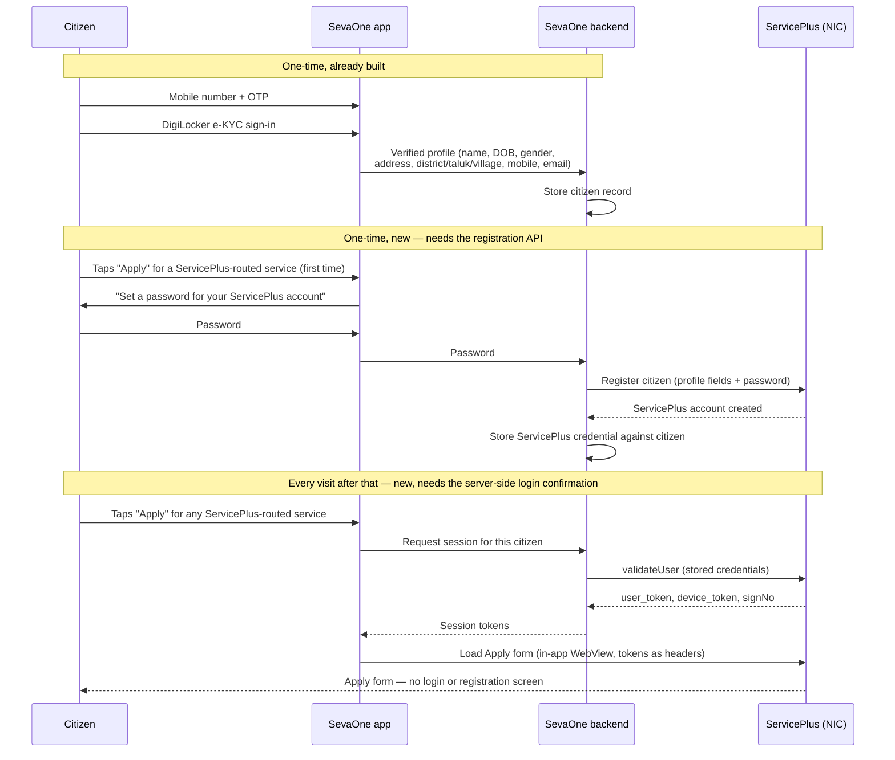

**Message to NIC / ServicePlus platform team: request for a citizen registration API + SSO session hand-off (drafted 2026-09-28)**
Status: draft, not yet sent. Review before sending — the Aadhaar caveat and the password-handling paragraph are the two points most likely to need back-and-forth before they can say yes.

**Subject: Request — citizen registration API and server-to-server login for the SevaOne (Karnataka) integration**

Dear ServicePlus / NIC Team,

We are integrating the ServicePlus platform into the SevaOne citizen mobile app (Government of Karnataka), so that when a citizen taps a department's "Apply" link inside SevaOne, they land straight in your Apply form. Today that instead shows a `citizenRegistration.html` sign-up page for a first-time citizen, then a second login screen with a new username and password — on top of the identity they already verified inside SevaOne via mobile OTP and DigiLocker e-KYC.

We'd like to replace that second registration/login with a one-time, invisible provisioning step run from our backend, and we need two things from you to build it:

1. **A server-to-server citizen registration API** for the Karnataka tenant — the API equivalent of `citizenRegistration.html`, callable once per citizen (idempotently) instead of us rendering your HTML form. We noticed the `getAllStateUrl` response our mobile app parses already carries a `third_party_registration` flag per tenant — if that's built for exactly this kind of integration, please point us at its documentation; if not, we're asking for the equivalent capability to be enabled for our tenant.
2. **Confirmation that we may call `validateUser` server-side** (not only from the mobile app) using the credentials we provision in step 1, so we can mint a session and hand the citizen straight into the Apply form with no login screen at all.
3. **Permission for our own in-app browser to load the Apply form directly**, carrying that session. We understand ServicePlus detects an embedded WebView and redirects to "open in the ServicePlus app" — reasonable as a default. We're asking for our app to be recognised rather than blocked for this one flow, rather than working around the check ourselves.

**What we can send in the registration call** — all already verified during SevaOne's own mobile-OTP + DigiLocker e-KYC login, nothing self-reported by the citizen: full name (English and Kannada), date of birth, gender, mobile number (OTP-verified), postal address (English and Kannada), district, taluk, village, state, and email when the citizen has supplied one.

**One caveat on identity data**: by design, SevaOne never stores or transmits a citizen's full Aadhaar number — only a masked form (last 4 digits) plus the fact that the identity came from a DigiLocker e-KYC pull. If your registration API requires the full Aadhaar number as a verification field, we cannot supply it directly, and we'd need to understand what alternative proof of identity you would accept in its place.

**Password**: we won't generate one blindly on the citizen's behalf. SevaOne will ask the citizen, once, to set a password specifically for their ServicePlus account, inside our own app, and send that password through in the registration call; we'll store it securely against the citizen's record so we can complete step 2 (silent login) on every later visit. Please confirm the field's expected format/length/complexity rules, and whether the registration payload should use the same encryption scheme as the mobile app's login payload today, or whether you'd prefer a different scheme for server-to-server calls.

A diagram of the exact flow we're proposing is below / attached.

Happy to walk through this on a call if that's easier than email.

Regards,
Srikanth, SevaOne Mobile App Team

---

## Proposed flow

Plain-text version of the same flow, for anyone who can't render Mermaid:

1. Citizen signs into SevaOne with mobile OTP, then DigiLocker e-KYC (already built).
2. SevaOne backend now holds the citizen's verified profile.
3. First time the citizen taps Apply on a ServicePlus-routed service, SevaOne asks them to set a password for their ServicePlus account.
4. SevaOne backend calls the **new registration API** with the verified profile fields + that password. ServicePlus creates the account.
5. SevaOne backend stores the resulting ServicePlus credential against the citizen, once.
6. On every later Apply tap, SevaOne backend calls the **existing `validateUser` login endpoint** server-side with the stored credential, gets back `user_token` / `device_token` / `signNo`.
7. SevaOne loads the Apply form in its own in-app WebView with those tokens attached as headers — the citizen never sees a ServicePlus login or registration screen.

Steps 1–2 exist today. Steps 3, 5, 6 are new backend work on our side once ServicePlus agrees to steps 4 (the registration API) and 6 (server-side `validateUser`, and allowing our WebView through the embedded-app check it currently blocks).
